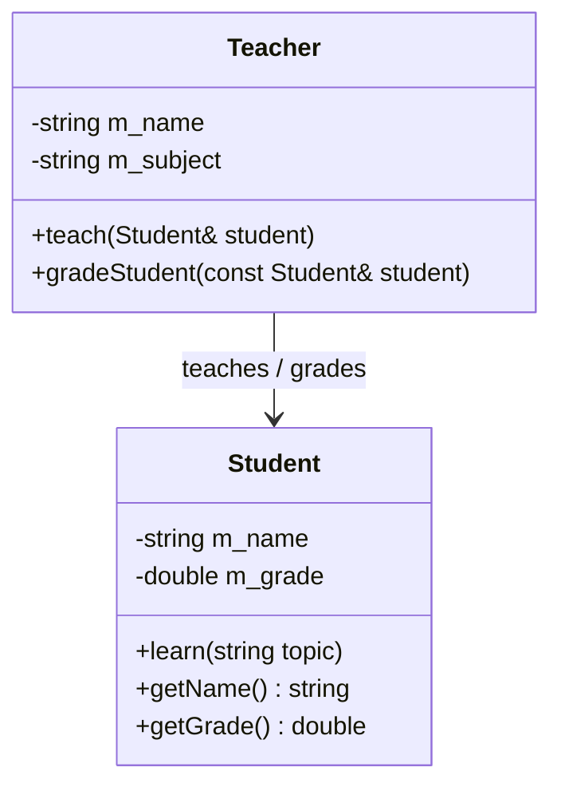
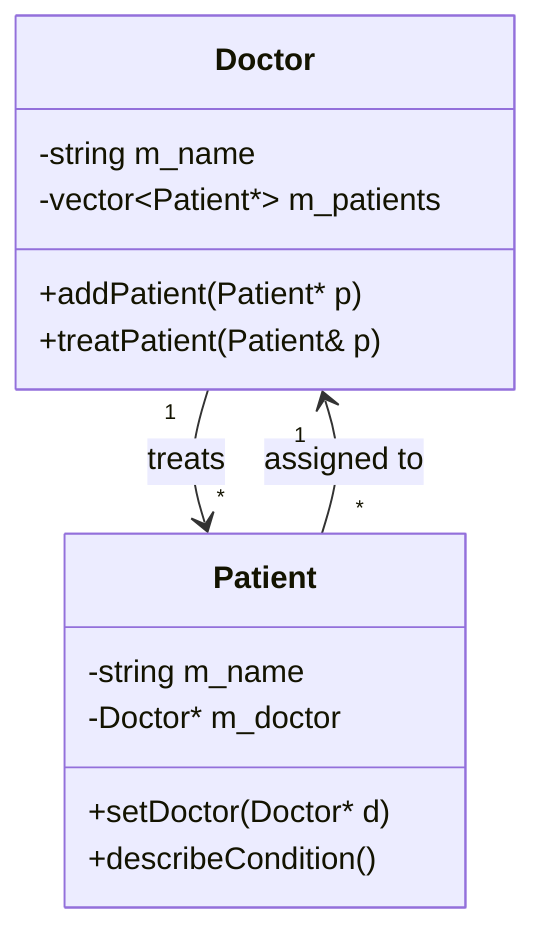
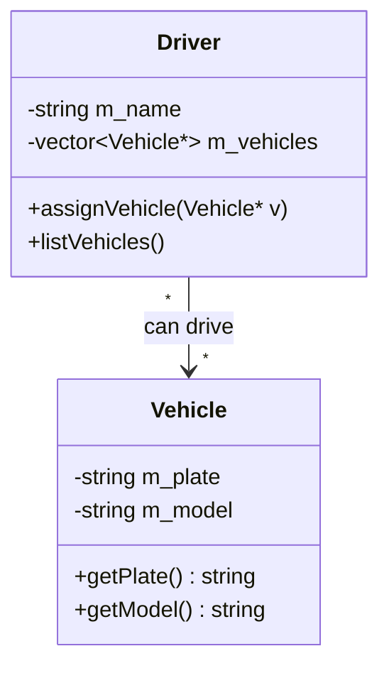
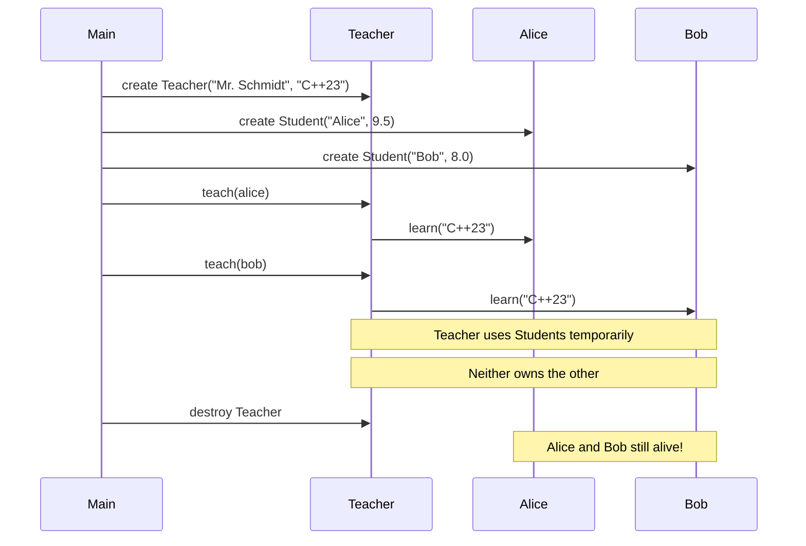
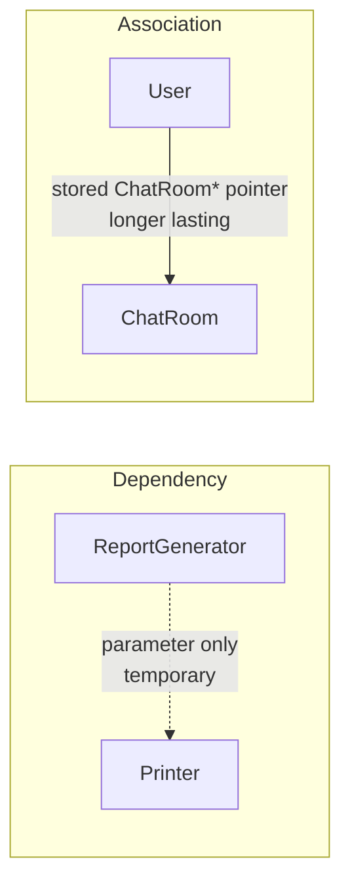

# Association — C++

## What is Association?

A **uses-a** relationship where two classes know about each other but
**neither owns the other**. Both objects exist independently and have
their own lifetimes.

---

## Class diagram



---

## Bidirectional association



---

## Many-to-many association



---

## Lifetime diagram



---

## Key characteristics

- No ownership — neither object creates or destroys the other
- Both can exist without the other
- One object is passed in from outside (parameter or pointer)
- Can be unidirectional or bidirectional
- Can be one-to-one, one-to-many, or many-to-many

---

## Code pattern

```cpp
class Teacher {
public:
    // Association — Student passed from outside, Teacher does NOT own it
    void teach(Student& student) {
        student.learn(m_subject);
    }
};

// Both exist independently
Teacher teacher("Mr. Schmidt", "C++23");
Student alice("Alice", 9.5);

teacher.teach(alice);   // Teacher uses Student temporarily
// Both still alive after this call
```

---

## Examples in this file

| # | Classes | Direction |
|---|---------|-----------|
| 1 | Teacher ↔ Student | unidirectional |
| 2 | Doctor ↔ Patient | bidirectional |
| 3 | Driver ↔ Vehicle | many-to-many |
| 4 | User ↔ ChatRoom | users join, leave and switch rooms |

- **Example 1:** `Teacher::teach(Student&)` takes the student as a parameter from outside; teacher and students are separate objects created in `main`, the teacher owns nobody
- **Example 2:** `Doctor` keeps a `vector<Patient*>`, each `Patient` keeps a `Doctor*` (both sides know each other, nobody owns); the forward declaration `class Patient;` and the out-of-class `Doctor::treatPatient` are needed because the classes refer to each other
- **Example 3:** many-to-many — `van` is assigned to both drivers, `driver1` has two vehicles; the vehicles exist in `main`, drivers only store pointers
- **Example 4:** two users join the same chat room, `Alice` leaves and switches to another room; rooms live on without users

## 🧾 Notes moved from `main.cpp`

The summary printouts were removed from `main.cpp` (the demos now only print what they do). Their content:

- **After each example:** both objects exist independently; neither owns the other. Doctor destroyed → patients still exist; the same vehicle can be associated with several drivers; users can switch rooms and rooms survive without users.
- **Summary block:** relationship *uses-a*; ownership none; lifetime independent; storage = pointer or reference passed from outside; destroy one → the other still exists; UML `A ————————> B` (solid line, open arrow) — see the Summary table below.

> **Caution:** "independent lifetimes" also means a stored pointer can **dangle** if the other object is destroyed first. In `main` the objects are declared so that the pointed-to object (`doctor`, vehicles, chat rooms) outlives the objects holding the pointers; in real code you must guarantee that yourself.

---

## Association vs Dependency

Both are "uses-a" but differ in duration:



---

## When to use Association

✅ Objects need to collaborate but have independent lifetimes
✅ One object needs to call methods on another
✅ Many-to-many relationships (drivers and vehicles)
✅ Bidirectional knowledge (doctor knows patients, patients know doctor)

❌ If one object creates and owns the other → use **Composition**
❌ If one object contains the other but doesn't own it → use **Aggregation**
❌ If the relationship is only temporary (method parameter) → use **Dependency**

---

## Summary

| Property | Value |
|----------|-------|
| Type | uses-a |
| Ownership | None |
| Lifetime | Independent |
| Destroy one | The other still exists |
| Storage | Pointer or reference passed from outside |
| UML | `A ————————> B` solid line, open arrow |

---

## Build

```bash
g++ -std=c++23 -Wall -Wextra main.cpp -o association
./association
```

`main.cpp` uses `std::println` (`<print>`), which needs **GCC 14+**.
