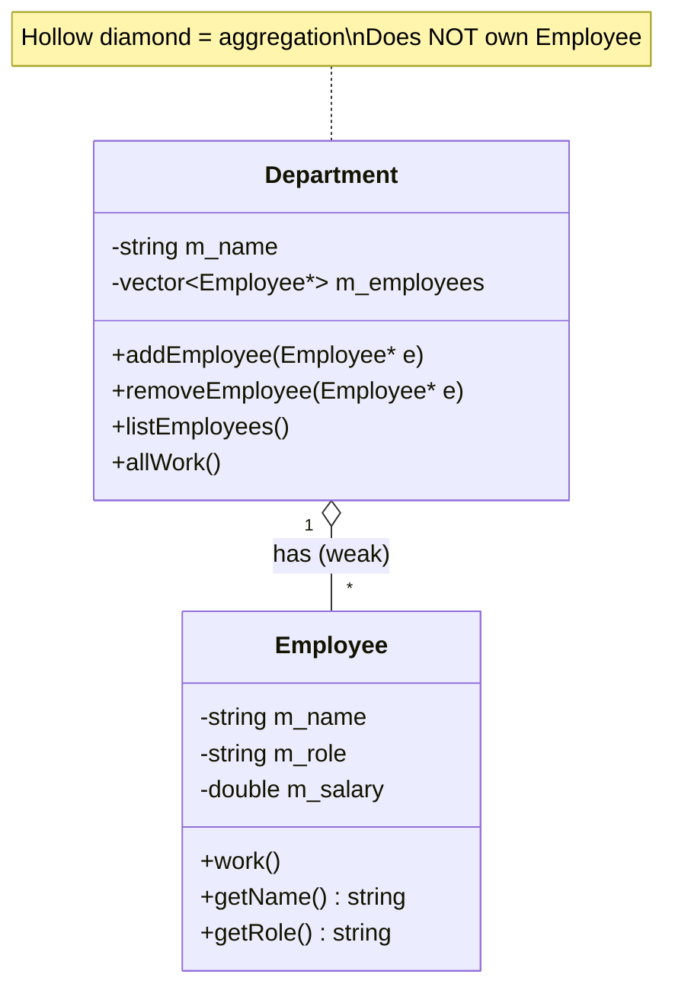
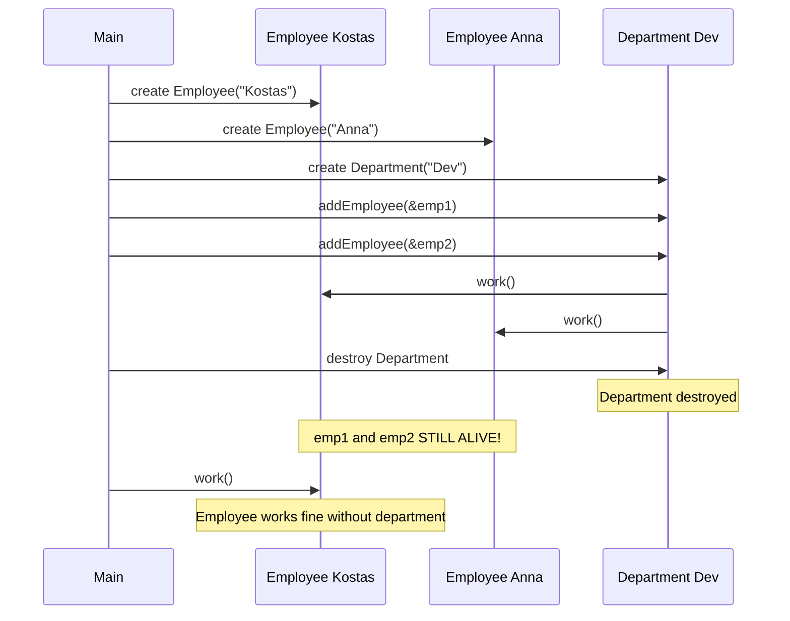
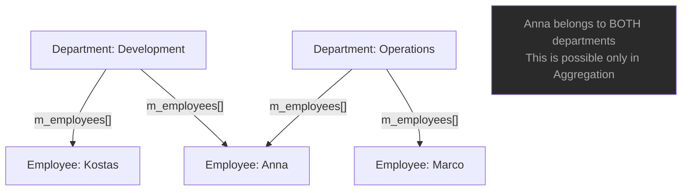
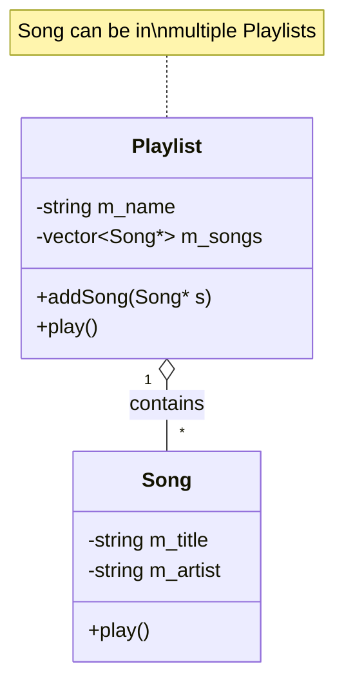
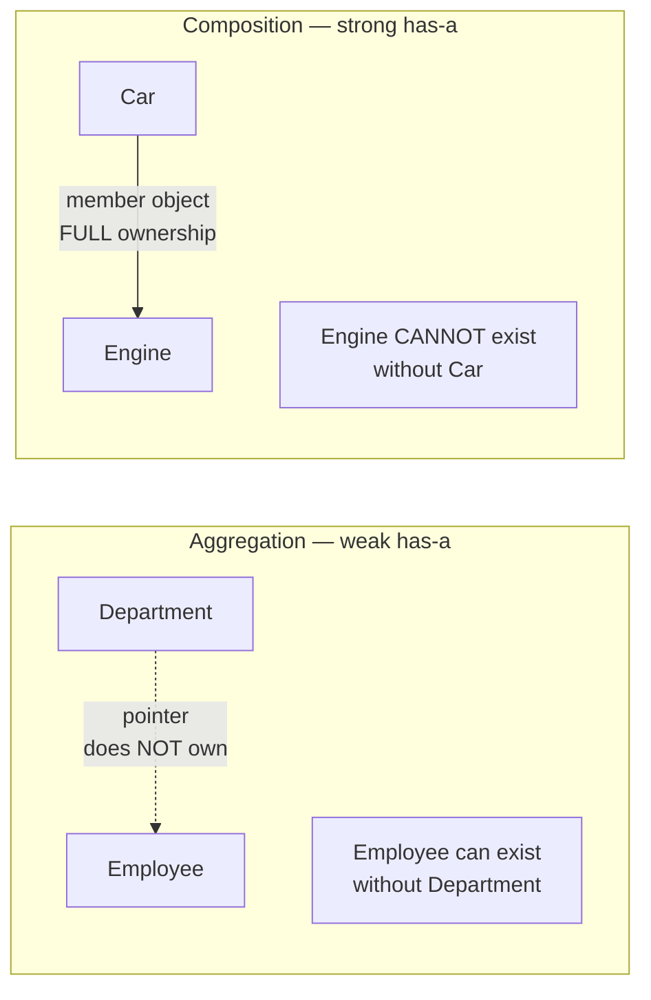

# Aggregation — C++

## What is Aggregation?

A **has-a** relationship where the whole **contains** parts, but the parts
can **exist independently** of the whole. The whole does **not** own the
lifetime of the parts.

---

## Class diagram



---

## Lifetime diagram — parts outlive the whole



---

## Part sharing diagram — same part in multiple wholes



---

## Playlist example



---

## Key characteristics

- Whole contains parts — but does NOT create or destroy them
- Parts are created outside and passed in
- Parts can outlive the whole
- The same part can belong to multiple wholes simultaneously
- Destructor of the whole does NOT delete the parts

---

## Code pattern

```cpp
class Department {
    std::vector<Employee*> m_employees;   // stores pointers — does NOT own

public:
    void addEmployee(Employee* e) { m_employees.push_back(e); }

    ~Department() {
        // Do NOT delete employees — they exist independently!
    }
};

// Employee created outside — exists independently
Employee emp("Kostas", "Dev", 75000);
Department dev("Development");

dev.addEmployee(&emp);    // emp passed in from outside

// Department destroyed — emp still alive
```

---

## Examples in this file

| # | Whole → Parts | Shows |
|---|---------------|-------|
| 1 | Department → Employee | Anna is in two departments; removing her from one keeps her alive |
| 2 | University → Course | Courses are created before and survive the university |
| 3 | Playlist → Song | Same song in several playlists; `play()` sums durations |
| 4 | Team → Player | a player is released by one team and signed by another |

- Every whole prints `[… destroyed — parts still exist]` from its destructor, and `main` then calls the parts again to prove they are alive
- Destruction order in `main`: wholes declared later are destroyed first (`ops` before `dev`, `favs` before `rock`, `blue` before `red`)
- `removeEmployee` / `detach` use `std::find` + `erase` (needs `<algorithm>`)

## 🧾 Notes moved from `main.cpp`

The summary printout was removed from `main.cpp` (the demos now only print what they do). Its content, so nothing is lost:

- Relationship: **has-a (weak)**; ownership: none — the whole does NOT own the parts
- Lifetime: parts exist independently of the whole; storage: pointers to externally created objects
- Destroy the whole → parts still alive; the same part can be in multiple wholes
- UML: `A <>————————B` (hollow diamond at A) — see the Summary table below

> **Caution:** "independent lifetimes" only works if the parts really outlive the whole *and* nobody keeps a pointer to a destroyed part. In `main` every part is declared **before** the wholes that point to it, so the wholes are destroyed first. If a part died first, the whole would hold a dangling pointer.

---

## Aggregation vs Composition



| | Aggregation | Composition |
|--|------------|-------------|
| Storage | `Part*` pointer | `Part` member object |
| Ownership | None | Full |
| Part lifetime | Independent | Tied to whole |
| Destructor | Does NOT delete | Automatic delete |
| Part sharing | Can be shared | Cannot be shared |

---

## When to use Aggregation

✅ The part has a meaningful existence outside the whole
✅ The part can belong to multiple wholes at the same time
✅ The whole doesn't control when parts are created/destroyed
✅ Parts are passed in from outside (constructor or setter)

❌ If you create the part inside the whole → use **Composition**
❌ If neither object contains the other → use **Association**

---

## Common mistake — accidental deletion

```cpp
// WRONG — deleting parts in destructor = double-delete crash!
~Department() {
    for (auto* e : m_employees) delete e;   // WRONG for aggregation!
}

// CORRECT — do not delete
~Department() { }   // parts managed elsewhere
```

---

## Summary

| Property | Value |
|----------|-------|
| Type | has-a (weak) |
| Ownership | None |
| Lifetime | Parts exist independently |
| Storage | Pointer to externally created object |
| Part sharing | Yes — same part in multiple wholes |
| UML | `A <>————————B` hollow diamond at A |

---

## Build

```bash
g++ -std=c++23 -Wall -Wextra main.cpp -o aggregation
./aggregation
```

`main.cpp` uses `std::println` (`<print>`), which needs **GCC 14+**.
