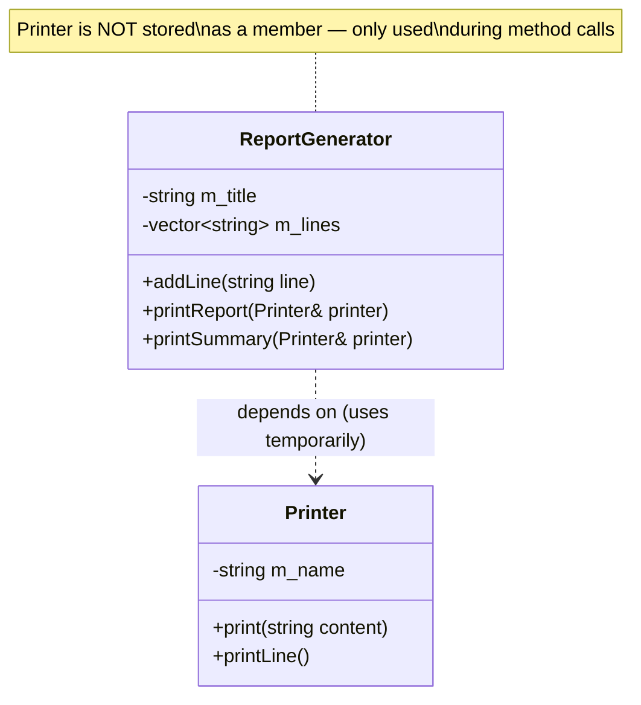
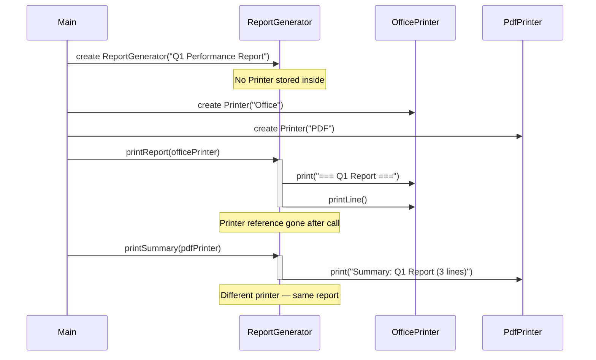
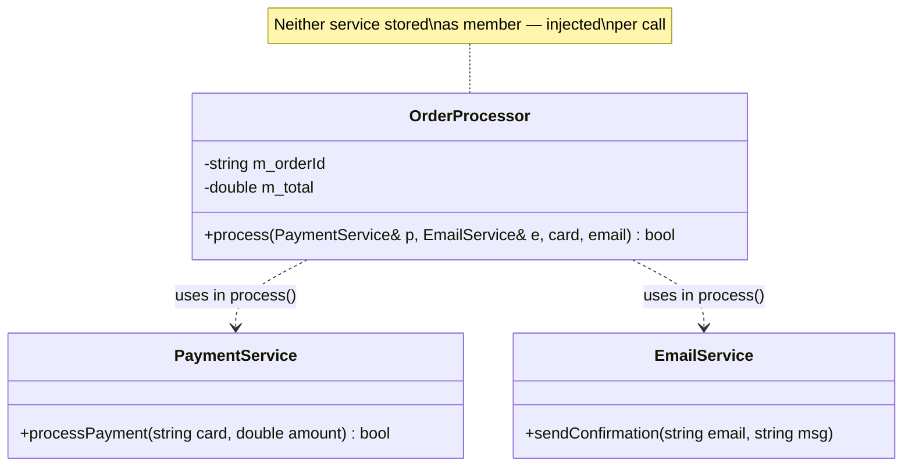
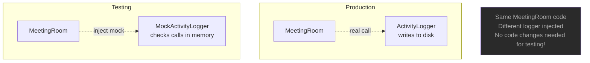
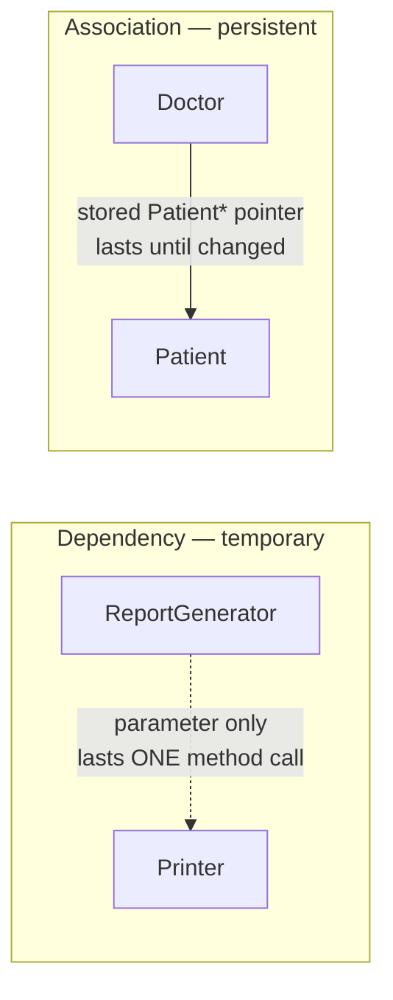

# Dependency — C++

## What is Dependency?

The **weakest** relationship. Class A depends on class B only **temporarily** —
during a single method call. B appears as a parameter, local variable, or
return type — never stored as a member of A.

---

## Class diagram



---

## Sequence diagram — temporary use only



---

## OrderProcessor dependency injection



---

## Why dependency enables testability



> **Important:** in the demo, `MeetingRoom::book(..., ActivityLogger& logger)` takes the **concrete** class. Dependency makes swapping *possible*, but a mock can only be passed if the parameter type allows it. Tested:
> ```cpp
> struct ActivityLogger { void log(const std::string&) const; };
> struct MockLogger  { void log(const std::string&) const; };   // unrelated class
> void use(ActivityLogger& l);
> use(mockLogger);   // ❌ error: invalid initialization of reference of type 'ActivityLogger&'
> ```
> Ways to make it testable (all compile and work):
> - **Interface parameter:** `void use(const ILogger& l)` with `struct ILogger { virtual void log(const std::string&) const = 0; virtual ~ILogger() = default; };` — `RealLogger` and `MockLogger` both derive from it (runtime swap, see `14_VirtualFunctions`)
> - **Template parameter:** `template <class L> void use(L& l) { l.log("x"); }` — any type with a `log()` works (compile-time swap)

---

## Dependency vs Association



| | Dependency | Association |
|--|-----------|------------|
| Duration | Method call only | Longer term |
| Storage | Parameter/local | Member pointer/reference |
| Connection | Temporary | Persistent |

---

## Examples in this file

| # | Class → depends on | Shows |
|---|--------------------|-------|
| 1 | ReportGenerator → Printer | a different `Printer` passed per call (`printReport`, `printSummary`) |
| 2 | OrderProcessor → PaymentService, EmailService | two dependencies injected into one method |
| 3 | DataSerializer → FileWriter | same serializer, two different writers |
| 4 | MeetingRoom → ActivityLogger | logger injected per call; the booking state lives in the room, the logger is not stored |

## 🧾 Notes moved from `main.cpp`

The explanatory printouts were removed from `main.cpp` (the demos now only print what they do). Their content, so nothing is lost:

- **Example 1:** `ReportGenerator` stores no `Printer` as member; any `Printer` can be passed at any time.
- **Example 2:** `OrderProcessor` stores neither service as member; different services can be injected — testable (see the note above for what that requires).
- **Example 3:** the serializer can write to any `FileWriter` passed to it.
- **Example 4:** `MeetingRoom` stores no `ActivityLogger` as member; the logger is injected per call and can be swapped for testing.
- **Summary block:** *uses-a (temporary)*; ownership none; lasts only during the method call; stored only as parameter or local variable; key benefit: easy to swap, enables testing/mocking; UML `A - - - - -> B` (dashed line, open arrow) — see the Summary table below.

---

## Key characteristics

- No persistent connection — relationship lasts only during a method call
- B is passed in from outside (parameter) — not created or stored by A
- A does not know about B between calls
- Different B objects can be passed on different calls
- Makes code highly testable — easy to inject mocks

---

## Code pattern

```cpp
class ReportGenerator {
    // No Printer member — dependency only

public:
    // Printer appears ONLY as a parameter — not stored
    void printReport(Printer& printer) const {
        printer.print("=== " + m_title + " ===");
        for (const auto& line : m_lines)
            printer.print(line);
    }
};

// Different printer each time
report.printReport(officePrinter);   // use office printer
report.printReport(pdfPrinter);      // use pdf printer
```

---

## When to use Dependency

✅ The external class is only needed temporarily for one operation
✅ You want to swap implementations (testing, mocking, strategy)
✅ The class doesn't need to remember the dependency between calls
✅ Reducing coupling — A should know as little about B as possible

❌ If A needs to remember B between calls → use **Association**
❌ If A contains B as a part → use **Aggregation** or **Composition**

---

## Summary

| Property | Value |
|----------|-------|
| Type | uses-a (temporary) |
| Ownership | None |
| Duration | Method call only |
| Storage | Parameter or local variable — never a member |
| Key benefit | Swappable, mockable, loosely coupled |
| UML | `A - - - - -> B` dashed line, open arrow |

---

## Build

```bash
g++ -std=c++23 -Wall -Wextra main.cpp -o dependency
./dependency
```

`main.cpp` uses `std::println` (`<print>`), which needs **GCC 14+**.
