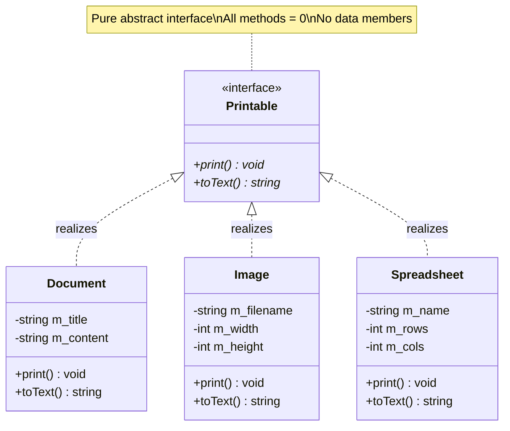
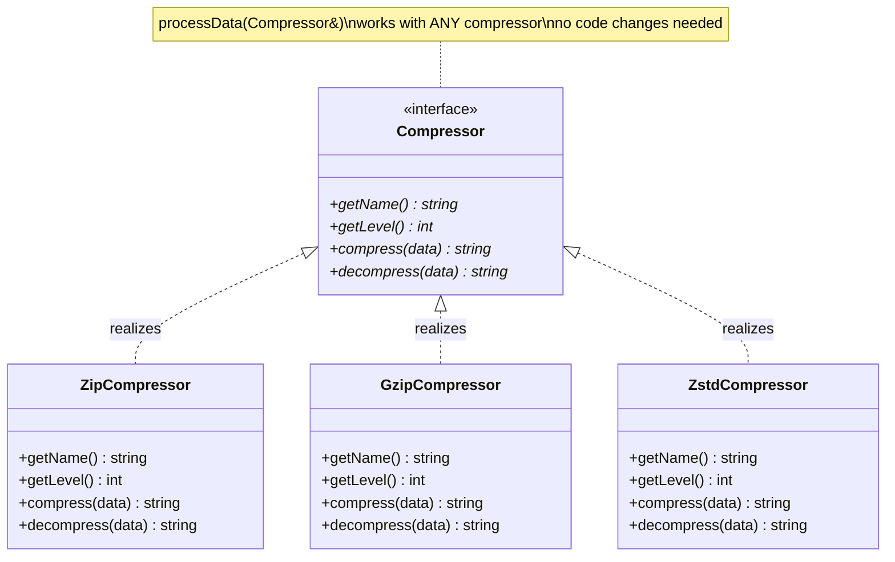
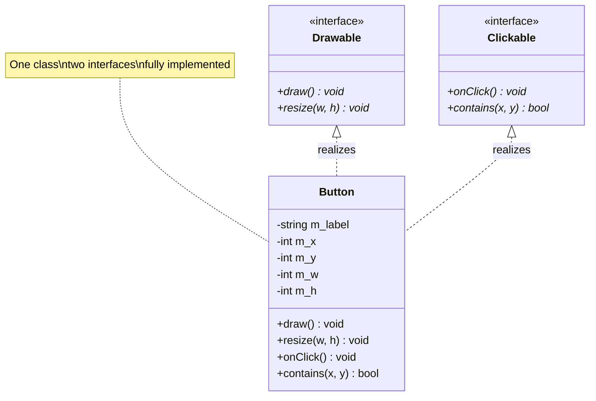
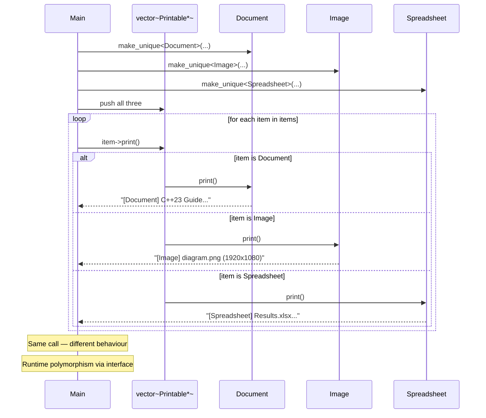
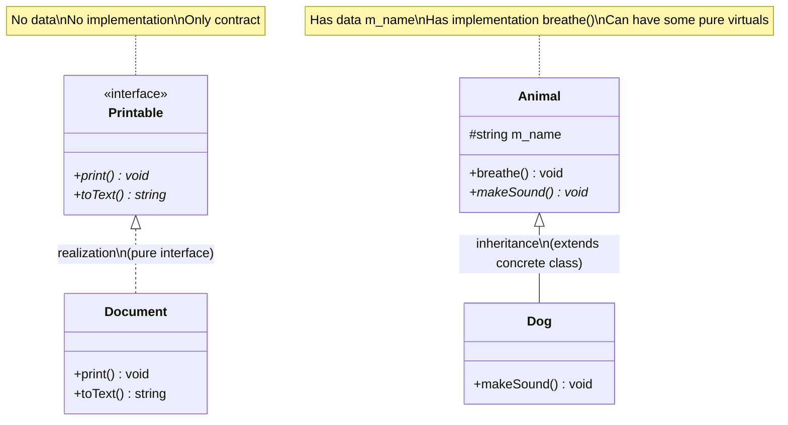

# Realization — C++

## What is Realization?

A class **realizes** (implements) an abstract interface — it fulfills the
contract defined by the interface. Every pure virtual method must be
overridden in the concrete class.

---

## Class diagram — Printable interface



---

## Compressor interface



---

## Multiple interfaces — Button



---

## Sequence — polymorphic dispatch through interface



---

## Realization vs Inheritance



---

## Examples in this file

| # | Interface | Realized by | Shows |
|---|-----------|-------------|-------|
| 1 | `Printable` | Document, Image, Spreadsheet | `vector<unique_ptr<Printable>>`, calls via the interface only |
| 2 | `Serializable` | UserProfile, AppSettings | `vector<Serializable*>` of different types; `UserProfile::print()` is *not* part of the interface |
| 3 | `Drawable` + `Clickable` | Button | one class realizing two interfaces, viewed through `Drawable&` and `Clickable&` |
| 4 | `Compressor` | Zip-, Gzip-, ZstdCompressor | `processData()` works with any compressor, no changes needed |

## 🧾 Notes moved from `main.cpp`

The explanatory printouts were removed from `main.cpp` (the demos now only print what they do). Their content, so nothing is lost:

- **Examples 1 and 4:** all classes realize the same interface; client code works through the interface and does not know the concrete type (`processData()` works with any compressor — no changes needed).
- **Example 3:** the same `Button` object viewed through two different interfaces.
- **Summary block:** is-a (implements a contract); base class pure abstract — no data, all `= 0`; derived class must implement ALL pure virtuals; benefit: interchangeable implementations; one class can realize many interfaces; UML `A <— — — — —B` (dashed, hollow triangle).
- **Realization vs Inheritance:** *Realization* implements a pure interface (no data, no implementation). *Inheritance* extends a concrete class (inherits data + implementation). See the diagram above.

---

## Key characteristics

- The base class is **purely abstract** — no data members, all methods `= 0`
- The concrete class must implement **all** pure virtual methods
- A class can realize multiple interfaces simultaneously
- Client code works through the interface — independent of concrete type
- Makes implementations interchangeable

---

## Code pattern

```cpp
// Interface — pure abstract, defines the CONTRACT
class Compressor {
public:
    virtual std::string compress(const std::string& data)   const = 0;
    virtual std::string decompress(const std::string& data) const = 0;
    virtual ~Compressor() = default;
};

// Realization — concrete class fulfills the contract
class ZipCompressor : public Compressor {
public:
    std::string compress(const std::string& data)   const override { /* ... */ }
    std::string decompress(const std::string& data) const override { /* ... */ }
};

// Client uses the interface — works with ANY realization
void processData(const Compressor& compressor, const std::string& data) {
    auto packed = compressor.compress(data);
}
```

> **C++ note:** "realization" is a UML term, there is no keyword for it. In C++ it is simply `public` inheritance from a class whose members are all pure virtual (plus a virtual destructor).

---

## When to use Realization

✅ Define a contract that multiple classes must fulfill
✅ Interchangeable implementations (compressors, serializers, printers)
✅ Depend on abstractions not concretions (Dependency Inversion)
✅ Safe multiple inheritance: interfaces have no data, so nothing is duplicated (note: a diamond is still possible if two interfaces share a common base)

❌ If you want to share code between classes → use **Inheritance**
❌ If the relationship is not "is-a" → use Association/Aggregation/Composition

---

## Summary

| Property | Value |
|----------|-------|
| Type | is-a (contract fulfillment) |
| Base class | Pure abstract — all `= 0`, no data |
| Derived class | Must implement all pure virtuals |
| Multiple | One class can realize many interfaces |
| Benefit | Interchangeable, testable, loosely coupled |
| UML | `A <— — — — —B` dashed line, hollow triangle |

---

## Build

```bash
g++ -std=c++23 -Wall -Wextra main.cpp -o realization
./realization
```

`main.cpp` uses `std::println` (`<print>`), which needs **GCC 14+**.
