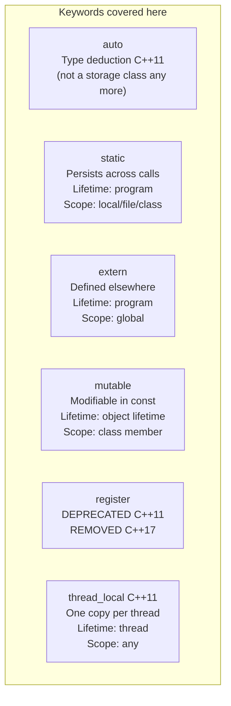
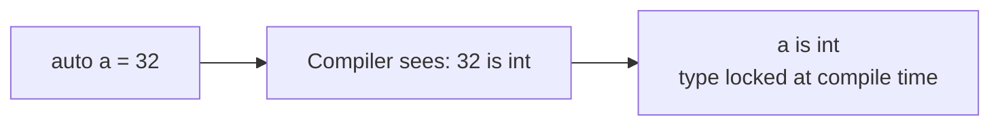
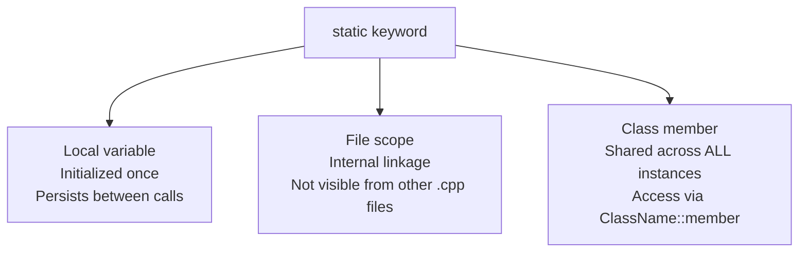
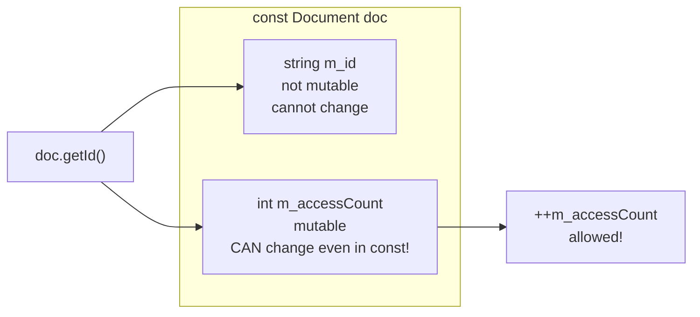
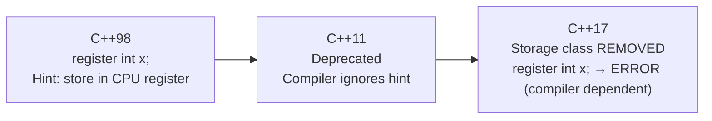
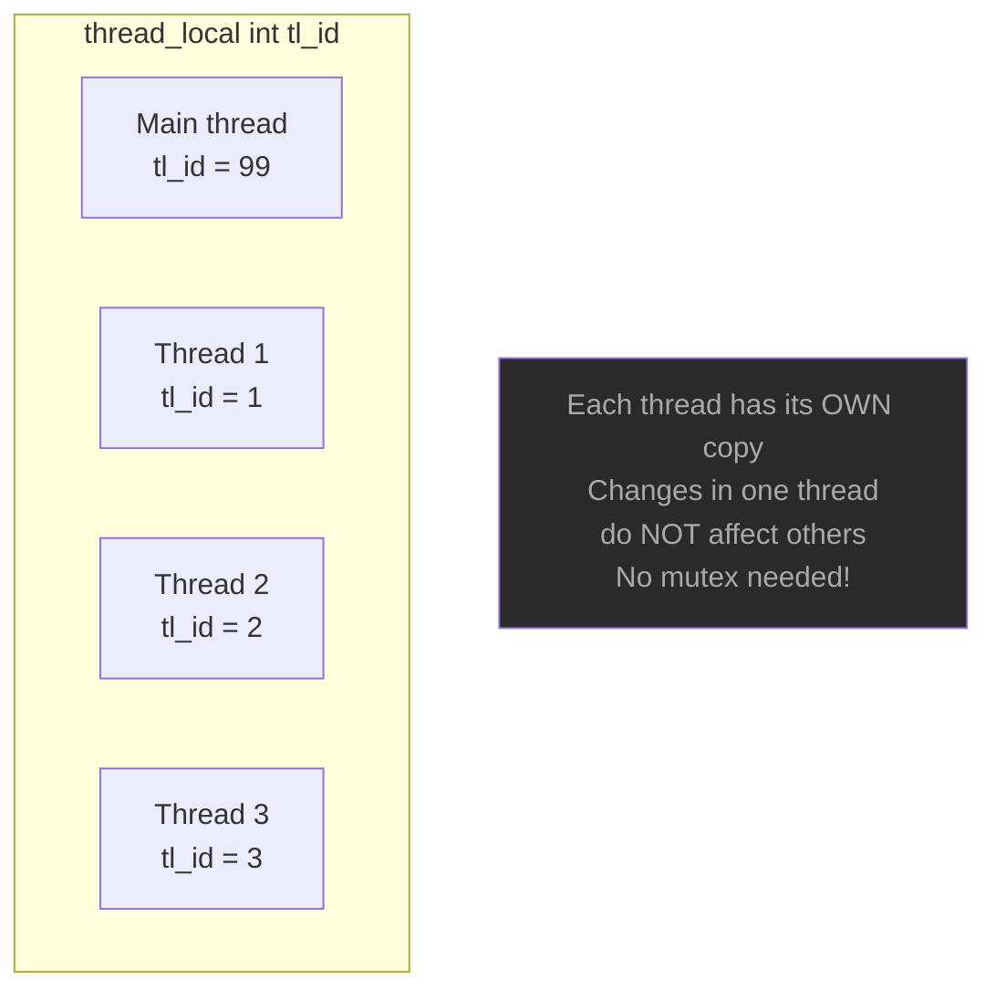
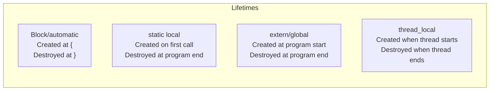

# Storage Classes — C++

> **Status marks**
> ✅ *tested* = compiled and run with GCC 13.3 (some with clang++), including AddressSanitizer, UBSan and ThreadSanitizer.
> ⚠️ *not tested* = from the language standard or common practice, not run here.

## What is a Storage Class?

A storage class defines three things for a variable or function:
- **Lifetime** — how long it exists in memory
- **Scope** — where it is visible/accessible
- **Linkage** — whether it is accessible from other translation units

> **Strictly speaking** (⚠️ from the standard, not from a test): the *storage class specifiers* of current C++ are `static`, `thread_local`, `extern` and `mutable`. `auto` stopped being one in C++11 and `register` was removed in C++17. They are still covered here because this is where they are usually taught, and because the old meanings still show up in old code.

---

## Overview



---

## 1. auto — type deduction (C++11)

```cpp
auto a = 32;             // int
auto b = 3.2;            // double
auto c = "Konstantinos"; // const char*
auto d = 'I';            // char
auto e = true;           // bool
auto f = 3.14f;          // float
```

The compiler deduces the type from the initializer — you never write the type.



`main.cpp` prints `typeid(x).name()` for each variable. ✅ On GCC this gives `i d PKc c b f`. These names are **implementation-defined** (GCC uses mangled names; MSVC prints `int`, `double`, ...), so do not rely on them.

> **Historical note:** In C++98 `auto` meant "automatic storage duration"
> (the default for local variables). This meaning was removed in C++11 when the
> keyword was repurposed for type deduction.
> ✅ Tested: `auto int x = 5;` compiles with `-std=c++98` and fails with `-std=c++11` (`two or more data types in declaration of 'x'`).
> Since the variable's lifetime comes from *where* it is declared, not from `auto`, the old "Lifetime: block" column for `auto` was dropped from the table below.

**Common uses:**
```cpp
auto it = myMap.begin();          // iterator — long type
for (const auto& item : vec) { }  // range-based for, no copy
auto result = computeHeavy();     // return type may change
```

`for (auto n : nums)` copies each element; `for (const auto& n : nums)` does not (matters for big types such as `std::string`).

---

## 2. static — persists across calls

Three different contexts — same keyword, different meanings:



### static local variable

```cpp
int generateId() {
    static int s_nextId = 1000;  // initialized ONCE on first call
    return s_nextId++;
}

generateId();  // 1000
generateId();  // 1001
generateId();  // 1002  — value persists!
```

A normal local (`int count = 0; return ++count;`) starts again on every call, so it always returns 1. ✅ Both are printed by Example 2.

### static class member

```cpp
class Counter {
public:
    static int s_count;  // declaration: ONE copy shared by ALL instances
    Counter() { ++s_count; }
};
int Counter::s_count = 0;   // definition — must be at file scope, outside the class

Counter a, b, c;
// Counter::s_count == 3 — all three instances share it
```

The old README wrote `Counter::s_count = 0;` for the definition. That is **not valid**: without the type, GCC says `'s_count' in 'struct Counter' does not name a type` ✅. It has to be `int Counter::s_count = 0;`.

Since C++17 you can define it inside the class instead: `inline static int s_count = 0;` ✅ (prints 3 with `-std=c++17`; with C++11 GCC warns that inline variables need C++17).

A local class cannot have static data members, which is why `Counter` is at file scope in `main.cpp`.

### static at file scope (internal linkage)

```cpp
static int fileOnlyVar = 42;  // only visible in this .cpp file
// Other .cpp files cannot access this — no name collision risk
```

✅ Tested with two source files: an `extern int fileOnly;` in the second file fails to link (`undefined reference to 'fileOnly'`) when the first file defines it `static`.

In modern C++ an unnamed `namespace { ... }` is the usual alternative for file-local names. ⚠️ not tested here.

---

## 3. extern — defined in another translation unit

```mermaid
sequenceDiagram
    participant header as config.h
    participant cpp1 as config.cpp
    participant cpp2 as main.cpp

    header->>cpp2: extern int g_port;\nextern string g_host;
    cpp1->>cpp1: int g_port = 8080;\nstring g_host = "localhost";
    cpp2->>cpp2: uses g_port, g_host
    Note over cpp1,cpp2: Linker connects declaration → definition
```

```cpp
// config.h — declaration (tell compiler it exists)
extern int         g_port;
extern std::string g_host;

// config.cpp — definition (actual memory allocated here)
#include "config.h"
int         g_port = 8080;
std::string g_host = "localhost";

// main.cpp — just include config.h and use
#include "config.h"
std::println("{}", g_port);   // works — linker resolves it
```

**Rule:** `extern` → declare in `.h`, define in exactly ONE `.cpp`, and let that `.cpp` include the `.h`.

`extern` tells the compiler "this variable exists — just not defined here"; the linker resolves it to the actual definition.

### Pitfall: `const` globals have internal linkage

A `const` variable at namespace scope is **internal** by default. If the defining file does not see an `extern` declaration first, the definition is *not* visible to other files:

```cpp
// def.cpp — no extern declaration seen before the definition
const std::string g_name = "demo";      // internal linkage!

// main.cpp
extern const std::string g_name;        // linker error
```

✅ Tested: this fails with `undefined reference to 'g_name[abi:cxx11]'`. Adding `extern const std::string g_name;` before the definition (normally by including the header) makes it link and print `demo`. In `main.cpp` the `extern` declaration is at the top of the same file, so the definition at the bottom has external linkage.

⚠️ Not tested: global objects in *different* `.cpp` files are initialized in an unspecified order relative to each other ("static initialization order fiasco"). Do not let one global's constructor read another file's global.

---

## 4. mutable — modify in const context



```cpp
class Document {
    std::string m_id;
    mutable int m_accessCount = 0;  // mutable!

public:
    explicit Document(const std::string& id) : m_id(id) {}

    std::string getId() const {
        ++m_accessCount;   // OK — mutable bypasses const
        return m_id;
    }
};

const Document d("DOC-001");
d.getId();  // allowed — const method
d.getId();  // allowed
// a const method that tries  m_id = "X";  → ERROR — not mutable
```

✅ Tested: assigning to the non-mutable `m_id` inside a `const` member function is a compile error (`no match for 'operator='`, because `m_id` is `const std::string` there); incrementing the `mutable` counter compiles and counts 3 accesses in the demo.

**When to use mutable:**
- Lazy-evaluated caches inside const getters
- Access counters / audit logging in const methods
- `std::mutex` inside a const thread-safe class

`mutable` is about *logical* constness: use it for bookkeeping that does not change the object's observable value. It does not make a genuinely `const` object's other members writable.

---

## 5. register — removed in C++17



```cpp
// C++98 — valid but useless hint
register int x = 5;

// C++17+ — rejected
// register int x = 5;  ← 'register' storage class specifier not allowed

// Modern: trust the compiler optimizer
// It does register allocation better than manual hints
int x = 5;   // compiler decides where to store it
```

✅ What the compilers actually do with `register int x = 5;`:

| Compiler / mode | Result |
|-----------------|--------|
| g++ `-std=c++98` / `c++11` / `c++14` (`-Wall`) | silent |
| g++ `-std=c++17` and later | **warning** `ISO C++17 does not allow 'register' storage class specifier [-Wregister]` |
| g++ `-std=c++17 -pedantic-errors` | **error** |
| clang++ `-std=c++14` | warning (`-Wdeprecated-register`) |
| clang++ `-std=c++17` | **error** |

So "compile error in C++17" is true for clang and for GCC with `-pedantic-errors`, but plain GCC only warns. The keyword itself stays reserved for future use. Because of this there is no code example for `register` in `main.cpp`.

---

## 6. thread_local — one copy per thread (C++11)



```cpp
thread_local int tl_requestId = 0;  // separate per thread

void worker(int id) {
    tl_requestId = id;   // only affects THIS thread's copy
    std::println("{}", tl_requestId);
}

std::thread t1(worker, 1);
std::thread t2(worker, 2);
// t1 and t2 each have their own tl_requestId — no race condition
```

✅ Demo (Example 5): the main thread sets 99, three threads set 1, 2, 3, and afterwards the main thread still sees 99. ThreadSanitizer reports no data race for the demo.

⚠️ **The order of the three `Thread n:` lines is not deterministic.** In 30 runs I saw 7 different orders (all six permutations plus interleaved output on one run, which comes from the stand-in `<print>` header used here). Do not compare the output line by line.

✅ Lifetime of a `thread_local` object of class type, observed with GCC: the constructor ran inside the thread, on first use (`start work` → `ctor in thread` → `end work`), and the destructor ran when the thread ended, **before** `join()` returned. The standard only requires that it is constructed before its first use in that thread, so other compilers may construct earlier.

**Common uses:**
- Per-thread random number generators (`std::mt19937`)
- `errno` — thread-local on POSIX systems (⚠️ from the POSIX specification)
- Per-thread logging context or request ID
- Avoid mutex overhead for thread-specific data

Compilation: with GCC 13 and a recent glibc the demo linked ✅ without `-pthread`; on older systems add `-pthread`.

---

## Lifetime comparison



---

## Summary table

| Keyword | Lifetime | Scope | Linkage | C++ status |
|---------|---------|-------|---------|------------|
| `auto` | (from declaration) | Local | None | ✅ Type deduction since C++11, not a storage class |
| `static` (local) | Program | Local | None | ✅ Persists between calls |
| `static` (file) | Program | File | Internal | ✅ Not visible outside `.cpp` |
| `static` (class) | Program | Class | External | ✅ Shared across instances |
| `extern` | Program | Global | External | ✅ Defined elsewhere |
| `mutable` | Object | Class member | N/A | ✅ Bypass const |
| `register` | Block | Local | None | ❌ Removed C++17 (warning or error, see above) |
| `thread_local` | Thread | Any | Any | ✅ C++11 |

---

## Compilation

`main.cpp` uses `std::println` (`<print>`), so it needs **C++23 and GCC 14+** (or another standard library that ships `<print>`):

```bash
g++ -std=c++23 -Wall -Wextra main.cpp -o storage_classes
./storage_classes
```

---

## Notes moved from main.cpp

The title/description comment at the top of `main.cpp` ("STORAGE CLASSES in C++23") stays. What changed:

- `std::cout` → `std::println` / `std::print`; the file was already half-converted. `#include <iostream>` removed, includes sorted.
- The `// ---` and `// ====` banners over the examples were replaced with `// === EXAMPLE n: … ===` title comments (the printed banners of the output are unchanged).
- **Printed lecture text removed from the program** (all of it is covered above):
  - Example 1: the three "Note: In C++98 'auto' meant…" lines → *1. auto, Historical note*;
  - Example 2: "static at file scope → internal linkage / Not accessible from other translation units" → *static at file scope*;
  - Example 3: "extern tells the compiler…" → *3. extern*;
  - Example 4: "mutable use cases" → *When to use mutable*;
  - **Old Example 5 (register)** printed only history and a code comment → *5. register*. So `thread_local` is now **Example 5** in the code (it was 6); the headings in this file keep the topic numbers 1–6, which is why `register` has a section but no example;
  - Example 6 (now 5): "thread_local use cases" → *Common uses*;
  - the final "Summary" list → *Summary table*.
- The top comment's topic list now says that `register` has no code.
- Neutral names: `Session` / `"SES-001"` → `Document` / `"DOC-001"`, and `"MCXApp"` → `"StorageDemo"`. In the README, `g_port = 5060` → `8080` and `tl_sessionId` → `tl_requestId`.

### Corrections to the original README

1. `Counter::s_count = 0;` is not a valid definition; it is `int Counter::s_count = 0;` (or `inline static` in C++17).
2. `auto` is not a storage class since C++11; the table row and diagram now say so.
3. `register` in C++17 is a hard error only on some compilers; GCC warns by default.
4. The `Session`/`Document` snippet used `const Session s("SES-001")` without the constructor; the constructor is now shown.
5. Added the `const` global linkage pitfall, the nondeterministic thread output, and that `typeid().name()` is implementation-defined.
6. The `std::cout << g_port` in the extern example became `std::println`, and the missing `#include "config.h"` in `config.cpp` was added (needed for the pitfall above).

### Tested

✅ `g++ -std=c++23 -Wall -Wextra` with AddressSanitizer + UBSan: no warnings or errors. ThreadSanitizer: no race reported.
✅ Output identical to the original after removing the moved lecture text, the renames, and ignoring thread order.
✅ Claims marked ✅ above: invalid `Counter::s_count = 0;`, `register` per compiler/mode (GCC and clang), `auto int x` per standard, `mutable` compile error, `const` global linkage across two files, `static` file-scope across two files, `thread_local` lifetime, `typeid` names, `inline static`.
⚠️ Not tested: static initialization order across files, `errno` being thread-local, anonymous namespaces, `std::println` with GCC 14 itself (the sandbox has GCC 13; a small stand-in header with the same behavior was used).

---
