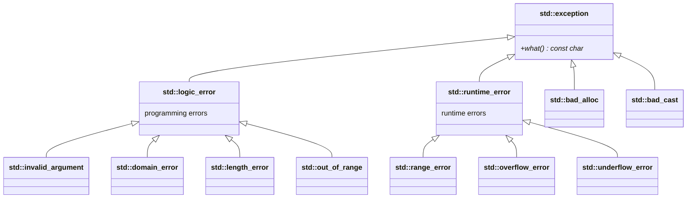
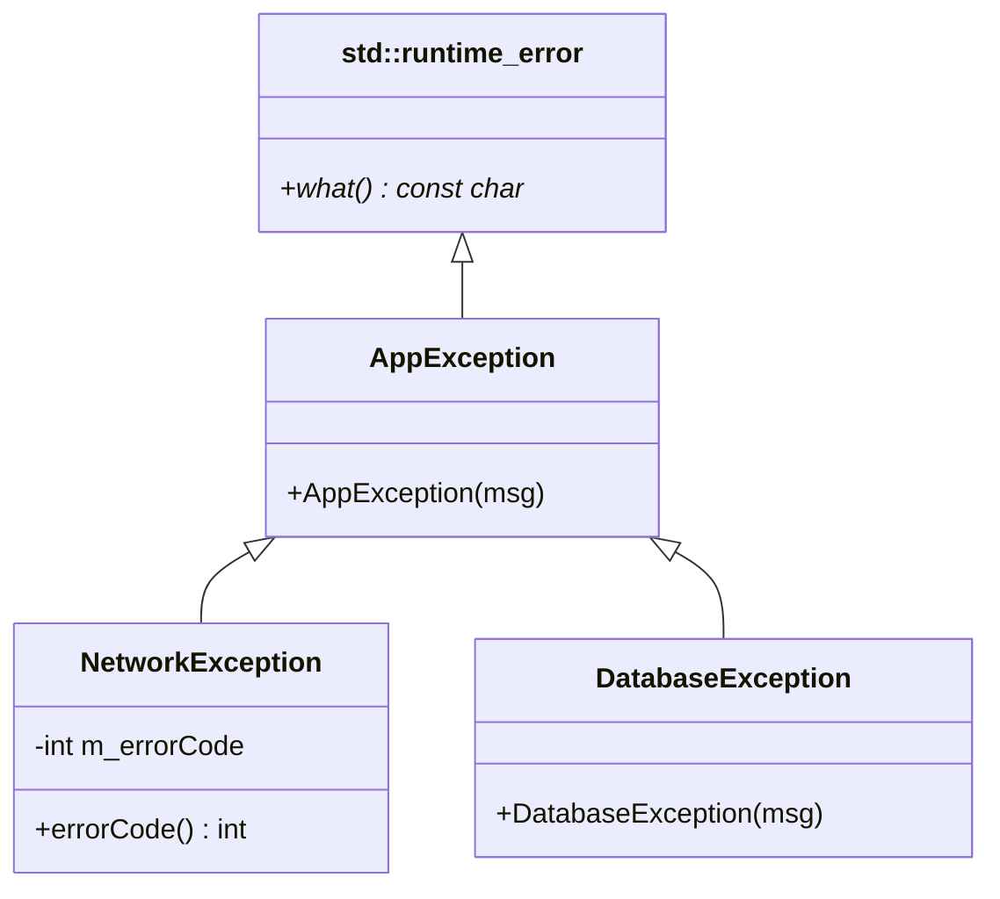
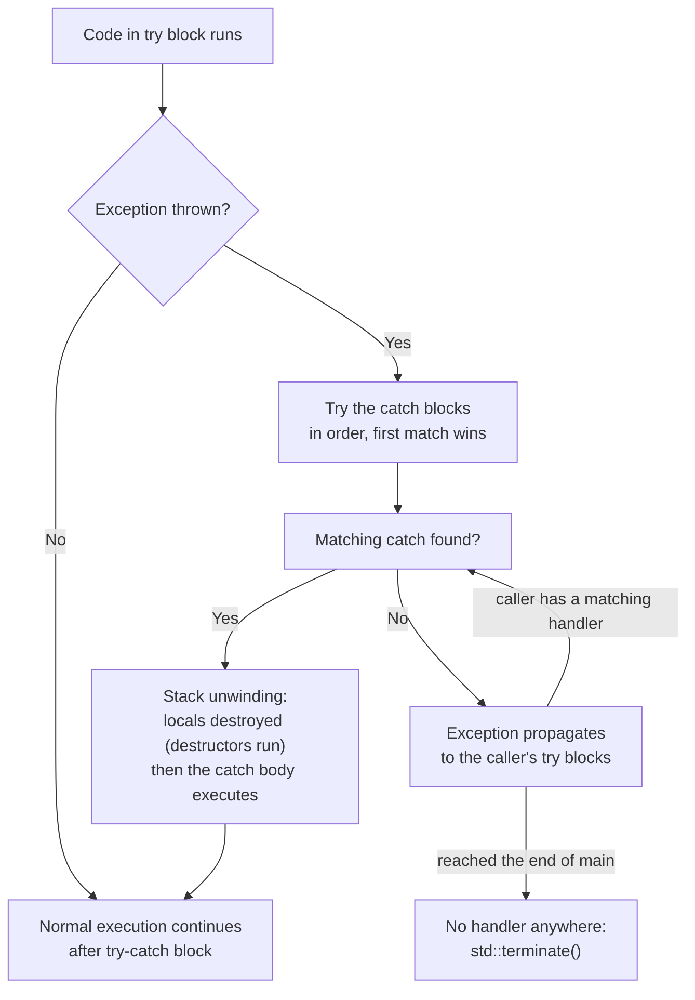
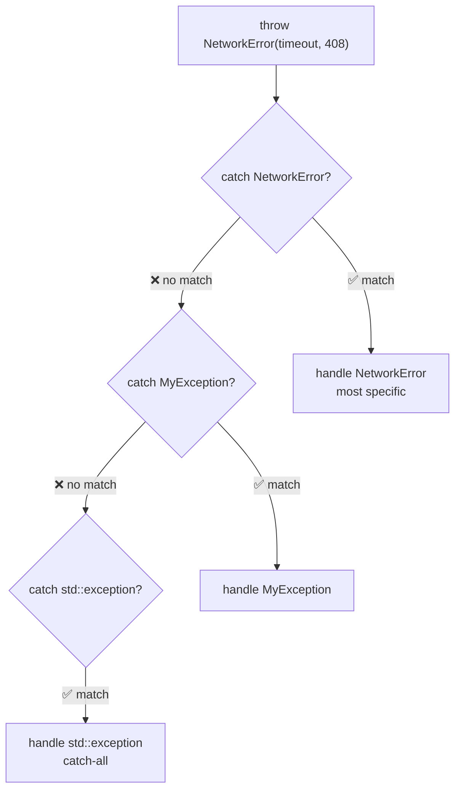
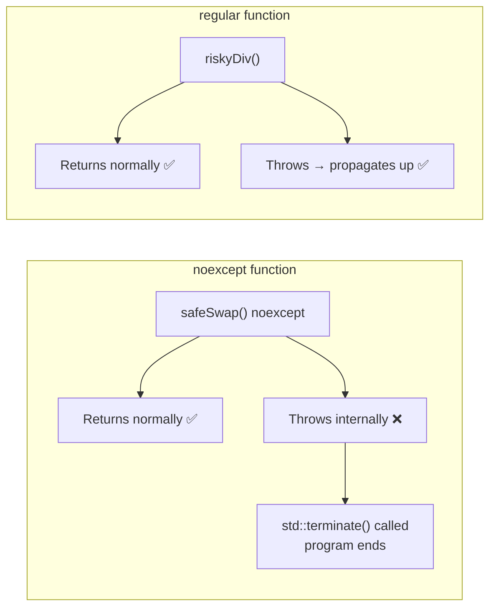
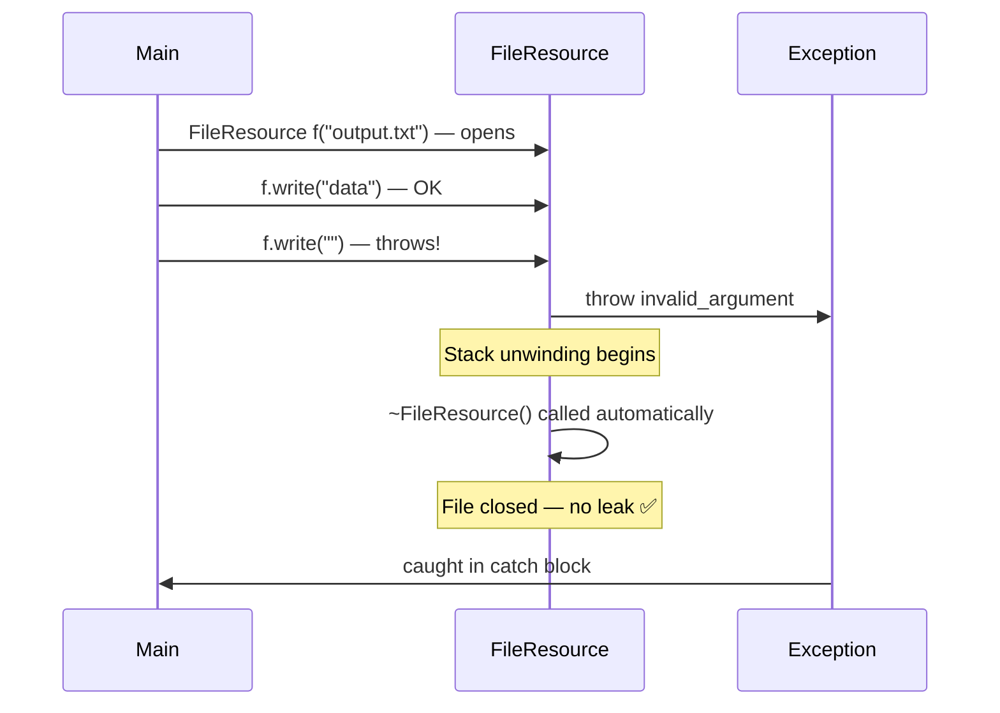
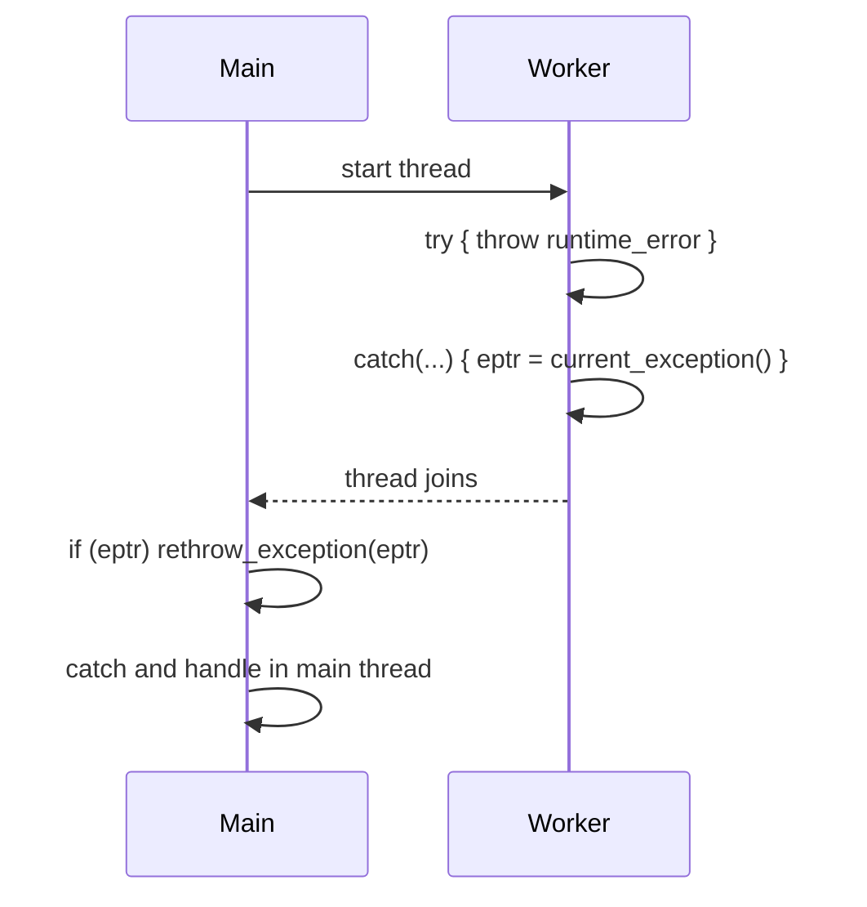
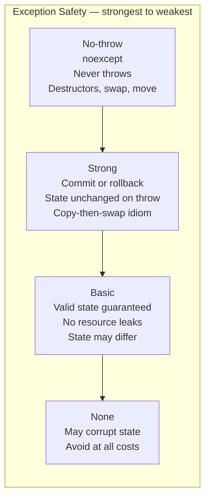

# StdexceptSTL — Exception Handling in C++23

C++ exceptions provide a structured way to handle errors without littering code
with error-code checks. RAII ensures resources are always cleaned up.

---

## Header

```cpp
#include <stdexcept>   // logic_error, runtime_error and their children
#include <exception>   // std::exception, exception_ptr, current_exception, nested_exception
#include <new>         // std::bad_alloc
#include <typeinfo>    // std::bad_cast
```

---

## Exception hierarchy



`std::exception` is **not abstract**: `std::exception e;` compiles and `e.what()` returns an
implementation-defined text (`"std::exception"` with GCC). `what()` of the library's own exceptions
(e.g. the text of `vector::at`) is also implementation-specific — don't compare it in tests.

---

## Custom exception hierarchy (from this file)



---

## try / catch flow



`catch (...)` is just another handler that matches everything. The order matters: the first
matching handler wins, so a base-class handler placed before a derived one hides it (GCC warns:
`exception of type 'A' will be caught by earlier handler`). Destructors of the locals run **before** the body
of the matching `catch` executes (the RAII example prints `closed` before `caught`). With no matching handler at
all, `std::terminate()` is called (stack unwinding is then not guaranteed): `terminate called after throwing an instance of 'std::runtime_error'`, exit status 134.

---

## Basic try/catch/throw

```cpp
try {
    throw std::runtime_error("something failed");
}
catch (const std::runtime_error& e) {
    std::cout << e.what();   // "something failed"
}
catch (const std::exception& e) {
    // catches anything derived from std::exception
}
catch (...) {
    // catches absolutely everything
}
```

**Always catch by `const` reference** — avoids slicing and copies.

---

## Standard exception types

```cpp
throw std::invalid_argument("negative size");       // logic error
throw std::out_of_range("index 100 out of [0,10)"); // logic error
throw std::runtime_error("disk full");              // runtime error
throw std::overflow_error("integer overflow");      // runtime error
throw std::bad_alloc();                             // heap allocation failed
```

`std::vector<int> huge(SIZE_MAX)` throws `std::length_error` ("cannot create std::vector larger than max_size()"), **not**
`bad_alloc`; a large but legal request such as `std::vector<char>(std::size_t(1) << 47)` throws `std::bad_alloc` (tested).

---

## Custom exceptions

```cpp
class MyException : public std::runtime_error {
public:
    explicit MyException(const std::string& msg)
        : std::runtime_error("MyException: " + msg) {}
};

class NetworkError : public MyException {
    int m_code;
public:
    NetworkError(const std::string& msg, int code)
        : MyException(msg), m_code(code) {}
    int code() const { return m_code; }
};
```

Always derive from `std::exception` or its children so callers can use
`catch (const std::exception& e)` as a catch-all.

---

## Catch order — most derived first



```cpp
try { throw NetworkError("timeout", 408); }
catch (const NetworkError& e)   { /* most specific */ }
catch (const MyException& e)    { /* less specific */ }
catch (const std::exception& e) { /* catch-all     */ }
```

---

## Rethrowing

```cpp
try {
    riskyOperation();
} catch (const std::exception& e) {
    log(e.what());
    throw;    // rethrow same exception — preserves type!
    // NOT: throw e;  — throws a COPY of the static type (const std::exception&):
    //                  the derived type is sliced away and what() becomes "std::exception" (tested)
}
```

---

## noexcept



```cpp
void safeSwap(int& a, int& b) noexcept { std::swap(a, b); }   // needs <utility>
```

- Tells compiler and callers the function never throws
- Enables move optimization (move constructors should be `noexcept`): when a `std::vector` grows it moves
  elements only if the move constructor is `noexcept`, otherwise it copies. Tested with 8 `emplace_back`s:
  noexcept move → 0 copies / 7 moves; non-noexcept move → 7 copies / 0 moves.
- If a `noexcept` function throws → `std::terminate()` is called (GCC warns `'throw' will always call 'terminate'`)
- Check: `noexcept(expr)` returns `true`/`false` (the expression is not evaluated)
- Destructors are `noexcept` by default; only `~T() noexcept(false)` may throw

---

## RAII — exception-safe resources



```cpp
class FileHandle {
public:
    FileHandle(const std::string& path) { open(path); }
    ~FileHandle() { close(); }  // always runs — even on exception
};
```

**Exceptions in constructors:** if a constructor throws, the object never finished construction, so its
destructor does **not** run — but all already-constructed members and base classes are destroyed (tested:
`Res ctor`, `Owner ctor body`, `Res dtor`, and `~Owner` never runs). That is why resources should be owned
by members (RAII), not acquired raw inside the constructor body.

---

## std::exception_ptr — transfer across threads



```cpp
#include <thread>
#include <iostream>

std::exception_ptr eptr;

std::thread t([&eptr]() {
    try { throw std::runtime_error("worker error"); }
    catch (...) { eptr = std::current_exception(); }
});
t.join();

if (eptr) {
    try { std::rethrow_exception(eptr); }
    catch (const std::exception& e) { std::cout << e.what(); }
}
```

An exception that escapes a `std::thread` function calls `std::terminate`, which is why the worker catches
`(...)` and stores `std::current_exception()`. (`main.cpp` calls the lambda directly to keep the demo single-threaded; the
`std::thread` version above was compiled and prints `worker error`.) `std::async`/`std::future` do this transport automatically.

---

## std::nested_exception — wrapping errors

```cpp
void loadConfig() {
    try { throw std::runtime_error("file 'app.cfg' not found"); }
    catch (...) { std::throw_with_nested(AppException("cannot load configuration")); }
}

void printNested(const std::exception& e, int level = 0) {
    std::println("{}{}", std::string(level * 2, ' '), e.what());
    try { std::rethrow_if_nested(e); }
    catch (const std::exception& inner) { printNested(inner, level + 1); }
}
// prints:  AppException: cannot load configuration
//            file 'app.cfg' not found
```

`std::throw_with_nested` keeps the original error inside the new one so the cause isn't lost.

---

## Exception safety levels



| Level | Guarantee |
|-------|-----------|
| **No-throw** | Never throws — `noexcept` |
| **Strong** | If throws, state unchanged (commit-or-rollback) |
| **Basic** | If throws, object in valid state, no leaks |
| **None** | May corrupt state (avoid!) |

---

## Best practices

```cpp
// DO
throw MyException("message");             // throw by value
catch (const std::exception& e) { }       // catch by const ref
throw;                                    // rethrow without argument
// noexcept on swap and move operations (destructors are already noexcept by default)
// use RAII for cleanup — destructors run during unwinding
// derive your exceptions from std::exception or its subclasses

// DON'T
catch (std::exception e) { }             // by value — slices derived type (what() becomes "std::exception")
throw e;                                  // in catch — loses derived type
throw new MyException();                  // raw pointer — leaks, and catch (const std::exception&) does NOT match it:
                                          // uncaught -> std::terminate (tested)
catch (...) { }                           // silently swallowing everything hides bugs
// throwing out of a destructor            // std::terminate (not UB): destructors are noexcept by default
// exceptions for normal control flow      // use if/else, std::optional, std::expected
```

---

## When to use exceptions

✅ Constructor failures (no return value to signal error)
✅ Propagating errors up multiple call levels
✅ Errors that are truly exceptional (not expected in normal flow)

❌ Normal control flow — use `if`/`else` or `std::optional`
❌ Expected, frequent failures in hot loops — the no-throw path is cheap, but actually throwing is slow (not measured here)
❌ Across language boundaries (C callbacks/APIs) — an exception must not propagate through C frames
❌ Embedded systems with exceptions disabled

---

## Notes moved from main.cpp

- `main.cpp` uses `std::println` and `std::` everywhere (no `using namespace std;`).
- **Example 1** used to print an ASCII tree of the hierarchy; it is now real code: `std::is_base_of_v`
  checks (compile-time `static_assert`) plus printed lines. The tree itself is the first diagram above.
- **Example 9 ("Exception safety levels") and Example 10 ("Best practices")** were only printed text, so they were removed
  from `main.cpp`; their content is the safety-levels table and the Best-practices / When-to-use sections above.
  The header listed `std::nested_exception` as topic 9 but the file never used it, so Example 9 is now a small real
  `std::nested_exception` demo and the topic list has 9 entries.
- Exception-safety levels (moved): **no-throw** (`noexcept`; destructors, swap, move), **strong** (commit-or-rollback,
  copy-then-swap), **basic** (valid state, no leaks), **none** (avoid).
- Output differences vs the original: bool results print `true`/`false` (was `1`/`0`), and the new Examples 1 and 9.

## Corrections to the original

- `std::exception` is not abstract (the diagram said `<<abstract>>`).
- The try/catch flowchart sent "no match" to `catch(...)`; unmatched exceptions propagate to the caller, and with no handler
  at all `std::terminate()` is called. Unwinding happens *before* the handler body runs.
- `int safeSwap(...) noexcept { std::swap(a, b); }` returned `int` without returning anything; it is `void`.
- "throw from destructors — undefined behavior" is wrong: destructors are `noexcept` by default, so an exception escaping one calls
  `std::terminate` (well defined); `~T() noexcept(false)` can throw but then a throw during unwinding also terminates.
- `// std::vector<int> huge(SIZE_MAX); // would throw bad_alloc` — it throws `std::length_error`.
- "`noexcept` on destructors" — they are already `noexcept`; the useful places are swap and move.
- `std::thread`/`std::cout` snippet needed `<thread>` and `<iostream>`; `std::bad_alloc` needs `<new>`.

## What was tested

GCC 13.3, `-std=c++23 -Wall -Wextra -Wshadow -fsanitize=address,undefined`, with a small test-only `<print>` shim
(GCC 13 has no `<print>`): clean build, no sanitizer reports; output compared with the original by `diff`. Separately run:
`std::exception` instantiable, `throw e` vs `throw;`, catch by value, `length_error` vs `bad_alloc`, vector copy-vs-move with
and without `noexcept`, constructor-throws destruction order, `std::thread` + `exception_ptr`, uncaught exception and
`noexcept`/destructor `terminate` (exit 134), catch-order warning, `throw new` not matching `const std::exception&`.

## Not tested

- The cost of throwing vs returning an error code (no benchmark was run).
- The exact `what()` text on other standard libraries.
- Real `<print>` from GCC 14+, MSVC/Clang behavior.
