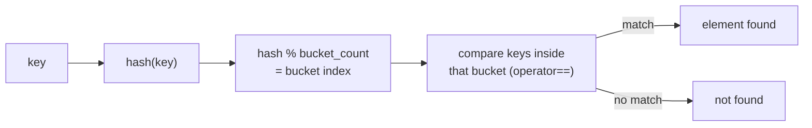

# UnorderedSTL — Unordered Containers in C++23

Hash-table containers: `std::unordered_map`, `std::unordered_set`, `std::unordered_multimap`,
`std::unordered_multiset`. Average O(1) lookup / insert / erase, **no ordering**.

---

## Header

```cpp
#include <unordered_map>   // unordered_map, unordered_multimap
#include <unordered_set>   // unordered_set, unordered_multiset
#include <functional>      // std::hash, std::equal_to
```

---

## The four containers

| Container | Key / value | Duplicates | Typical use |
|-----------|-------------|-----------|-------------|
| `unordered_map<K,V>` | key → value | no | lookup table, counters, registry |
| `unordered_set<T>` | value only | no | membership test, de-duplication |
| `unordered_multimap<K,V>` | key → value | yes | several values per key |
| `unordered_multiset<T>` | value only | yes | counting occurrences |

---

## How lookup works



- Needs a **hash function** (`std::hash<Key>`, or your own) and an **equality** (`std::equal_to<Key>`, i.e. `operator==`).
- Average O(1); worst case O(n) when many keys land in the same bucket (see "Bad hashes" below).

---

## unordered_map

```cpp
std::unordered_map<std::string, int> scores;
scores["Alice"] = 95;              // inserts or overwrites
scores.insert({"Andre", 75});      // does nothing if the key already exists
scores.emplace("Sara", 91);        // does nothing if the key already exists

scores.at("Kostas");               // throws std::out_of_range if missing
scores.contains("Bob");            // C++20
scores.find("Maria");              // iterator, or end()
scores.erase("Andre");             // returns the number of erased elements (0 or 1)
```

Behavior of each insert form (tested with an existing key `"a"` = 1):

| Call | Existing key | Result |
|------|--------------|--------|
| `m["a"] = 99` | overwritten | value 99 |
| `m.insert({"a", 99})` | **not** changed | `second == false`, value stays 1 |
| `m.emplace("a", 5)` | **not** changed | `second == false` |
| `m.insert_or_assign("a", 99)` | overwritten | value 99 |
| `m.try_emplace("b", 7)` | does not touch the arguments if the key exists | value 7 for new key |

### Gotchas

- **`operator[]` inserts.** `m["zzz"]` on a missing key creates it with a default value (size went 1 → 2 in the test).
  Use `find` / `contains` / `at` for read-only lookup. `operator[]` also cannot be used on a `const` map.
- **`contains()` is C++20.** With `-std=c++17` it does not compile (`no member named 'contains'`); use `count()` or `find()`.
- **Iteration order is unspecified** and can change after inserts. Inserting `0..19` into an `unordered_set<int>` with
  libstdc++ printed `19 18 17 16 15 14 13 0 1 2 ... 12`. Never rely on it, and don't compare against it in tests.
- **Keys are `const`.** To rename a key use node handles (C++17):
  `auto nh = m.extract("Bob"); nh.key() = "Robert"; m.insert(std::move(nh));` (tested).
- **Erasing while iterating:** `erase(it)` returns the next iterator:

  ```cpp
  for (auto it = m.begin(); it != m.end(); )
      it = pred(*it) ? m.erase(it) : std::next(it);
  ```

---

## unordered_set

```cpp
std::unordered_set<std::string> tags;
tags.insert("TAG-ALPHA");
tags.insert("TAG-ALPHA");          // duplicate — ignored, size stays 1
tags.contains("TAG-ALPHA");        // C++20
tags.erase("TAG-BETA");

std::vector<int> nums = {3,1,4,1,5,9,2,6,5,3,5};
std::unordered_set<int> unique(nums.begin(), nums.end());   // 11 elements -> 7 unique
```

The result of de-duplicating is **not sorted**. If you need it sorted, use `std::set` or sort a vector afterwards.

---

## unordered_multimap / unordered_multiset

```cpp
std::unordered_multimap<std::string, std::string> contacts;
contacts.insert({"Kostas", "kostas@work.com"});
contacts.insert({"Kostas", "kostas@personal.com"});

auto [first, last] = contacts.equal_range("Kostas");     // all entries with this key
for (auto it = first; it != last; ++it) std::println("{}", it->second);
contacts.count("Kostas");                                 // number of entries with this key
```

- Equal keys are stored next to each other, but **their order is not the insertion order**: inserting
  values `1, 2, 3` under one key printed `1 3 2` in the test.
- No `operator[]` / `at()` (a key does not identify one value).
- `unordered_multiset`: `erase(key)` removes **all** copies (it returned 3 for three `2`s);
  `erase(find(key))` removes exactly one.

---

## Custom hash function

```cpp
struct Point {
    int x, y;
    bool operator==(const Point& o) const { return x == o.x && y == o.y; }
};

struct PointHash {
    std::size_t operator()(const Point& p) const {
        std::size_t hx = std::hash<int>{}(p.x);
        std::size_t hy = std::hash<int>{}(p.y);
        return hx ^ (hy << 1);
    }
};

std::unordered_map<Point, std::string, PointHash> grid;
```

You need both: an `operator==` (or a custom equality type as 4th template argument) and a hash.
Rule: **equal keys must have equal hashes.**

- **`std::pair`, `std::tuple` and your own structs have no `std::hash`.**
  `std::unordered_map<std::pair<int,int>, int>` fails to compile (`use of deleted function ... std::hash<std::pair<int,int>>`).
  Write a hash like `PointHash`.
- **The XOR-shift combine above is weak.** `(3,0)` and `(1,1)` both hash to `3` (tested, with libstdc++ where
  `std::hash<int>(42) == 42`). It is correct (equal points still hash equally), just collision-prone. A common better
  combine is the boost style:

  ```cpp
  std::size_t seed = std::hash<int>{}(p.x);
  seed ^= std::hash<int>{}(p.y) + 0x9e3779b97f4a7c15ULL + (seed << 6) + (seed >> 2);
  return seed;
  ```
  (This combine was not run here.)

### Bad hashes → O(n)

A hash that returns a constant puts everything in one bucket. Test: 1000 ints with `hash == 0` gave
`bucket_size(bucket(5)) == 1000`, so every lookup scans the whole bucket — O(n), the worst case.

---

## Buckets, load factor, rehashing

```cpp
m.size();              // elements
m.bucket_count();      // buckets
m.load_factor();       // size / bucket_count
m.max_load_factor();   // default 1.0 — rehash when load_factor would exceed it
m.bucket("a");         // bucket index of a key
m.bucket_size(i);      // elements in bucket i
m.reserve(100);        // make room for 100 elements without rehash
```

Observed with libstdc++ (the numbers are implementation-specific):

- Empty set: `bucket_count() == 1`; default `max_load_factor() == 1`.
- Growth while inserting 200 ints: 13 (at 1 element), 29 (at 14), 59 (at 30), 127 (at 60), 257 (at 128) — roughly doubling prime sizes.
- `reserve(100)` → `bucket_count() == 103`.
- Printed bucket numbers (`bucket for 'a'`) depend on the implementation and may differ elsewhere.

**Rehash and references:** a rehash **invalidates iterators**, but pointers and references to the *elements* stay valid.
Test: after inserting 1000 elements (13 → 1109 buckets) a pointer taken earlier still pointed to the right value.
Call `reserve()` first if you insert many elements and want to avoid rehashes.

---

## Heterogeneous lookup (C++20)

`m.find("literal")` on a `std::unordered_map<std::string, V>` constructs a temporary `std::string`. With a transparent
hash and `std::equal_to<>` you can look up by `std::string_view` directly:

```cpp
struct StringHash {
    using is_transparent = void;
    std::size_t operator()(std::string_view s) const { return std::hash<std::string_view>{}(s); }
};
std::unordered_map<std::string, int, StringHash, std::equal_to<>> m;
m.find(std::string_view{"x"});   // no temporary std::string (compiled and ran on GCC 13)
```

---

## ordered vs unordered

| | `std::map` / `std::set` | `std::unordered_map` / `std::unordered_set` |
|---|---|---|
| Lookup / insert | O(log n) | O(1) average, O(n) worst case |
| Order | sorted by key | none |
| Range queries (`lower_bound`, ...) | yes | no |
| Needs | `operator<` | hash + `operator==` |
| Memory | one node per element | one node per element **plus** a bucket array |
| Iterators after insert | stay valid | invalidated by a rehash |

The old text "unordered uses less memory — contiguous buckets" is wrong: both are node-based. Measured:
200 000 random `int` keys (199 996 distinct) with a counting `operator new`: `std::map` made 199 996 allocations / 8.0 MB
requested; `unordered_map` 200 011 allocations / 8.7 MB requested (nodes plus bucket arrays).

**One noisy sandbox run** (GCC 13.3, `-O2`, 2 000 000 random lookups on those 200 000 keys): `std::map` about
1.1 s, `unordered_map` about 45 ms — about 25× faster, run twice with similar results. Your numbers will differ with key type,
size, cache and hash quality; small maps or string keys narrow the gap, so measure your own case.

---

## Word frequency counter

```cpp
std::unordered_map<std::string, int> freq;
std::istringstream iss(text);
std::string word;
while (iss >> word) freq[word]++;      // operator[] default-inserts 0, then ++
```

To print the top entries, copy into a `vector<pair<...>>` and sort. Sorting by count alone gives an arbitrary
order for ties (it depends on the hash table order), so `main.cpp` breaks ties alphabetically.

## Device registry

`std::unordered_map<std::string, Device>` keyed by device ID: O(1) lookup (`contains` / `at`), iterate to filter, `erase(id)` to remove.

---

## When to use which

✅ `std::unordered_map` / `unordered_set`: only lookup / insert / erase matter, order doesn't, keys have a good hash (string, int)
✅ `std::map` / `std::set`: sorted iteration, range queries, no good hash, or a worst-case O(log n) guarantee
✅ multimap / multiset (ordered or unordered): several values per key, or duplicate values

❌ Relying on iteration order of an unordered container
❌ Using a pair / struct as key without a proper hash
❌ Holding iterators across inserts (a rehash invalidates them)

---

## Notes moved from main.cpp

- `main.cpp` uses `std::println`/`std::print` and `std::` everywhere (no `using namespace std;`); duplicate includes were removed and `<iostream>` is no longer needed.
- **Example 7 ("Performance — ordered vs unordered") and Example 10 ("When to use ordered vs unordered")** only printed text, so they were removed
  from `main.cpp`; their content is the comparison table and the "When to use which" section above. The word-frequency and registry
  examples are now Examples 7 and 8 (the header topic list was updated).
- The earlier registry example (with ports and groups from a previous project) was replaced by a neutral device registry
  (`DEV-001`, `ZONE-A`, port `8080`); the `GRP-…` set values became `TAG-…`.
- The word-frequency sort now breaks ties alphabetically, so the "top 5" is deterministic (the old output depended on hash order).
- Unordered iteration, bucket numbers and `bucket_count` in the output are libstdc++ specific.

## Corrections

- `contains()` was commented as "C++23!" — it is C++20 (tested: not available with `-std=c++17`, available with `-std=c++20`).
- "Memory: less — contiguous buckets" — not true, see the measurement above.
- "Keys have a good hash (string, int)" — true for built-in types; pairs and structs have none (compile error).
- The XOR-shift hash is valid but collision-prone (example `(3,0)` / `(1,1)`).

## What was tested

GCC 13.3, `-std=c++23 -Wall -Wextra -Wshadow -fsanitize=address,undefined`, with a small test-only `<print>` shim (GCC 13 has no
`<print>`): clean build, no sanitizer reports; output compared with the original by `diff` (only the intended changes).
Separately run: `operator[]` insertion, `at()` exception, insert / emplace / insert_or_assign / try_emplace on an existing key, pointer
stability across a rehash, erase-while-iterating idiom, key renaming with `extract`, weak-hash collision, constant-hash bucket
size, default load factor / `reserve` / bucket growth, heterogeneous lookup, `unordered_multiset::erase`, `equal_range` order, `contains` under
C++17 vs C++20, `std::pair` key compile error, allocation counts and lookup timing.

## Not tested

- The boost-style hash combine (shown for reference only).
- Bucket counts and iteration order on other standard libraries (libc++, MSVC).
- Performance with string keys, small maps, or other hash functions.
- Real `<print>` from GCC 14+.
