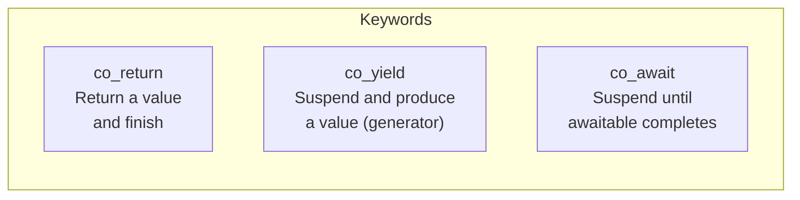
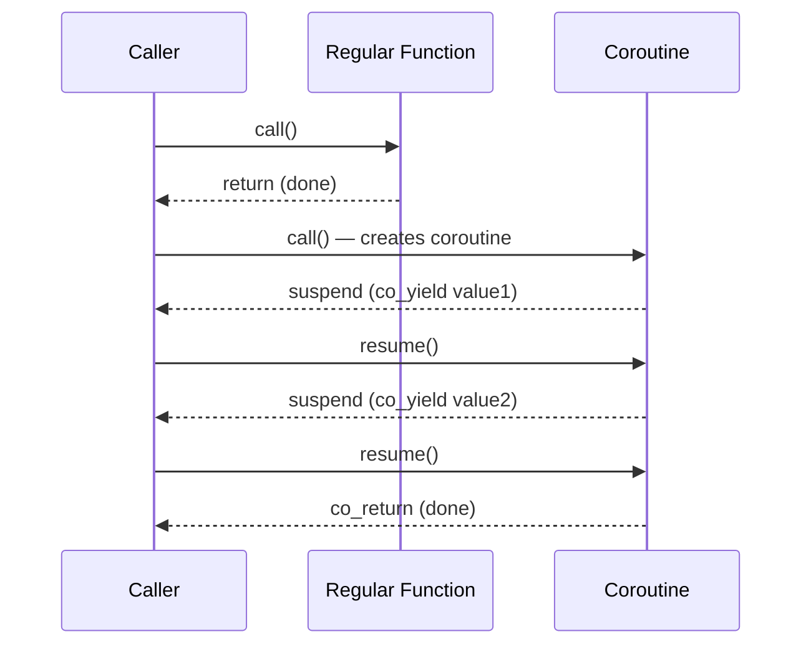
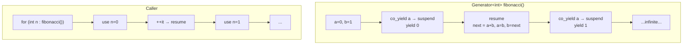
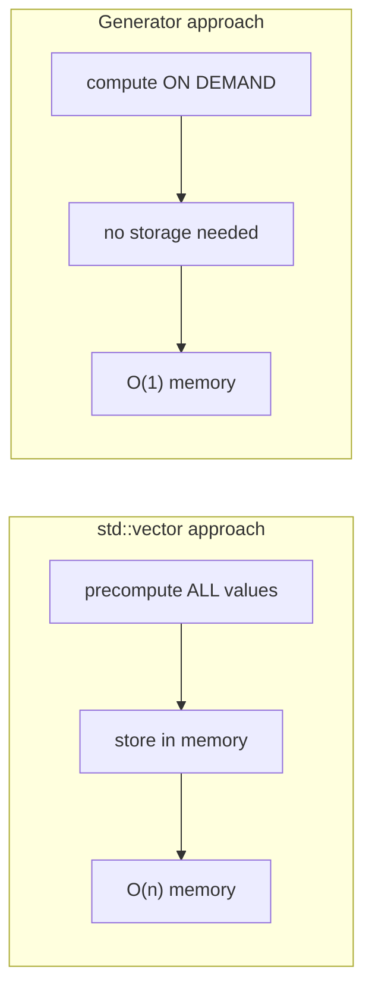
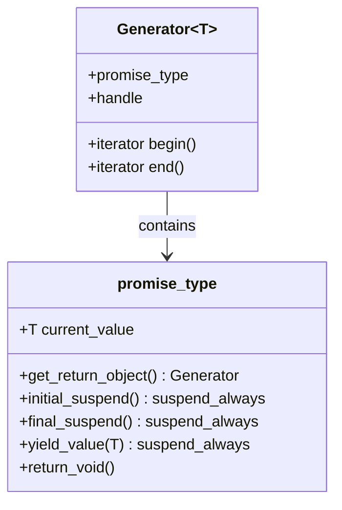
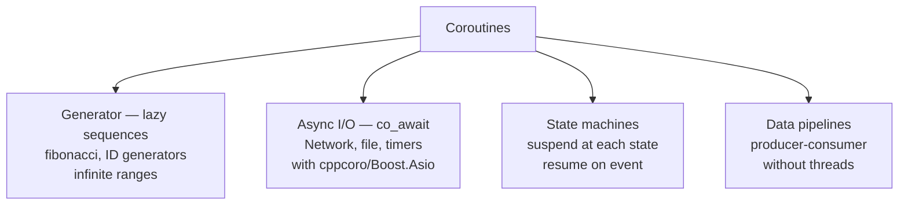

# C++20 Coroutines

## What are Coroutines?

A coroutine is a function that can **suspend** its execution and **resume** later,
preserving its state across suspensions.

---

## Three keywords



---

## Coroutine vs regular function



---

## Generator pattern — co_yield



```cpp
Generator<int> fibonacci() {
    int a = 0, b = 1;
    while (true) {
        co_yield a;          // suspend here, produce a
        int next = a + b;
        a = b;
        b = next;
    }
}

// Usage — take first 10
int count = 0;
for (int n : fibonacci()) {
    std::cout << n << ' ';
    if (++count >= 10) break;
}
// 0 1 1 2 3 5 8 13 21 34
```

---

## Generator vs vector



---

## co_await — async tasks

```cpp
// co_await suspends until the awaitable is ready
Task<std::string> fetchData(const std::string& url) {
    auto response = co_await httpGet(url);   // suspends here
    co_return response.body;                  // resumes here
}

// Reads like synchronous code — no callbacks!
Task<void> processAll() {
    auto data1 = co_await fetchData("url1");
    auto data2 = co_await fetchData("url2");
    std::cout << data1 << data2;
    co_return;
}
```

---

## Coroutine infrastructure (required boilerplate)



> In C++23 `std::generator<T>` is standardized — no boilerplate needed.
> On GCC 14: use the custom `Generator<T>` from this file or install `cppcoro`.

---

## Coroutine vs Thread vs Callback

| | Callback | Thread | Coroutine |
|--|:--------:|:------:|:---------:|
| Memory | Low | High (MB stack) | Low (KB stack) |
| OS involvement | No | Yes | No |
| Code style | Fragmented | Sequential | Sequential |
| Switching | Function call | OS scheduler | Explicit suspend |
| Parallelism | No | Yes | No (cooperative) |

---

## Practical use cases



---

## Async frameworks for co_await

```bash
# cppcoro — C++ coroutine library
# https://github.com/lewissbaker/cppcoro

# Boost.Asio — network + coroutines
sudo apt install libboost-all-dev

# QCoro — Qt coroutines
# https://github.com/danvratil/qcoro
```

---

## When to use Coroutines

✅ Lazy infinite sequences — `co_yield` generators
✅ Async I/O without callbacks — `co_await`
✅ Complex state machines — suspend at each state
✅ Producer-consumer pipelines without threads

❌ Simple synchronous code — unnecessary complexity
❌ CPU-bound parallel work — use threads instead
❌ When framework support is needed but not available

---

## Pitfall: reference parameters in coroutines

A coroutine keeps its parameters in its heap-allocated frame. A parameter of type `const std::string&` is only a reference: after the first suspension it points at whatever the caller passed, and a temporary such as `idGenerator("ORD")` is already destroyed by then. AddressSanitizer reports this as `stack-use-after-scope`. Take the parameter by value, as `idGenerator(std::string prefix)` in `main.cpp` does. This was a real bug in the earlier version of this example and was found by running it under AddressSanitizer.

## Notes moved from main.cpp

This text used to be printed by `main()`. It is lecture material, so it lives here and the program only prints the demo output.

### Example 1: What are Coroutines?

**A coroutine is a function that can:**

SUSPEND — pause execution and return control to caller  
RESUME  — continue from where it was suspended

**Three keywords:**

co_return — return a value and finish the coroutine  
co_yield  — suspend and produce a value (generator)  
co_await  — suspend until an async operation completes

A function is a coroutine if it contains ANY of these.  
The compiler transforms it into a state machine.

### Example 4: Fibonacci — infinite generator

```cpp
Key point: fibonacci() is INFINITE but LAZY
```

Values computed ON DEMAND — not stored  
Memory O(1) regardless of how many values we take

### Example 5: Coroutine execution flow

**Generator execution flow:**

```cpp
Generator<int> gen = range(1, 4);
// coroutine created but NOT started yet

for (int n : gen) {
    // begin() called → coroutine resumes
    // runs until co_yield 1 → suspends
    // n = 1, loop body runs
    // ++it → coroutine resumes
    // runs until co_yield 2 → suspends
    // ...
}
// coroutine reaches end → done
```

**Actual output:**

### Example 7: ID generator

**Coroutine advantages for ID generation:**

No vector pre-allocation needed  
IDs generated on demand  
Infinite sequence — stop whenever

### Example 8: co_await concept (explanation)

**co_await suspends coroutine until an awaitable completes:**

```cpp
Task<string> fetchData() {
    auto result = co_await httpGet('url');  // suspends
    co_return result;                       // resumes here
}
```

Typical use cases:

- Network I/O — co_await socket.read()
- File I/O    — co_await file.read()
- Timers      — co_await sleep(1s)
- Tasks       — co_await otherCoroutine()

Full co_await needs an async framework:

- cppcoro (C++ coroutine library)
- Boost.Asio (network + coroutines)
- Qt (QCoro library for Qt coroutines)

### Summary: Coroutines vs Alternatives (closing summary)

```cpp
Generator<T> vs std::vector:
```

vector   — stores ALL values in memory upfront  
Generator— computes values ON DEMAND, O(1) memory

**Coroutine vs callback:**

Callback — control flow fragmented, hard to follow  
Coroutine— reads like synchronous code, suspends cleanly

**Coroutine vs thread:**

Thread   — OS-managed, heavy (MB stack, scheduling)  
Coroutine— user-space, lightweight (KB stack, no OS)

=== Coroutines complete ===

## What was tested

- Compiled with GCC 13.3 (`-std=c++23`) using a stand-in `<print>` header, because `std::println` needs GCC 14 and it was not available here. The source files were compiled directly, not through CMake.
- Run and compared with the original `std::cout` output line by line. Differences: the moved lecture text (see *Notes moved from main.cpp*), `bool` values print as `true`/`false` instead of `1`/`0`, floating-point numbers print in their shortest exact form instead of 6 significant digits, and values that change on every run (thread ids, timings, random data). I sampled the differing lines; I did not review every one.
- Run once with AddressSanitizer + UndefinedBehaviorSanitizer: no findings.

## Not tested

- The real `<print>` header (GCC 14+, recent Clang or MSVC) and platforms other than Linux x86-64.
