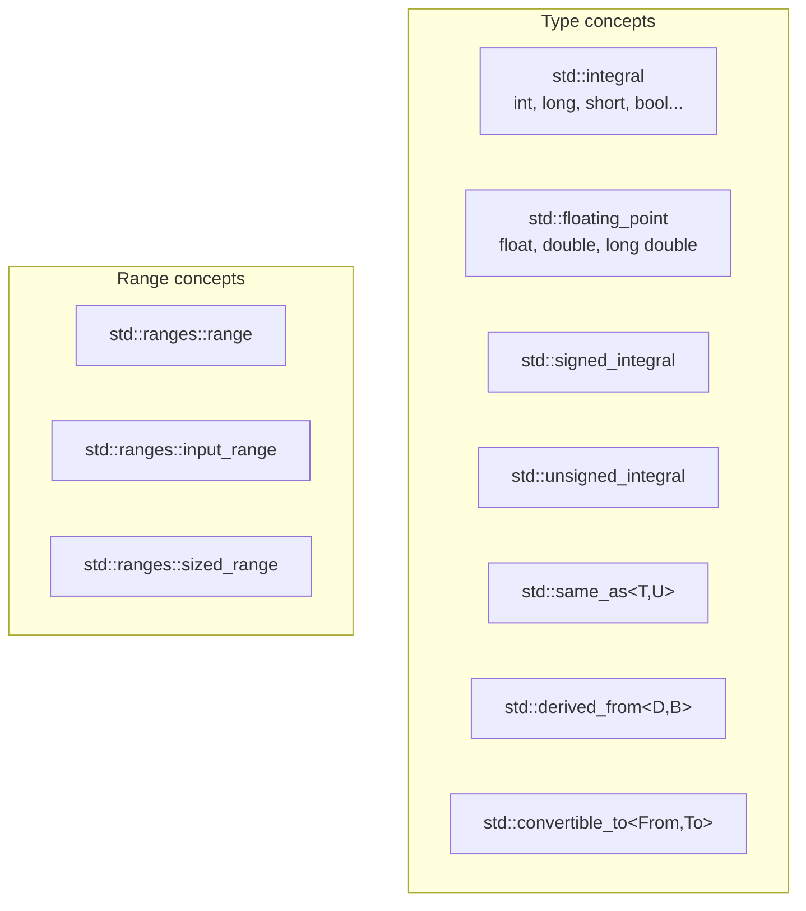
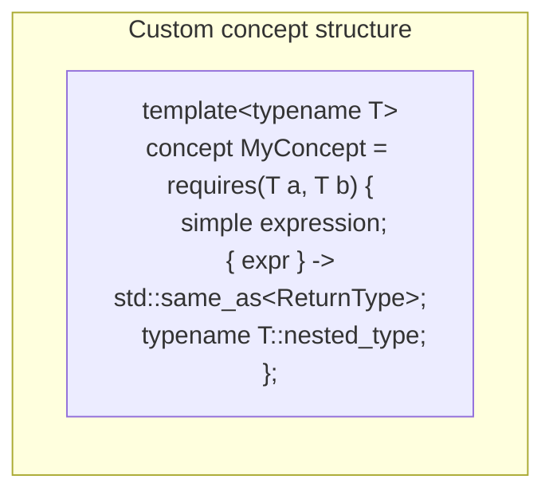
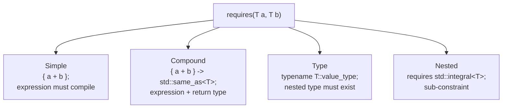
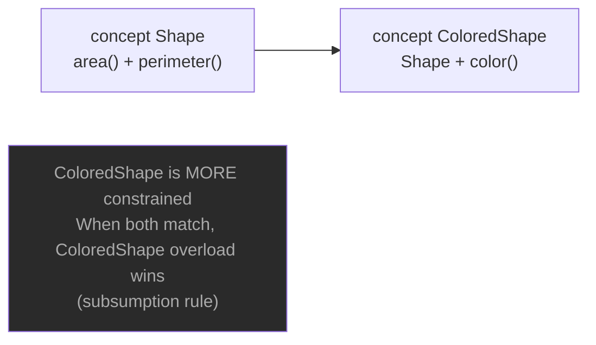

# C++20 Concepts

## What are Concepts?

Concepts are **compile-time constraints** on template type parameters.
They replace SFINAE with readable, expressive requirements.

---

## Built-in concepts (`<concepts>`)



---

## 4 syntaxes for constrained functions

```cpp
// Syntax 1: requires clause after template
template<typename T>
requires std::integral<T>
T doubled(T x) { return x * 2; }

// Syntax 2: concept in template parameter (recommended)
template<std::integral T>
T doubled(T x) { return x * 2; }

// Syntax 3: constrained auto
auto doubled(std::integral auto x) { return x * 2; }

// Syntax 4: requires clause at end
template<typename T>
T doubled(T x) requires std::integral<T> { return x * 2; }
```

---

## Custom concepts



```cpp
template<typename T>
concept Arithmetic = requires(T a, T b) {
    { a + b } -> std::same_as<T>;
    { a - b } -> std::same_as<T>;
    { a * b } -> std::same_as<T>;
    { a / b } -> std::same_as<T>;
};

template<typename T>
concept Container = requires(T c) {
    typename T::value_type;
    { c.begin() } -> std::input_or_output_iterator;
    { c.end()   } -> std::input_or_output_iterator;
    { c.size()  } -> std::convertible_to<std::size_t>;
};
```

---

## requires expression types



---

## Concepts vs SFINAE

```cpp
// SFINAE — hard to read, terrible error messages
template<typename T,
         typename = std::enable_if_t<std::is_integral_v<T>>>
T old_way(T x) { return x * 2; }

// Concepts — clean, clear error messages
template<std::integral T>
T new_way(T x) { return x * 2; }

// Error message with SFINAE:
// "candidate template ignored: substitution failure"
// Error message with Concepts:
// "'double' does not satisfy 'std::integral'"
```

---

## Subsumption — more specific concept wins



---

## Text encoder concept

```cpp
template<typename T>
concept TextEncoder = requires(T encoder, const std::string& data) {
    { encoder.name()       } -> std::convertible_to<std::string>;
    { encoder.maxLength()    } -> std::convertible_to<int>;
    { encoder.encode(data) } -> std::convertible_to<std::string>;
    { encoder.decode(data) } -> std::convertible_to<std::string>;
};

// Works with any type satisfying TextEncoder
template<TextEncoder T>
void processText(const T& encoder, const std::string& text) {
    auto encoded = encoder.encode(text);
}

// BracketEncoder satisfies TextEncoder ✅
// PrefixEncoder satisfies TextEncoder  ✅
// int does not satisfy TextEncoder ❌ — compile error
```

---

## When to use Concepts

✅ Template functions that only work for certain types
✅ Replacing SFINAE — clearer error messages
✅ Overload resolution based on type properties
✅ Interface contracts (like TextEncoder above)
✅ Constrained auto in lambdas and parameters

## Notes moved from main.cpp

This text used to be printed by `main()`. It is lecture material, so it lives here and the program only prints the demo output.

### Example 1: What are Concepts?

Concepts are COMPILE-TIME constraints on template types.

**Without concepts:**

```cpp
template<typename T>
T add(T a, T b) { return a + b; }
// Works on int, double, string — even if that's wrong!
```

**With concepts:**

```cpp
template<std::integral T>
T add(T a, T b) { return a + b; }
// ONLY works on int, long, short etc.
// Clear error message if you try double or string
```

### Example 6: requires expression — inspect type

**requires expressions check:**

```cpp
Simple:     { expr }          — expr must be valid
Type:       typename T::type  — type must exist
Compound:   { expr } -> T     — expr must return T
```

Nested:     requires(...)     — sub-requires

### Example 8: Concepts vs SFINAE

**SFINAE error message (old):**

'enable_if' not found, candidate not viable...  
substitution failure... template argument deduction...

**Concepts error message (new):**

```cpp
'double' does not satisfy 'std::integral'
```

Much clearer — exactly what constraint failed

## What was tested

- Compiled with GCC 13.3 (`-std=c++23`) using a stand-in `<print>` header, because `std::println` needs GCC 14 and it was not available here. The source files were compiled directly, not through CMake.
- Run and compared with the original `std::cout` output line by line. Differences: the moved lecture text (see *Notes moved from main.cpp*), `bool` values print as `true`/`false` instead of `1`/`0`, floating-point numbers print in their shortest exact form instead of 6 significant digits, and values that change on every run (thread ids, timings, random data). I sampled the differing lines; I did not review every one.
- Run once with AddressSanitizer + UndefinedBehaviorSanitizer: no findings.

## Not tested

- The real `<print>` header (GCC 14+, recent Clang or MSVC) and platforms other than Linux x86-64.
