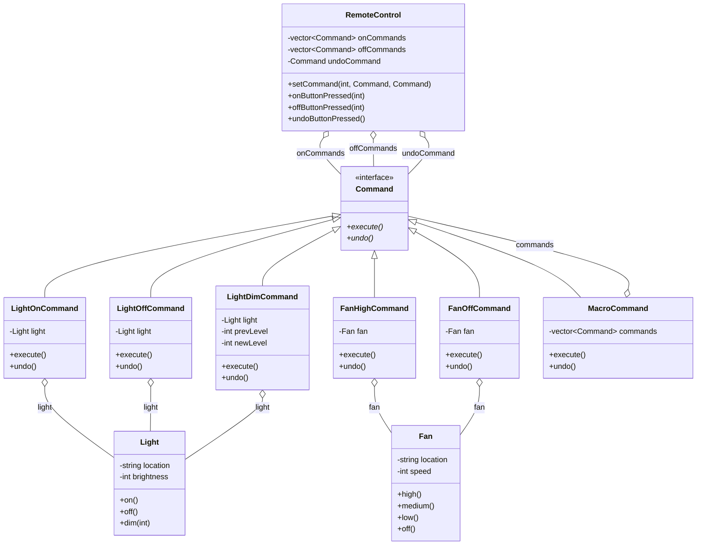

# Command Pattern — Smart Home Remote Control

## Intent

A practical Command Pattern implementation with **undo support** and
**macro commands** — multiple commands executed as one.

---

## Structure from this file

```
Command (interface)
  ├── execute()
  └── undo()

Receivers:
  ├── Light  — on(), off(), dim()
  └── Fan    — high(), medium(), low(), off()

Concrete Commands:
  ├── LightOnCommand   ← execute: on()  | undo: off()
  ├── LightOffCommand  ← execute: off() | undo: on()
  ├── LightDimCommand  ← execute: dim() | undo: dim(prevLevel)
  ├── FanHighCommand   ← execute: high()| undo: off()
  ├── FanOffCommand    ← execute: off() | undo: high()
  └── MacroCommand     ← execute: all commands | undo: all in reverse

Invoker:
  └── RemoteControl — 7 slots, each with ON/OFF command + undo
```

---

## Command interface with undo

```cpp
class Command {
public:
    virtual void execute() = 0;
    virtual void undo()    = 0;   // ← key addition over basic pattern
};
```

Every command knows how to **reverse itself**:

```cpp
class LightOnCommand : public Command {
    Light* light;
public:
    void execute() override { light->on();  }
    void undo()    override { light->off(); }  // reverse: turn off
};

class LightDimCommand : public Command {
    Light* light;
    int prevLevel, newLevel;
public:
    void execute() override {
        prevLevel = 100;          // store before changing
        light->dim(newLevel);
    }
    void undo() override {
        light->dim(prevLevel);    // restore previous level
    }
};
```

---

## Macro command — execute multiple as one

```cpp
class MacroCommand : public Command {
    std::vector<std::shared_ptr<Command>> commands;
public:
    void execute() override {
        for (auto& cmd : commands)
            cmd->execute();          // execute all in order
    }
    void undo() override {
        for (auto it = commands.rbegin(); it != commands.rend(); ++it)
            (*it)->undo();           // undo all in REVERSE order
    }
};
```

Party mode = lights + fan together as one command:
```cpp
std::vector<std::shared_ptr<Command>> partyOn = {livingLightOn, kitchenLightOn, fanHigh};
auto partyOnMacro = std::make_shared<MacroCommand>(partyOn);
```

---

## Invoker — RemoteControl with undo

```cpp
class RemoteControl {
    std::vector<std::shared_ptr<Command>> onCommands;
    std::vector<std::shared_ptr<Command>> offCommands;
    std::shared_ptr<Command> undoCommand;   // last executed

public:
    void onButtonPressed(int slot) {
        onCommands[slot]->execute();
        undoCommand = onCommands[slot];   // remember for undo
    }
    void undoButtonPressed() {
        undoCommand->undo();
    }
};
```

---

## Remote setup

```cpp
RemoteControl remote;
remote.setCommand(0, livingLightOn,  livingLightOff);   // slot 0: living room light
remote.setCommand(1, kitchenLightOn, kitchenLightOff);  // slot 1: kitchen light
remote.setCommand(2, fanHigh,        fanOff);            // slot 2: fan
remote.setCommand(3, partyOnMacro,   partyOffMacro);    // slot 3: party mode
remote.setCommand(4, livingLightDim, livingLightOn);    // slot 4: dim

remote.onButtonPressed(3);    // party on
remote.undoButtonPressed();   // undo entire party macro in reverse
```

---

## Key design decisions

- **`shared_ptr`** — commands shared between macro and individual slots
- **Undo stores previous state** — `LightDimCommand` saves `prevLevel` before executing
- **Macro undo is reversed** — if execute was A→B→C, undo is C→B→A

---

## When to use this variant

✅ Physical device control (smart home, hardware push buttons)
✅ When undo/redo is required
✅ When multiple operations must execute as one unit (macro)
✅ GUI toolbars where buttons trigger different actions

## What was tested

- Compiled with GCC 13.3 (`-std=c++23`) using a stand-in `<print>` header, because `std::println` needs GCC 14 and it was not available here. The source files were compiled directly, not through CMake.
- Run, and the output is identical to the original `std::cout` version.
- Run once with AddressSanitizer + UndefinedBehaviorSanitizer: no findings.

## Not tested

- The real `<print>` header (GCC 14+, recent Clang or MSVC) and platforms other than Linux x86-64.

## Structure

Class diagram generated from the types in `main.cpp`. Arrows: `<|--` inheritance, `o--` the class holds a pointer, reference or container of the other, `*--` the class owns the other by value. `*` after a method = pure virtual, `$` = static.


