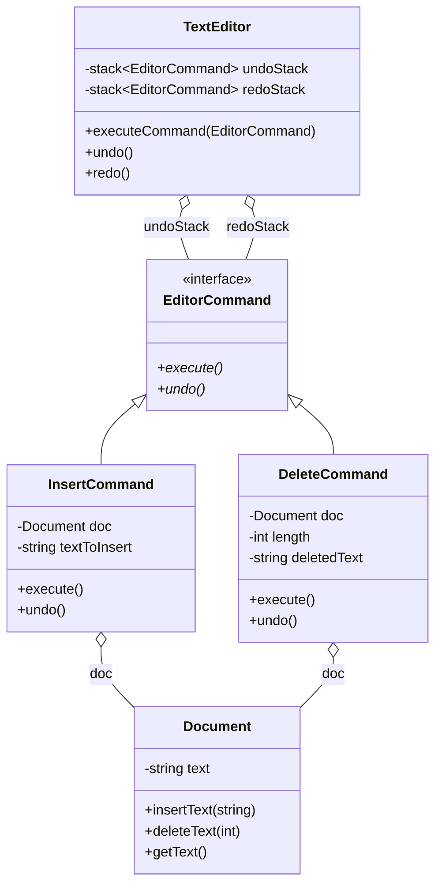

# Command Pattern — Text Editor with Undo/Redo

## Intent

A Command Pattern implementation that demonstrates a full
**undo/redo stack** — exactly how real text editors work.

---

## Structure from this file

```
EditorCommand (interface)
  ├── execute()
  └── undo()

Document (Receiver)
  ├── insertText(txt)
  └── deleteText(length)

Concrete Commands:
  ├── InsertCommand  ← execute: insert | undo: delete same length
  └── DeleteCommand  ← execute: delete | undo: re-insert saved text

TextEditor (Invoker)
  ├── undoStack  (std::stack)
  ├── redoStack  (std::stack)
  ├── executeCommand()
  ├── undo()
  └── redo()
```

---

## Undo/Redo stack mechanism

```cpp
class TextEditor {
    std::stack<std::shared_ptr<EditorCommand>> undoStack;
    std::stack<std::shared_ptr<EditorCommand>> redoStack;

public:
    void executeCommand(std::shared_ptr<EditorCommand> cmd) {
        cmd->execute();
        undoStack.push(cmd);
        redoStack = {};      // new command clears redo history
    }

    void undo() {
        auto cmd = undoStack.top(); undoStack.pop();
        cmd->undo();
        redoStack.push(cmd); // save for possible redo
    }

    void redo() {
        auto cmd = redoStack.top(); redoStack.pop();
        cmd->execute();
        undoStack.push(cmd); // back on undo stack
    }
};
```

---

## DeleteCommand saves text before deleting

```cpp
class DeleteCommand : public EditorCommand {
    Document* doc;
    int length;
    std::string deletedText;   // saved for undo!

public:
    void execute() override {
        // Save the text BEFORE deleting
        deletedText = doc->getText().substr(doc->getText().length() - length);
        doc->deleteText(length);
    }

    void undo() override {
        doc->insertText(deletedText);   // restore saved text
    }
};
```

Undo is only possible because the deleted text is captured in `execute()`.

---

## Usage flow

```cpp
editor.executeCommand(make_shared<InsertCommand>(&doc, "Hello "));
editor.executeCommand(make_shared<InsertCommand>(&doc, "World!"));
editor.executeCommand(make_shared<InsertCommand>(&doc, " How are you?"));
// doc = "Hello World! How are you?"

editor.undo();   // removes " How are you?"
editor.undo();   // removes "World!"
// doc = "Hello "

editor.redo();   // re-inserts "World!"
// doc = "Hello World!"

editor.executeCommand(make_shared<DeleteCommand>(&doc, 6));
// doc = "Hello " (deleted "World!")

editor.undo();   // re-inserts "World!"
// doc = "Hello World!"
```

---

## The three rules of undo/redo

1. **executeCommand** — push to undo, clear redo
2. **undo** — pop from undo, call `undo()`, push to redo
3. **redo** — pop from redo, call `execute()`, push to undo

```
After 3 inserts:       undo stack: [ins1, ins2, ins3]   redo: []
After undo:            undo stack: [ins1, ins2]          redo: [ins3]
After undo:            undo stack: [ins1]                redo: [ins3, ins2]
After redo:            undo stack: [ins1, ins2]          redo: [ins3]
After new command:     undo stack: [ins1, ins2, del]     redo: []  ← redo cleared!
```

---

## When to use this variant

✅ Text editors, IDEs (Ctrl+Z / Ctrl+Y)
✅ Graphics editors (undo brush stroke)
✅ Database transactions (rollback)
✅ Configuration changes with rollback support
✅ Any system where operations must be reversible

## What was tested

- Compiled with GCC 13.3 (`-std=c++23`) using a stand-in `<print>` header, because `std::println` needs GCC 14 and it was not available here. The source files were compiled directly, not through CMake.
- Run, and the output is identical to the original `std::cout` version.
- Run once with AddressSanitizer + UndefinedBehaviorSanitizer: no findings.

## Not tested

- The real `<print>` header (GCC 14+, recent Clang or MSVC) and platforms other than Linux x86-64.

## Structure

Class diagram generated from the types in `main.cpp`. Arrows: `<|--` inheritance, `o--` the class holds a pointer, reference or container of the other, `*--` the class owns the other by value. `*` after a method = pure virtual, `$` = static.


