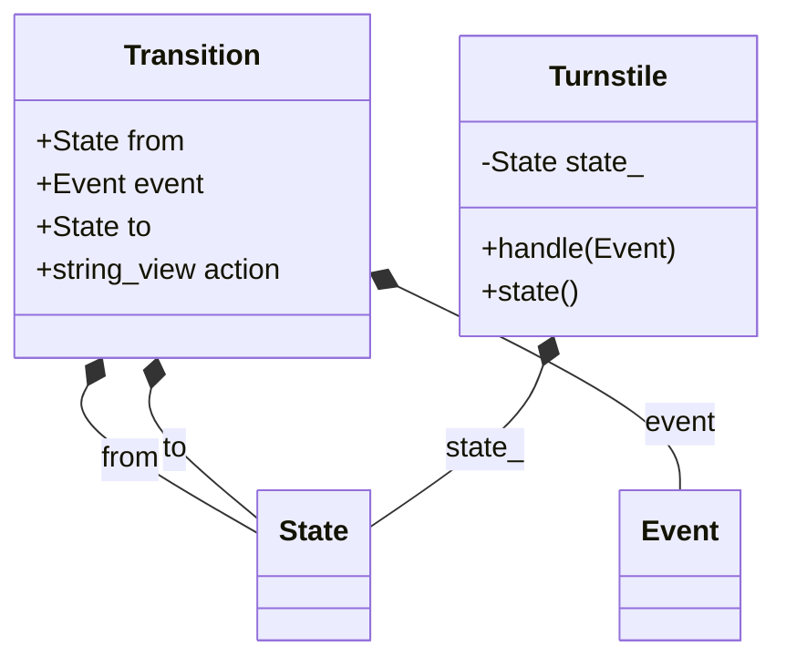

# State machine (table-driven) — `02_StateMachineExample`

> **Intent:** Describes the allowed transitions as data (current state, event, next state, action) instead of one class per state.

## Scenario

A turnstile is Locked or Unlocked. A coin unlocks it, a push lets one person pass and locks it again.

## Types in `main.cpp`

| Type | Role |
|---|---|
| `State` / `Event` | enums for the states and the inputs |
| `Transition` | one row of the table |
| `kTable` | the complete rule set as a `constexpr std::array` |
| `Turnstile` | the machine; looks up the row for (state, event) |

## The pattern in short

- Adding a rule means adding one row to the table.
- Combinations without a row are reported as "no rule".

**Use it when:** The behaviour is mostly about which transition is allowed, and the actions are small.

**Watch out:** If every state has a lot of its own logic, the object-per-state version (`01_StateExample`) is easier to maintain.

## Output

```text
Locked + Push -> Locked: stay locked
Locked + Coin -> Unlocked: unlock the arm
Unlocked + Coin -> Unlocked: keep the coin
Unlocked + Push -> Locked: let one person pass, lock again
final state: Locked
```

## Structure

Class diagram generated from the types in `main.cpp`. Arrows: `<|--` inheritance, `o--` the class holds a pointer, reference or container of the other, `*--` the class owns the other by value. `*` after a method = pure virtual, `$` = static.



## Build and run

`main.cpp` uses `std::println` (C++23, `<print>`): GCC 14+ or a recent Clang/MSVC with `<print>` in the standard library.

```bash
g++ -std=c++23 -Wall -Wextra main.cpp -o 02_StateMachineExample
./02_StateMachineExample
```

The included `CMakeLists.txt` also asks CMake to find Qt Core; `main.cpp` does not use Qt, so the plain `g++` command is enough.

## What was tested

Checked with GCC 13.3 and a small `<print>` stand-in header (GCC 13 has no `<print>`), so `std::println` itself was not compiled with a real GCC 14 library:

- Builds with `-std=c++23 -Wall -Wextra` without warnings.
- Runs to completion (exit code 0) and prints 5 lines.
- Clean under AddressSanitizer + UBSan (no errors, no leaks reported).
- Output identical between two runs.

## Not tested

- GCC 14 / the real `<print>`; MSVC; Apple Clang; Windows/macOS.
- The CMake build.

## Notes

This example was rewritten with its own scenario, class names and output. It follows the usual structure of the state machine (table-driven) pattern.
