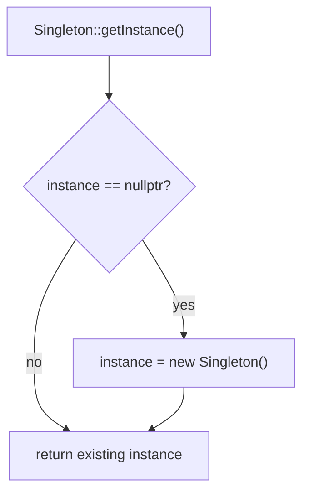

# Singleton — Naive version (NOT thread-safe)

A **Singleton** guarantees that a class has exactly one instance and gives global access to it.
This folder shows the simplest implementation — lazy creation with a raw pointer — and why it is a trap in
multithreaded code.

---

## How it works



Three ingredients make it a singleton:

| Ingredient | Code | Effect |
|-----------|------|--------|
| Private constructor | `private: Singleton()` | nobody outside the class can create one |
| Deleted copy operations | `Singleton(const Singleton&) = delete;` `operator=(...) = delete;` | no copies (declaring them also removes the implicit move operations) |
| Static accessor + static pointer | `static Singleton* instance;` `static Singleton* getInstance()` | one shared instance, created on first use ("lazy initialization") |

```cpp
Singleton* s1 = Singleton::getInstance();   // creates the instance
Singleton* s2 = Singleton::getInstance();   // returns the same one
// s1 == s2  -> true
```

Output of `main.cpp`:

```
Singleton instance created
Singleton is doing something
Singleton is doing something
Are s1 and s2 the same instance? Yes
```

Note what is **missing**: `Singleton instance destroyed` is never printed.

---

## Problem 1 — not thread-safe (data race)

```cpp
if (instance == nullptr) {        // thread A and thread B can both see nullptr here ...
    instance = new Singleton();   // ... and both construct an object
}
```

The check and the creation are not one atomic step, and `instance` is a plain pointer read and written by several threads without
synchronization: that is a **data race**, which is undefined behavior. Possible results: two (or more) objects are created,
different threads get different "singletons", one object leaks, or a thread sees a half-constructed object.

Tested: 8 threads call `getInstance()` at the same time and the constructor sleeps 20 ms (to make the race window wide):

| Variant | Constructions | Distinct pointers returned |
|---------|---------------|---------------------------|
| Naive (this folder) | **8** | **8** |
| Meyers singleton (function-local `static`) | 1 | 1 |
| `std::mutex` around the check | 1 | 1 |
| `std::call_once` | 1 | 1 |

ThreadSanitizer (`-fsanitize=thread`) reports `WARNING: ThreadSanitizer: data race ... in S::get()` for the naive version and nothing for the Meyers one.

The sleep only makes the bug *visible*. Without it the race still exists, but the program may work for thousands of runs and then fail — that is
what makes this bug dangerous. `main.cpp` itself is single-threaded, so it always behaves correctly.

---

## Problem 2 — the instance is never destroyed

`new Singleton()` is never matched by a `delete`, so the destructor never runs (`Singleton instance destroyed` is not printed).
For this empty class that is harmless, but a singleton that owns a file, a socket, or flushes a log in its destructor would lose that work.

Note that tools may stay quiet: AddressSanitizer's leak checker does **not** report it (tested), because the memory is still reachable through the
static pointer when the program exits — it is a "still reachable" block, not a classic leak.

## Problem 3 — anyone can delete it

The destructor is `public`, so this compiles:

```cpp
delete Singleton::getInstance();      // legal!
Singleton* again = Singleton::getInstance();   // returns the same, now dangling, pointer (tested: pointers equal)
```

Any use of the dangling pointer is undefined behavior. Make the destructor private (and provide a controlled shutdown) if the lifetime matters.

## Problem 4 — raw pointer interface

`getInstance()` returns a pointer, so callers can store it, compare it with `nullptr`, or delete it. Returning a reference (`Singleton&`) expresses
"always valid, not owned by you".

---

## Fixes (overview — each its own lesson)

**Meyers singleton** — the simplest and usually the best. Since C++11 initialization of a function-local `static` is guaranteed to happen exactly once, even when several threads
arrive at the same time:

```cpp
static Singleton& getInstance() {
    static Singleton instance;     // created on first call, thread-safe, destroyed at program exit
    return instance;
}
```

Tested: 1 construction with 8 threads. It is also destroyed automatically: output order was `main start`, `created`, `main end`, `destroyed`.

**`std::mutex`** — lock around the whole check-and-create (every call pays for the lock):

```cpp
static Singleton* getInstance() {
    std::lock_guard<std::mutex> lock(m);
    if (!instance) instance = new Singleton();
    return instance;
}
```

**`std::call_once`** — runs the initializer exactly once, even if several threads arrive together:

```cpp
static std::once_flag flag;
std::call_once(flag, [] { instance = new Singleton(); });
```

Both the mutex and the `call_once` version were tested with 8 threads: 1 construction, 1 distinct pointer.

---

## When (not) to use a Singleton

✅ Truly one-per-process resources that are needed everywhere (a logger, a configuration registry)

❌ As a convenient global variable — hidden dependencies make code hard to test (you cannot easily replace it with a mock)
❌ When the instance may need to be created more than once later (tests, multiple configurations)
❌ In code that runs in several threads, unless it uses one of the thread-safe versions above

---

## Notes moved from main.cpp

- `main.cpp` uses `std::println` instead of `std::cout`/`std::endl` and has no other standard names, so no `using namespace std;` is needed.
- The description comment block (it used to sit inside the class, above the constructor) is now the title block at the top of the file; its text is unchanged.
- The closing comment about the memory leak ("we never delete the instance ...") moved here (Problem 2).
- The output is identical to the original (`diff` shows no difference).

## What was tested

GCC 13.3, `-std=c++23 -Wall -Wextra -Wshadow -fsanitize=address,undefined`, with a small test-only `<print>` shim (GCC 13 has no `<print>`): clean build, output identical to
the original. Separately run: the 8-thread race harness for the four variants (above), ThreadSanitizer on the naive and Meyers versions, `delete getInstance()`
followed by another `getInstance()`, the Meyers singleton's creation and destruction order, and that LeakSanitizer stays silent for the naive version.

## Not tested

- Double-checked locking with a plain pointer or `std::atomic` (not shown here; the plain-pointer form is another data race).
- Behavior with other compilers / real `<print>` from GCC 14+.
- Static destruction order problems between several singletons that use each other at exit.
