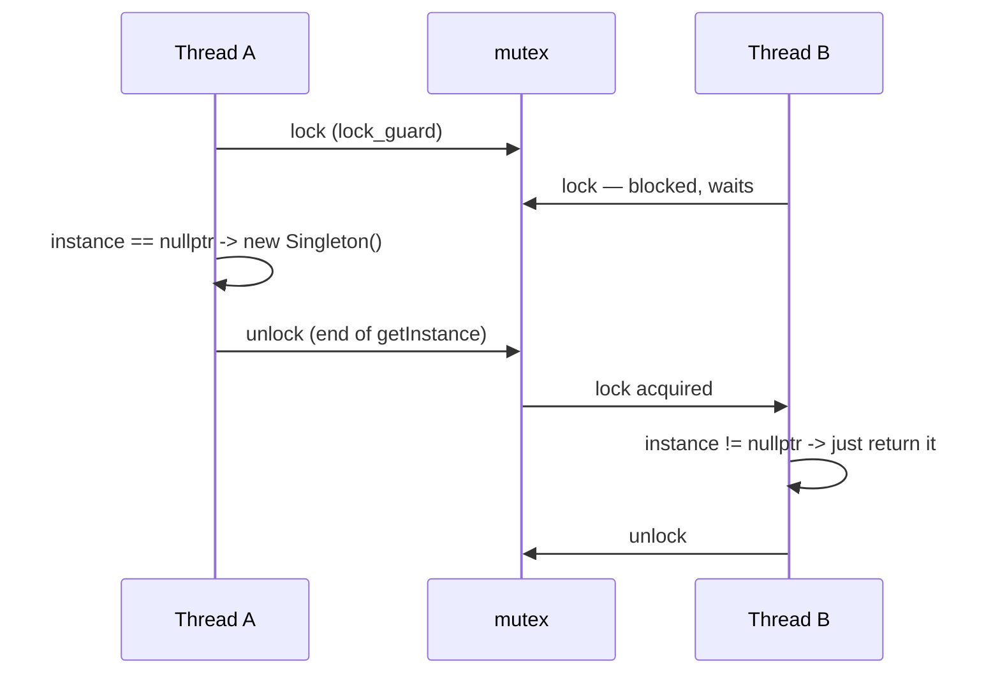

# Singleton — Thread-safe with `std::lock_guard`

The naive Singleton (check `instance == nullptr`, then `new`) has a data race when several threads call `getInstance()` at once.
This version fixes it with the most direct tool: a **mutex** around the whole check-and-create.

---

## How it works



```cpp
static Singleton* getInstance() {
    std::lock_guard<std::mutex> lock(mtx);   // locks on EVERY call
    if (instance == nullptr) {
        instance = new Singleton();
    }
    return instance;                          // lock released here (destructor of lock_guard)
}
```

- `std::lock_guard` is RAII: the mutex is unlocked when `lock` goes out of scope, also if the constructor throws.
- Because the check and the creation happen under the lock, exactly one thread creates the object; all later callers see
  `instance != nullptr`. The mutex also makes the write to `instance` visible to the other threads (no data race).
- The mutex is a `static std::mutex`; its constructor is `constexpr`, so it is initialized before any code runs (standard guarantee).

Output of `main.cpp` (3 threads, then the main thread):

```
Singleton instance created
Singleton is doing something, thread: <id>
Singleton is doing something, thread: <id>
Singleton is doing something, thread: <id>
Same instance? Yes
```

"created" appears exactly once. The order of the three "doing something" lines and the thread ids change from run to run.
`Singleton instance destroyed` is never printed — the instance is never deleted (see below).

---

## Tested: it really is safe

Same harness as the naive version: 8 threads call `getInstance()` simultaneously while the constructor sleeps 20 ms to widen the race window.

| Variant | Constructions | Distinct pointers |
|---------|---------------|-------------------|
| Naive (no lock) | 8 | 8 |
| **This version (mutex)** | **1** | **1** |

`main.cpp` also ran three times under ThreadSanitizer (`-fsanitize=thread`) with no report.

---

## The price: every call locks

After the object exists, each `getInstance()` still takes and releases the mutex, although nothing can change any more.

One noisy sandbox run (GCC 13.3, `-O2`, a 2-core machine, 2 000 000 calls per thread; an empty asm barrier keeps the compiler from deleting the loop):

| Threads | mutex version | Meyers singleton |
|---------|---------------|------------------|
| 1 | about 35 ms (≈ 18 ns per call) | under 1 ms |
| 4 | about 540 ms | about 2 ms |

Uncontended it is cheap but not free; with several threads hammering `getInstance()` the threads queue up on the mutex. Your numbers will differ —
measure your own case. This is the "locks on EVERY call" cost mentioned in the code comment.

---

## Pitfalls

**1. Re-entrance deadlock.** `std::mutex` is not recursive. If the constructor (or anything it calls) calls `getInstance()` again, the same thread
tries to lock a mutex it already holds. Standard: undefined behavior. Tested on glibc: the program hangs (killed by `timeout` after 3 s).

**2. Everybody waits during construction.** The lock is held while `new Singleton()` runs, so a slow constructor blocks all other callers (intended — they need the instance anyway).

**3. The instance is never destroyed.** `new` without `delete`: the destructor never runs (no "destroyed" line). Harmless for this empty class, a problem if the destructor
should flush or close something. LeakSanitizer does not flag it, because the pointer is still reachable through the static member.

**4. Public destructor and raw pointer.** `delete Singleton::getInstance();` compiles and leaves a dangling `instance`; returning `Singleton&` and making the destructor private would prevent that.

---

## Where this fits in the series

| Version | Thread-safe? | Cost per call | Notes |
|---------|--------------|---------------|-------|
| Naive | no | none | data race, several objects possible |
| **Mutex + lock_guard (this folder)** | yes | one lock/unlock every call | simple, obviously correct |
| Double-checked locking | yes, *if* done with atomics | lock only while creating | easy to get wrong (not shown or tested here) |
| Meyers (function-local `static`) | yes (C++11) | a cheap "already initialized?" check | recommended; also destroyed at exit |

```cpp
static Singleton& getInstance() {
    static Singleton instance;      // thread-safe initialization guaranteed since C++11
    return instance;
}
```

Double-checked locking with a plain `Singleton*` is itself a data race (the unlocked first read races with the write); a correct version needs `std::atomic`
with acquire/release ordering, which is why the Meyers singleton is the preferred way — that reasoning is standard-based, the code here does not test it.

---

## Notes moved from main.cpp

- `main.cpp` uses `std::println` and `std::` everywhere (no `using namespace std;`, no `std::cout`).
- The doc comment at the top of the file (title block) is unchanged.
- **Thread id printing:** `std::println("{}", std::this_thread::get_id())` fails to compile on GCC 13 (`std::formatter must be specialized for each type being formatted`);
  formatting `std::thread::id` is a newer C++23 addition. `main.cpp` therefore converts the id with a small `std::ostringstream` helper, which works with every compiler.
- `std::println` formats the whole line first and writes it in one go, so the three threads' lines do not get mixed up inside a line the way
  `cout << a << b << c` chains can. (That is the standard's design; here it was only exercised with a stand-in header, not the real GCC 14 `<print>`.)
- Output is otherwise identical to the original, apart from the order of the three thread lines and the thread ids, which are non-deterministic.

## What was tested

GCC 13.3, `-std=c++23 -Wall -Wextra -Wshadow -pthread`, with ThreadSanitizer (3 runs, clean), using a small test-only `<print>` shim (GCC 13 has no `<print>`).
Output compared with the original after masking thread ids and sorting lines. Separately: the 8-thread construction-count harness (naive vs mutex),
the re-entrance hang (3 s timeout), the single/4-thread call-cost measurement, and the `thread::id` formatter compile error.

## Not tested

- Real `<print>` from GCC 14+ (including whether it prints `thread::id` directly and whether lines can interleave).
- Double-checked locking implementations.
- Timing on machines other than this 2-core sandbox.
