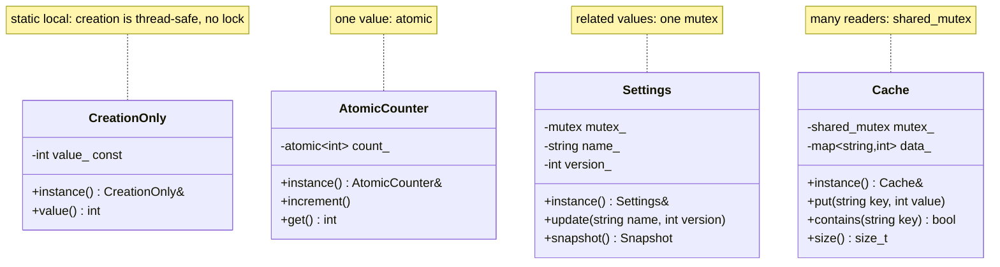
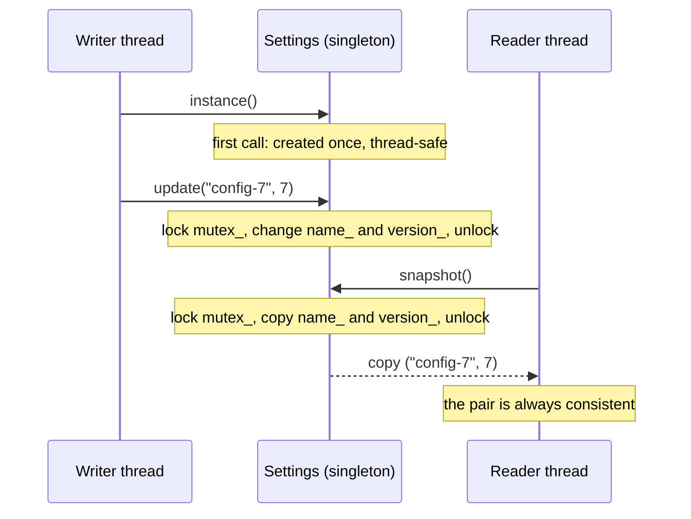

# Meyers' Singleton with Data: When Do You Need a Mutex?

> **Intent:** Show what the `static` local variable of Meyers' Singleton protects (the creation) and what it does not protect (the data inside the object), and when each kind of lock is the right tool.

## Problem

`05_MeyersSingleton` shows that a `static` local variable is created exactly once, even if many threads call `instance()` at the same moment. Since C++11 the compiler adds the synchronisation for that. You write no mutex.

That guarantee covers **only the creation**. As soon as the object has data that threads change, those changes are an ordinary shared-memory problem:

```cpp
class Counter {
public:
    static Counter& instance() { static Counter c; return c; }   // creation: safe
    void increment() { ++count_; }                               // data: NOT safe
private:
    Counter() = default;
    int count_ = 0;
};
```

With 4 threads that each call `increment()` 1000 times, the result should be 4000. In three test runs the program printed **3000, 3000 and 4000**, and ThreadSanitizer reported a data race every time. Updates get lost because `++count_` is a read, an add and a write, and two threads can interleave them. A data race is undefined behaviour, so the program is wrong even in the run that printed 4000.

**Rule: protect the data, not the singleton.**

## Do I need a mutex?

| Situation | What to use | Why |
|---|---|---|
| Only the creation is shared, nobody changes data afterwards | nothing | the static local variable is enough |
| Data is set in the constructor and only read afterwards | nothing, make it `const` | many threads may read unchanging data |
| One independent value is written by several threads (counter, flag) | `std::atomic` | one indivisible operation, no lock needed |
| Several values must change together and stay consistent | `std::mutex` | an atomic per field does not make the pair consistent |
| Many readers, rare writers | `std::shared_mutex` | readers do not block each other |
| Only one thread ever uses the data | nothing, or `thread_local` | no sharing, no problem |

### When you do NOT need a mutex

- The object is **immutable** after construction. This is the best case. Make the members `const` and nothing can go wrong.
- You only need **one number** that threads add to or read. `std::atomic<int>` does it without a lock.
- The data is **not shared**: each thread works on its own copy.

### When you DO need a mutex

- **Two or more values belong together.** In example 3 the name and the version must always match. Two separate atomics could still be read in the middle of an update. One lock around both changes keeps them consistent.
- The operation is **more than one step** on shared state: check then change, read then write back, insert into a container.
- The data is a **container** (`std::map`, `std::vector`, `std::string`). Their internals are not safe against concurrent writes.

### Choosing between the tools

```text
Is the data changed after construction?
 |-- no  --> make it const, no lock
 `-- yes --> Is it one single value?
              |-- yes --> std::atomic
              `-- no  --> Are there many more reads than writes?
                           |-- yes --> std::shared_mutex
                           `-- no  --> std::mutex
```

## Structure



Every class has a private constructor and deleted copy operations, and `instance()` returns a reference to a `static` local variable (Meyers' Singleton). The classes differ only in how the data inside is protected.

## Sequence: a writer, a reader and the lock



## Examples

| # | Example | What it shows |
|---|---|---|
| 1 | Creation only | 4 threads call `instance()`, the constructor runs exactly once, no mutex written |
| 2 | Atomic counter | 4 threads x 1000 increments give exactly 4000 |
| 3 | Mutex for related values | one writer and two readers: the readers never see a name that does not match the version |
| 4 | Shared mutex | one writer inserts 100 keys while three readers look them up |

### Details

- **Banner.** The helper `printBanner(title)` draws the box around each example title. It counts the title length, so the box always fits (ASCII titles only).
- **Example 1.** The constructor sleeps for 20 ms, so the other threads really have to wait for it. The counter `g_constructions` shows that it ran once. `value_` is `const`, so the reads need no lock.
- **Example 2.** `fetch_add` is one indivisible step. Compare with the broken version above.
- **Example 3.** `update()` changes both fields under one lock. `snapshot()` returns a **copy** under the same lock, so the caller works on a consistent value and holds no lock while using it. Handing out a reference to `name_` would let the caller read it without the lock.
- **Example 4.** `put()` takes a `unique_lock` (exclusive). `contains()` and `size()` take a `shared_lock` (many at once).

## Pitfalls

- **The creation guarantee is not a data guarantee.** This is the most common mistake with Meyers' Singleton.
- **Do not return references or pointers to protected data.** The caller then uses them without the lock. Return a copy or offer methods that do the work inside the lock.
- **Do not lock in the callers.** Put the lock inside the singleton's methods, so nobody can forget it.
- **Do not call a locking method from another locking method of the same object** with a plain `std::mutex`. That deadlocks. Use a private method that assumes the lock is held (see `04_ConcurrencyPatterns/12_ThreadSafeInterface`).
- **Two atomics are not one consistent pair.** Use a mutex when values belong together.
- **Destruction order at program exit.** The instance is destroyed in reverse order of construction. A static object that uses the singleton in its destructor may use an object that is already gone.
- **A global mutable object is global state.** It is hard to test. For real code, consider creating the object in `main` and passing it where it is needed.

## Related

- `05_MeyersSingleton`: the creation-only version this example builds on.
- `02_ThreadSafeSignleton`: locks a mutex on every `getInstance()` call. Slower, and it protects only the creation.
- `04_DoubleCheckedSingleton`: tries to avoid that cost by hand and is easy to get wrong.
- `07_DesignPatterns/04_ConcurrencyPatterns/08_MonitorObject` and `12_ThreadSafeInterface`: the object that holds its own lock.
- `04_ConcurrencyPatterns/04_ReaderWriterLock`: the `shared_mutex` idea in detail.

## Build and run

```bash
g++ -std=c++23 -Wall -Wextra -pthread main.cpp -o meyers_data
./meyers_data
```

With CMake:

```bash
cmake -S . -B build
cmake --build build
./build/meyers_data
```

To check for data races:

```bash
g++ -std=c++23 -Wall -Wextra -pthread -fsanitize=thread -g main.cpp -o meyers_data_tsan
./meyers_data_tsan
```

## Output

```text
╔══════════════════════════╗
║ EXAMPLE 1: CREATION ONLY ║
╚══════════════════════════╝
constructor ran 1 time(s)
values seen by the 4 threads: 42 42 42 42

╔═══════════════════════════╗
║ EXAMPLE 2: ATOMIC COUNTER ║
╚═══════════════════════════╝
4 threads x 1000 increments = 4000

╔═════════════════════════════════════╗
║ EXAMPLE 3: MUTEX FOR RELATED VALUES ║
╚═════════════════════════════════════╝
inconsistent snapshots seen by the readers: 0
final state: config-1000 / version 1000

╔═════════════════════════╗
║ EXAMPLE 4: SHARED MUTEX ║
╚═════════════════════════╝
entries in the cache: 100
contains key99: true
```

## Tested

- GCC 15.2.0, `-std=c++23 -Wall -Wextra -pthread`: no warnings (also with `-O2`).
- ThreadSanitizer: no reports in 3 runs. AddressSanitizer and UBSan: no reports.
- The output was identical in all runs.
- The broken counter shown under "Problem" was built separately with ThreadSanitizer: 2 data race reports in each of 3 runs, and the printed result was 3000, 3000 and 4000.
- Not tested with Clang or MSVC.

## Reference

- `<atomic>`: `std::atomic` (C++11).
- `<mutex>`: `std::mutex`, `std::lock_guard` (C++11).
- `<shared_mutex>`: `std::shared_mutex` (C++17), `std::shared_lock` and `std::unique_lock` (C++14 / C++11).
- Thread-safe initialisation of function-local statics: C++11.
- `std::println` from `<print>`: C++23.
- `std::string_view` from `<string_view>`: C++17 (used by `printBanner`).
