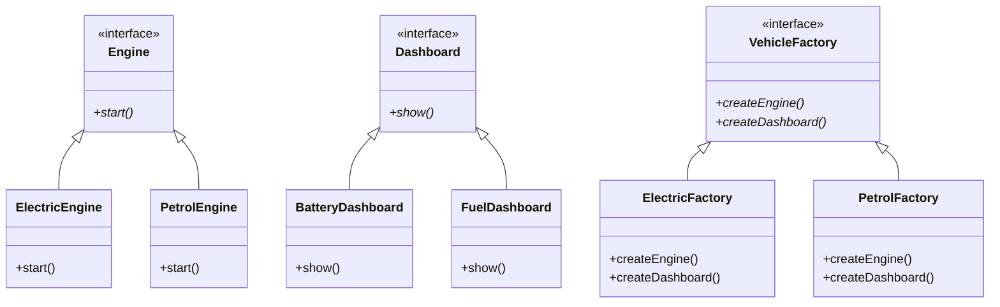

# Abstract Factory — `02_AbstractFactoryExample`

> **Intent:** Creates families of related objects without naming their concrete classes in the client code.

## Scenario

Electric and petrol cars each need a matching engine and dashboard. A factory creates the whole matching family.

## Types in `main.cpp`

| Type | Role |
|---|---|
| `Engine` / `Dashboard` | abstract products |
| `ElectricEngine` / `BatteryDashboard` / `PetrolEngine` / `FuelDashboard` | concrete products of the two families |
| `VehicleFactory` | abstract factory |
| `ElectricFactory` / `PetrolFactory` | concrete factories |

## The pattern in short

- The client function `assemble()` gets a factory and can never mix products of different families.
- Adding a third family means one new factory plus its products.

**Use it when:** The code must work with several families of products that belong together.

**Watch out:** Adding a new kind of product (for example a gearbox) means changing the factory interface and every factory.

## Output

```text
electric car:
  engine:    silent start, battery at 100%
  dashboard: range in km, charging state
petrol car:
  engine:    starter turns, engine rumbles
  dashboard: fuel level, revolutions per minute
```

## Structure

Class diagram generated from the types in `main.cpp`. Arrows: `<|--` inheritance, `o--` the class holds a pointer, reference or container of the other, `*--` the class owns the other by value. `*` after a method = pure virtual, `$` = static.



## Build and run

`main.cpp` uses `std::println` (C++23, `<print>`): GCC 14+ or a recent Clang/MSVC with `<print>` in the standard library.

```bash
g++ -std=c++23 -Wall -Wextra main.cpp -o 02_AbstractFactoryExample
./02_AbstractFactoryExample
```

The included `CMakeLists.txt` also asks CMake to find Qt Core; `main.cpp` does not use Qt, so the plain `g++` command is enough.

## What was tested

Checked with GCC 13.3 and a small `<print>` stand-in header (GCC 13 has no `<print>`), so `std::println` itself was not compiled with a real GCC 14 library:

- Builds with `-std=c++23 -Wall -Wextra` without warnings.
- Runs to completion (exit code 0) and prints 6 lines.
- Clean under AddressSanitizer + UBSan (no errors, no leaks reported).
- Output identical between two runs.

## Not tested

- GCC 14 / the real `<print>`; MSVC; Apple Clang; Windows/macOS.
- The CMake build.

## Notes

This example was rewritten with its own scenario, class names and output. It follows the usual structure of the abstract factory pattern.
