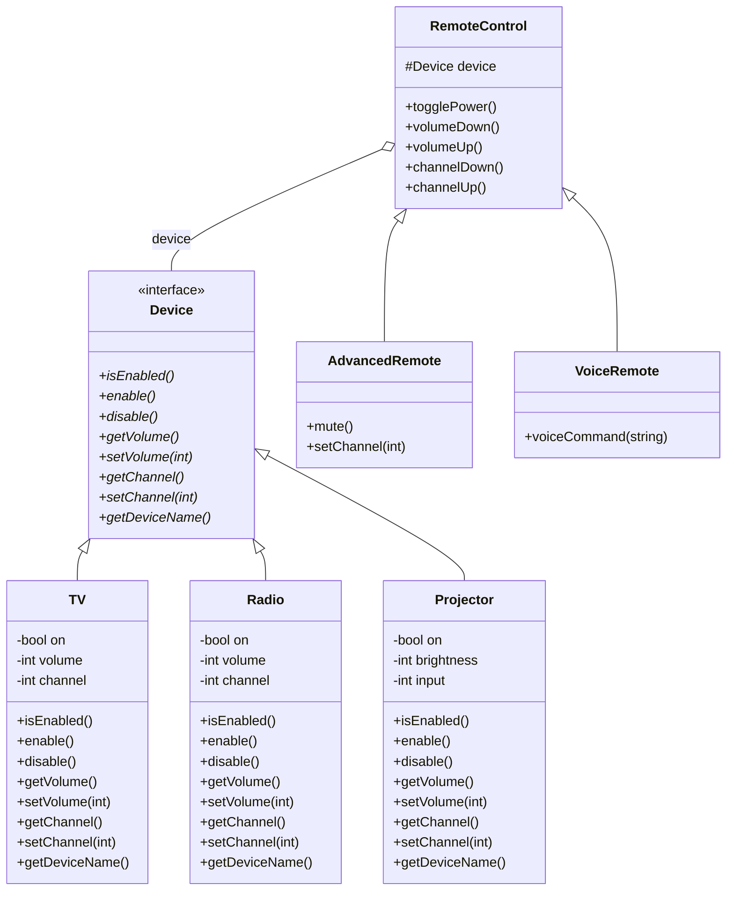
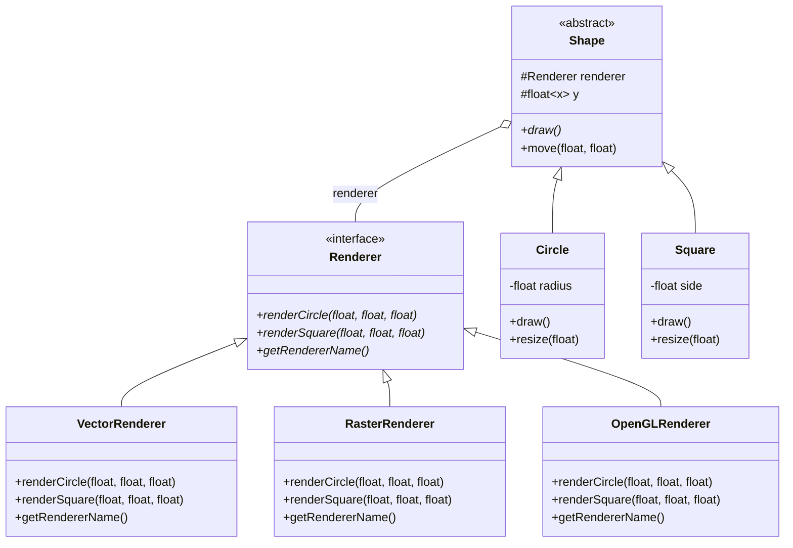
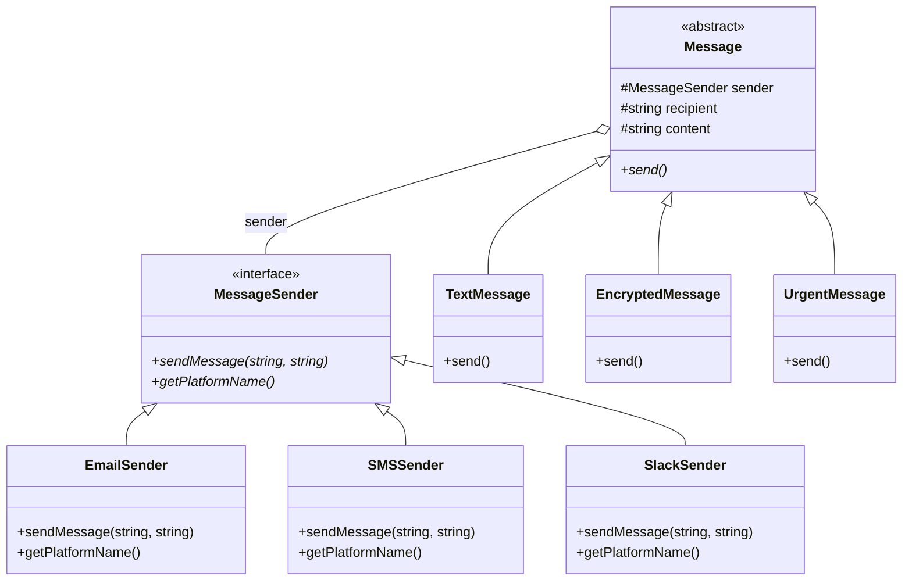

# Bridge — `02_Bridge`

> **Intent:** Splits an abstraction from its implementation so both can vary independently.

## What this example contains

Sections in `main.cpp`:

- EXAMPLE 1: DEVICE & REMOTE CONTROL
- EXAMPLE 2: SHAPE & RENDERING
- EXAMPLE 3: MESSAGE SENDER
- CLIENT CODE & DEMONSTRATIONS
- MAIN - DEMONSTRATING THE PATTERN
- Benefits Summary

Types defined in `main.cpp`:

| Type | Derives from |
|---|---|
| `Device` | — |
| `TV` | `Device` |
| `Radio` | `Device` |
| `Projector` | `Device` |
| `RemoteControl` | — |
| `AdvancedRemote` | `RemoteControl` |
| `VoiceRemote` | `RemoteControl` |
| `Renderer` | — |
| `VectorRenderer` | `Renderer` |
| `RasterRenderer` | `Renderer` |
| `OpenGLRenderer` | `Renderer` |
| `Shape` | — |
| `Circle` | `Shape` |
| `Square` | `Shape` |
| `MessageSender` | — |
| `EmailSender` | `MessageSender` |
| `SMSSender` | `MessageSender` |
| `SlackSender` | `MessageSender` |
| `Message` | — |
| `TextMessage` | `Message` |
| `EncryptedMessage` | `Message` |
| `UrgentMessage` | `Message` |

## The pattern in short

- An abstraction that holds a pointer to an implementor.
- An implementor interface and its concrete variants.
- Refined abstractions.

**Use it when:** You would otherwise get a class explosion from combining two independent dimensions.

**Watch out:** Needs the split to be designed up front; for one dimension plain inheritance is enough.

## Structure

Class diagram generated from the types in `main.cpp`. Arrows: `<|--` inheritance, `o--` the class holds a pointer, reference or container of the other, `*--` the class owns the other by value. `*` after a method = pure virtual, `$` = static.

### Example 1: Device & Remote Control



### Example 2: Shape & Rendering



### Example 3: Message Sender



## Sample output (first lines)

```text
========================================
BRIDGE PATTERN DEMO
========================================

╔════════════════════════════════════╗
║  EXAMPLE 1: REMOTE & DEVICE        ║
╚════════════════════════════════════╝

--- Basic Remote with TV ---

🎮 Remote: Toggle power button pressed
📺 TV: Turning ON
🎮 Remote: Volume up button pressed
📺 TV: Volume set to 40%
```

## Build and run

`main.cpp` uses `std::println` (C++23, `<print>`), so you need GCC 14+ or a recent Clang/MSVC with a standard library that ships `<print>`.

```bash
g++ -std=c++23 -Wall -Wextra main.cpp -o 02_Bridge
./02_Bridge
```

The included `CMakeLists.txt` sets C++23 but also asks CMake to find Qt Core. `main.cpp` itself does not use Qt, so the plain `g++` command above is enough.

## What was tested

Checked with GCC 13.3 using a small `<print>` stand-in header (GCC 13 has no `<print>`), so `std::println` itself was not compiled with a real GCC 14 library:

- Builds with `-std=c++23 -Wall -Wextra`: 2 warning(s) (-Wunused-parameter). They come from the original code and were left as they were.
- Runs to completion (exit code 0) and prints 177 lines.
- Clean under AddressSanitizer + UBSan (no errors, no leaks reported).
- Output is identical between two consecutive runs.
- The output of the `std::cout` → `std::println` conversion matched the original. Afterwards the lecture text that `main()` used to print was moved into *Notes moved from main.cpp* below. I compared the output before and after that move: the only difference is that the moved lines are no longer printed (values that change on every run, such as addresses, thread ids or timings, were ignored).

## Not tested

- Behaviour on Windows/macOS or with MSVC/Apple Clang.
- The CMake build (Qt is not installed in the sandbox).

## Changes made to `main.cpp`

- `std::cout` replaced by `std::println` / `std::print`; no `"\n"` at line ends, `std::println("")` for blank lines.
- `using namespace std;` removed; standard names are written with `std::`.

## Notes moved from main.cpp

This text used to be printed by `main()`. It is lecture material, so it lives here and the program only prints the demo output.

### BENEFITS OF BRIDGE PATTERN

- ✅ Decouples abstraction from implementation
- ✅ Both can vary independently
- ✅ Improves extensibility (add abstractions/implementations)
- ✅ Hides implementation details from client
- ✅ Open/Closed Principle (open for extension)
- ✅ Single Responsibility (separate concerns)
- ✅ Can switch implementations at runtime

### WHEN TO USE BRIDGE

1. Avoid permanent binding between abstraction/implementation
2. Both should be extensible by subclassing
3. Changes in implementation shouldn't affect clients
4. Share implementation among multiple objects
5. Prevent class explosion from combinations
6. Switch implementations at runtime

### BRIDGE vs ADAPTER

**Bridge:**

- Designed upfront
- Lets abstraction and implementation vary independently
- Works with new code
- Intent: Separation of concerns

**Adapter:**

- Used after design (retrofit)
- Makes incompatible interfaces work together
- Works with existing code
- Intent: Interface compatibility

### STRUCTURE

**Abstraction Hierarchy:**

Abstraction (has-a Implementation)  
└── RefinedAbstraction1  
└── RefinedAbstraction2

**Implementation Hierarchy:**

Implementation (interface)  
└── ConcreteImplementation1  
└── ConcreteImplementation2

```cpp
Bridge = Connection between hierarchies
```

### REAL-WORLD EXAMPLES (closing summary)

- GUI frameworks (Window ←→ OS)
- Graphics (Shape ←→ Renderer)
- Database (API ←→ Driver)
- Remote controls (Remote ←→ Device)
- Messaging (Message ←→ Platform)
- Vehicles (Car ←→ Engine)
- Persistence (Object ←→ Storage)
