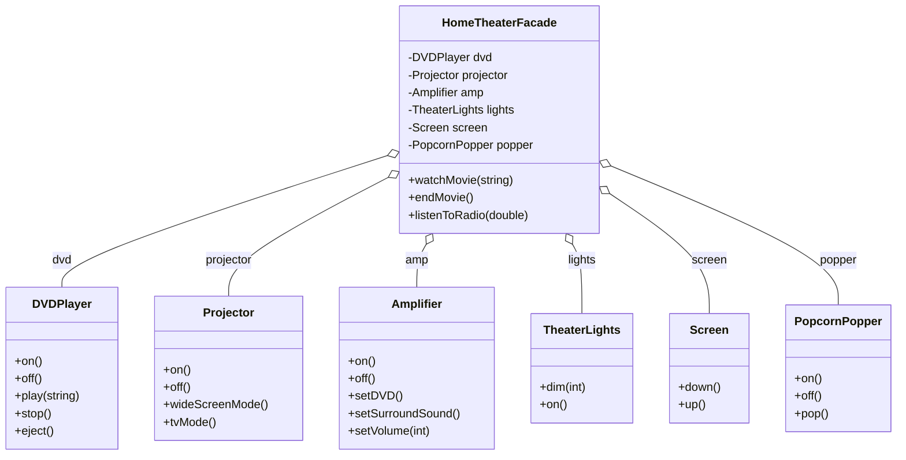
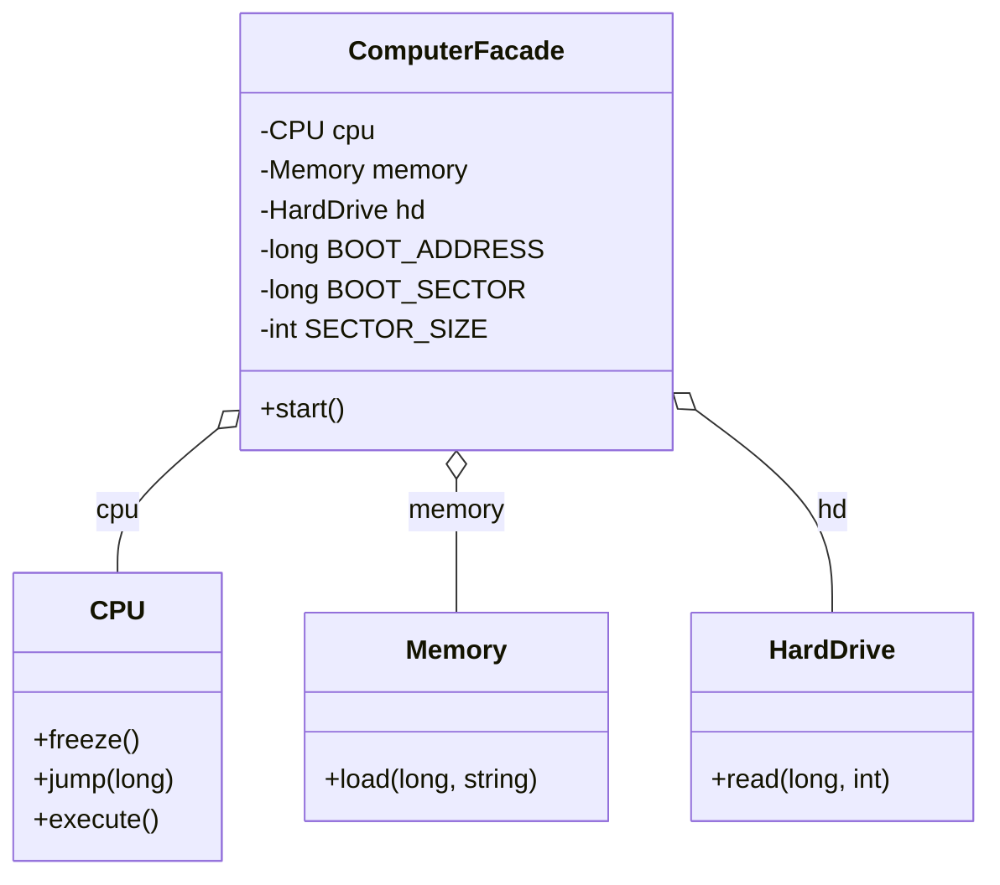
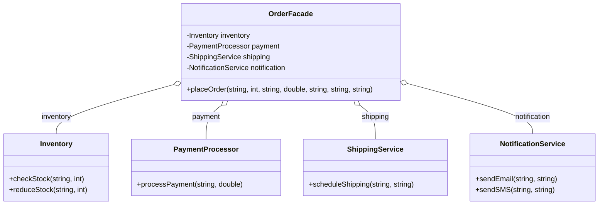
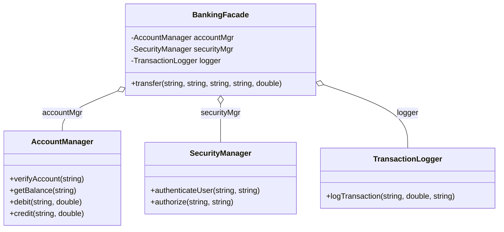
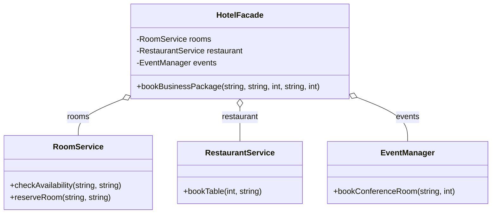

# Facade — `03_Facade`

> **Intent:** Provides one simple interface to a complex subsystem.

## What this example contains

Sections in `main.cpp`:

- EXAMPLE 1: HOME THEATER SYSTEM
- EXAMPLE 2: COMPUTER SYSTEM
- EXAMPLE 3: ONLINE SHOPPING
- EXAMPLE 4: BANK OPERATIONS
- EXAMPLE 5: HOTEL BOOKING
- CLIENT CODE & DEMONSTRATIONS
- MAIN - DEMONSTRATING THE PATTERN
- Benefits Summary

Types defined in `main.cpp`:

| Type | Derives from |
|---|---|
| `DVDPlayer` | — |
| `Projector` | — |
| `Amplifier` | — |
| `TheaterLights` | — |
| `Screen` | — |
| `PopcornPopper` | — |
| `HomeTheaterFacade` | — |
| `CPU` | — |
| `Memory` | — |
| `HardDrive` | — |
| `ComputerFacade` | — |
| `Inventory` | — |
| `PaymentProcessor` | — |
| `ShippingService` | — |
| `NotificationService` | — |
| `OrderFacade` | — |
| `AccountManager` | — |
| `SecurityManager` | — |
| `TransactionLogger` | — |
| `BankingFacade` | — |
| `RoomService` | — |
| `RestaurantService` | — |
| `EventManager` | — |
| `HotelFacade` | — |

## The pattern in short

- Subsystem classes.
- A facade that coordinates them behind a few simple calls.

**Use it when:** Clients should not need to know the details or the call order of a subsystem.

**Watch out:** The facade can turn into a god class; the subsystem classes should stay usable directly.

## Structure

Class diagram generated from the types in `main.cpp`. Arrows: `<|--` inheritance, `o--` the class holds a pointer, reference or container of the other, `*--` the class owns the other by value. `*` after a method = pure virtual, `$` = static.

### Example 1: Home Theater System



### Example 2: Computer System



### Example 3: Online Shopping



### Example 4: Bank Operations



### Example 5: Hotel Booking



## Sample output (first lines)

```text
========================================
FACADE PATTERN DEMO
========================================

╔════════════════════════════════════╗
║  EXAMPLE 1: HOME THEATER           ║
╚════════════════════════════════════╝

🎥 Get ready to watch a movie...
━━━━━━━━━━━━━━━━━━━━━━━━━━━━━━━━
🍿 Popcorn Maker: Turning ON
🍿 Popcorn Maker: Popping popcorn!
💡 Lights: Dimming to 10%
🎬 Screen: Going DOWN
```

## Build and run

`main.cpp` uses `std::println` (C++23, `<print>`), so you need GCC 14+ or a recent Clang/MSVC with a standard library that ships `<print>`.

```bash
g++ -std=c++23 -Wall -Wextra main.cpp -o 03_Facade
./03_Facade
```

The included `CMakeLists.txt` sets C++23 but also asks CMake to find Qt Core. `main.cpp` itself does not use Qt, so the plain `g++` command above is enough.

## What was tested

Checked with GCC 13.3 using a small `<print>` stand-in header (GCC 13 has no `<print>`), so `std::println` itself was not compiled with a real GCC 14 library:

- Builds with `-std=c++23 -Wall -Wextra`: 2 warning(s) (-Wunused-parameter). They come from the original code and were left as they were.
- Runs to completion (exit code 0) and prints 220 lines.
- Clean under AddressSanitizer + UBSan (no errors, no leaks reported).
- Output is identical between two consecutive runs.
- The output of the `std::cout` → `std::println` conversion matched the original. Afterwards the lecture text that `main()` used to print was moved into *Notes moved from main.cpp* below. I compared the output before and after that move: the only difference is that the moved lines are no longer printed (values that change on every run, such as addresses, thread ids or timings, were ignored).

## Not tested

- Behaviour on Windows/macOS or with MSVC/Apple Clang.
- The CMake build (Qt is not installed in the sandbox).

## Changes made to `main.cpp`

- `std::cout` replaced by `std::println` / `std::print`; no `"\n"` at line ends, `std::println("")` for blank lines.
- `using namespace std;` removed; standard names are written with `std::`.

## Notes moved from main.cpp

This text used to be printed by `main()`. It is lecture material, so it lives here and the program only prints the demo output.

### BENEFITS OF FACADE PATTERN

- ✅ Simplifies complex subsystem
- ✅ Reduces dependencies on subsystem
- ✅ Provides single entry point
- ✅ Decouples client from subsystem
- ✅ Promotes loose coupling
- ✅ Makes subsystem easier to use
- ✅ Layers the system architecture

### WHEN TO USE FACADE

1. Provide simple interface to complex subsystem
2. Many dependencies between clients and subsystem
3. Want to layer subsystems
4. Decouple subsystem from clients
5. Wrap poorly designed APIs
6. Reduce complexity for clients

### STRUCTURE

Client  
↓ (uses simple interface)  
Facade  
↓ (delegates to)  
Subsystem Classes

- Component1
- Component2
- Component3
- ...

### FACADE vs OTHER PATTERNS

**Facade:**

- Simplifies interface
- Single entry point
- Hides complexity

**Adapter:**

- Converts interface
- Makes compatible
- Usually one-to-one

**Decorator:**

- Adds responsibilities
- Wraps objects
- Same interface

**Proxy:**

- Controls access
- Same interface
- Adds control layer

### WITHOUT FACADE (Complex)

```cpp
// Client code without facade:
popper->on();
popper->pop();
lights->dim(10);
screen->down();
projector->on();
projector->wideScreenMode();
amp->on();
amp->setDVD();
amp->setSurroundSound();
amp->setVolume(5);
dvd->on();
dvd->play(movie);
// 12 lines of complex code!
```

### WITH FACADE (Simple)

```cpp
// Client code with facade:
homeTheater.watchMovie("Inception");
// 1 line - simple!
```

### KEY POINTS

- Facade doesn't prevent access to subsystem
- Clients can still use subsystem directly if needed
- Facade adds no new functionality
- Facade only provides convenient interface
- Can have multiple facades for same subsystem
- Facade can be coupled to multiple subsystems

### REAL-WORLD EXAMPLES (closing summary)

- Home theater systems (watchMovie)
- Computer startup (complex boot sequence)
- Online shopping (order processing)
- Banking operations (money transfer)
- Compiler facade (compile, link, execute)
- Database access (connection pooling)
- Web frameworks (routing, middleware)
- Library APIs (simplified interfaces)
