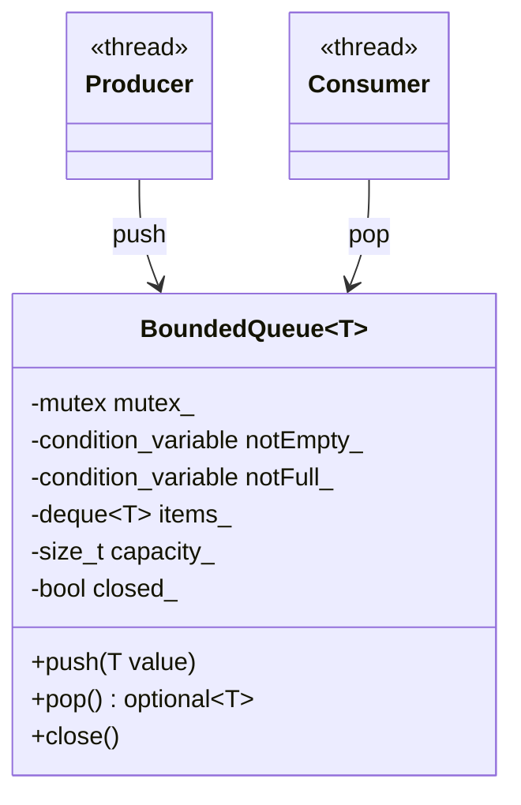
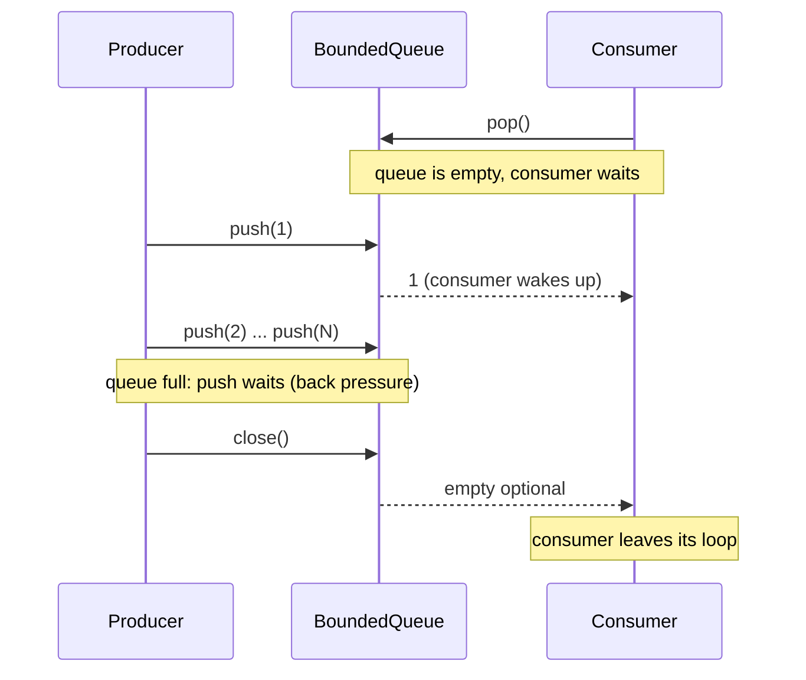

# Producer-Consumer

> **Intent:** Separate the code that creates work (producers) from the code that processes it (consumers) with a shared queue, so both sides run at their own speed.

## Problem

A fast producer can overwhelm a slow consumer, and a consumer must not spin while it waits for work. The queue needs a lock, and both sides need a way to wait without busy-looping.

## Roles

| Role | What it is |
|---|---|
| Producer | thread that creates items and calls `push` |
| Consumer | thread that calls `pop` and handles the item |
| BoundedQueue | the shared buffer: a mutex, two condition variables and a capacity limit |
| close() | end marker: `pop` returns an empty optional once the queue is closed and empty |

## Structure



## Sequence



## Examples in `main.cpp`

| # | What | Detail |
|---|---|---|
| 1 | One producer, one consumer | 100 numbers, sum is checked |
| 2 | 3 producers, 2 consumers | 3000 items, count and sum are checked |
| 3 | Back pressure | capacity 1: the producer is never far ahead |

## When to use

- Work arrives faster or slower than it is handled (logging, network packets, jobs).
- You want to decouple "create" from "handle" in time and in threads.

## Pitfalls

- Close the queue only after **all** producers are finished (example 2).
- Always wait with a predicate (`wait(lock, pred)`) because of spurious wakeups.
- An unbounded queue hides a slow consumer until memory runs out. Bound it.

## Related

- `05_Multithreading/07_ConditionVariable`, `10_Semaphores` (same pattern built from other tools).

## Build and run

```bash
g++ -std=c++23 -Wall -Wextra -pthread main.cpp -o producer_consumer
./producer_consumer
```

or with CMake:

```bash
cmake -S . -B build
cmake --build build
./build/producer_consumer
```

## Output (GCC 15.2.0)

```text
=== EXAMPLE 1: ONE PRODUCER, ONE CONSUMER ===
consumed 100 items, sum = 5050

=== EXAMPLE 2: 3 PRODUCERS, 2 CONSUMERS ===
consumed 3000 items (expected 3000)
sum = 1501500 (expected 1501500)

=== EXAMPLE 3: BACK PRESSURE ===
producer was never more than 2 items ahead: true
```

## Tested

- GCC 15.2.0, `-std=c++23 -Wall -Wextra -pthread`: no warnings (also with `-O2`).
- ThreadSanitizer: no reports in 3 runs. AddressSanitizer and UBSan: no reports.
- The output was identical in all runs.
- Not tested with Clang or MSVC.

## Reference

- `<mutex>`, `<condition_variable>`, `<deque>`, `<optional>`, `<thread>`; C++17 (`std::optional`), `std::println` C++23.
