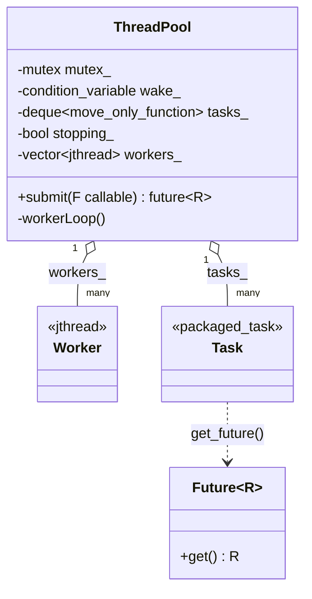
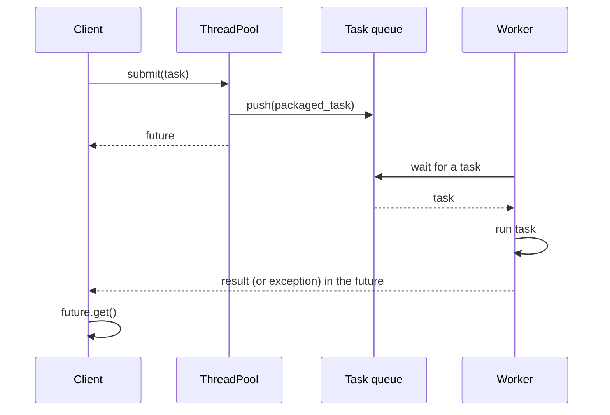

# Thread Pool

> **Intent:** Keep a fixed number of worker threads alive and let them run many small tasks, instead of creating a thread for each task.

## Problem

Creating a thread costs time and memory, and unlimited threads slow the machine down. A pool reuses threads and limits the parallelism.

## Roles

| Role | What it is |
|---|---|
| ThreadPool | owns the workers and the task queue; `submit` queues a task and returns a future |
| Worker | a thread that waits for a task, runs it, then waits again |
| Task | a callable packed into `std::packaged_task` |
| Future | how the caller gets the result or the exception |

## Structure



## Sequence



## Examples in `main.cpp`

| # | What | Detail |
|---|---|---|
| 1 | Submit 8 tasks, collect results | read in submit order for a stable output |
| 2 | Exception in a task | travels to the caller through `get()` |
| 3 | Destructor drains the queue | 20 queued tasks all finish before the pool is gone |

## When to use

- Many short tasks (requests, file chunks, image tiles).
- You want to cap the number of threads.

## Pitfalls

- A task that waits for another task in the same pool can deadlock a small pool.
- `submit` is `[[nodiscard]]`: the future carries the result and the exception.
- Long blocking tasks (I/O) occupy a worker. Use more threads or a separate pool.

## Related

- `05_Multithreading/11_ThreadPool` (the same pattern, other implementation).

## Build and run

```bash
g++ -std=c++23 -Wall -Wextra -pthread main.cpp -o thread_pool
./thread_pool
```

or with CMake:

```bash
cmake -S . -B build
cmake --build build
./build/thread_pool
```

## Output (GCC 15.2.0)

```text
=== EXAMPLE 1: SUBMIT AND COLLECT ===
task 1 -> 1
task 2 -> 4
task 3 -> 9
task 4 -> 16
task 5 -> 25
task 6 -> 36
task 7 -> 49
task 8 -> 64

=== EXAMPLE 2: EXCEPTION IN A TASK ===
other task still works: 7
caught in the caller: task failed

=== EXAMPLE 3: DESTRUCTOR DRAINS THE QUEUE ===
tasks finished before the pool was gone: 20
```

## Tested

- GCC 15.2.0, `-std=c++23 -Wall -Wextra -pthread`: no warnings (also with `-O2`).
- ThreadSanitizer: no reports in 3 runs. AddressSanitizer and UBSan: no reports.
- The output was identical in all runs.
- Not tested with Clang or MSVC.

## Reference

- `<future>`, `<functional>` (`std::move_only_function`, C++23), `<thread>` (`std::jthread`, C++20), `<deque>`, `<mutex>`, `<condition_variable>`.
