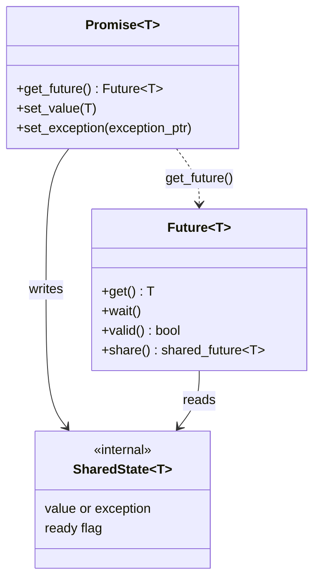
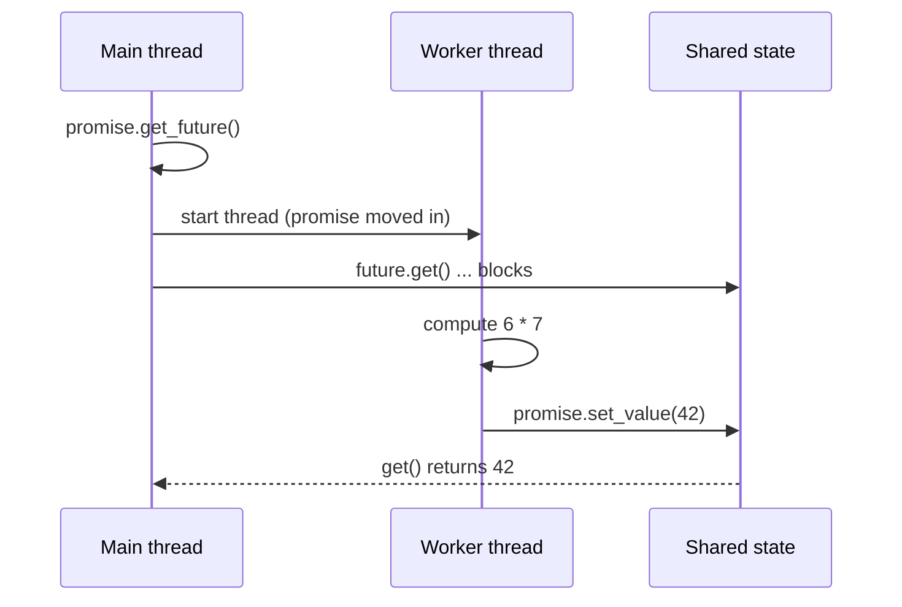

# Future / Promise

> **Intent:** Hand a result from one thread to another. The producer side fills a promise, the consumer side waits on the matching future.

## Problem

A thread needs a value that another thread is still computing, and it must also learn about errors, without sharing a variable and a lock by hand.

## Roles

| Role | What it is |
|---|---|
| Promise | write end: `set_value` or `set_exception` |
| Future | read end: `get` blocks until the value (or the exception) is there |
| Shared state | the hidden box between the two, created by `get_future()` |
| std::async | creates the thread and the promise for you |

## Structure



## Sequence



## Examples in `main.cpp`

| # | What | Detail |
|---|---|---|
| 1 | Promise and future | a worker delivers 42 |
| 2 | std::async | two tasks, `launch::async` |
| 3 | Exceptions | `set_exception` and automatic with `async` |
| 4 | shared_future | 3 readers get the same value |

## When to use

- One-shot results: a computation, a loaded file, a reply.
- You also need error transport across threads.

## Pitfalls

- `get()` can be called once on a `future`. Use `shared_future` for several readers.
- Ignoring the future of `std::async` blocks right there. That is why it is `[[nodiscard]]`.
- A promise destroyed without a value gives a `broken_promise` exception.

## Related

- `05_Multithreading/08_Futures`, `06_Async`.

## Build and run

```bash
g++ -std=c++23 -Wall -Wextra -pthread main.cpp -o future_promise
./future_promise
```

or with CMake:

```bash
cmake -S . -B build
cmake --build build
./build/future_promise
```

## Output (GCC 15.2.0)

```text
=== EXAMPLE 1: PROMISE AND FUTURE ===
waiting ...
result = 42

=== EXAMPLE 2: std::async ===
12^2 = 144, 13^2 = 169

=== EXAMPLE 3: EXCEPTIONS ===
get() rethrew: file not found
async rethrew: bad input

=== EXAMPLE 4: SHARED FUTURE ===
readers saw: 99 99 99
```

## Tested

- GCC 15.2.0, `-std=c++23 -Wall -Wextra -pthread`: no warnings (also with `-O2`).
- ThreadSanitizer: no reports in 3 runs. AddressSanitizer and UBSan: no reports.
- The output was identical in all runs.
- Not tested with Clang or MSVC.

## Reference

- `<future>`: `std::promise`, `std::future`, `std::shared_future`, `std::async` (C++11); `<thread>`.
