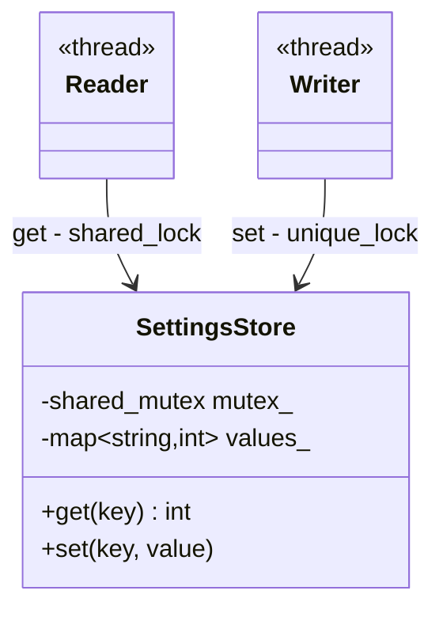
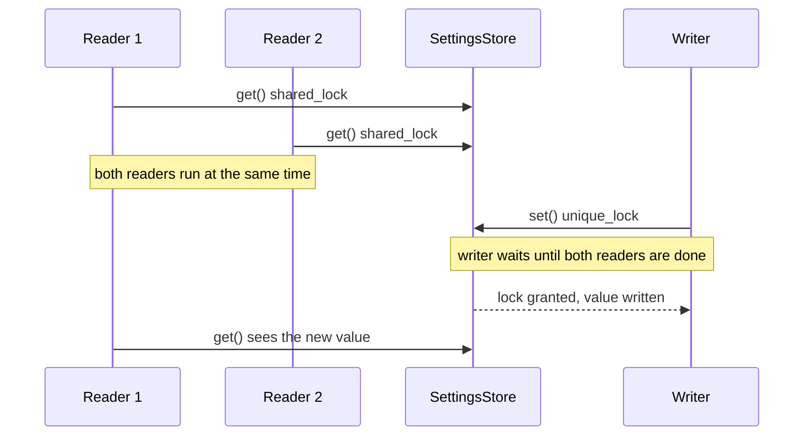

# Reader-Writer Lock

> **Intent:** Let many threads read the same data at the same time, but give a writer exclusive access.

## Problem

A plain mutex serializes readers although reading alone is harmless. For read-mostly data this wastes time.

## Roles

| Role | What it is |
|---|---|
| Shared lock | `std::shared_lock`: many holders at once, only for reading |
| Exclusive lock | `std::unique_lock`: one holder, waits for all readers |
| SettingsStore | the protected data with `get` (reads) and `set` (writes) |

## Structure



## Sequence



## Examples in `main.cpp`

| # | What | Detail |
|---|---|---|
| 1 | Basic use | set and get |
| 2 | 4 readers, 1 writer | a version number never goes backwards |
| 3 | Shared vs exclusive | probe from a second thread: reader allowed, writer refused |

## When to use

- Data is read often and changed rarely (configuration, caches, lookup tables).

## Pitfalls

- A `shared_mutex` is slower than a `mutex` when writes are frequent or the critical section is tiny.
- A thread that holds a lock must not lock again, not even a shared one (undefined behavior).
- You cannot upgrade a shared lock to an exclusive lock. Release it and take a new one.

## Related

- `05_Multithreading/05_Mutex`, `12_ThreadSynchronization`.

## Build and run

```bash
g++ -std=c++23 -Wall -Wextra -pthread main.cpp -o reader_writer
./reader_writer
```

or with CMake:

```bash
cmake -S . -B build
cmake --build build
./build/reader_writer
```

## Output (GCC 15.2.0)

```text
=== EXAMPLE 1: BASIC USE ===
volume = 7
missing = -1

=== EXAMPLE 2: 4 READERS, 1 WRITER ===
readers never saw an older version: true
final version = 100

=== EXAMPLE 3: SHARED vs EXCLUSIVE ===
another reader can enter: true
a writer can enter while a reader is active: false
a writer can enter after the reader left: true
```

## Tested

- GCC 15.2.0, `-std=c++23 -Wall -Wextra -pthread`: no warnings (also with `-O2`).
- ThreadSanitizer: no reports in 3 runs. AddressSanitizer and UBSan: no reports.
- The output was identical in all runs.
- Not tested with Clang or MSVC.

## Reference

- `<shared_mutex>`: `std::shared_mutex` (C++17), `std::shared_lock` (C++14).
