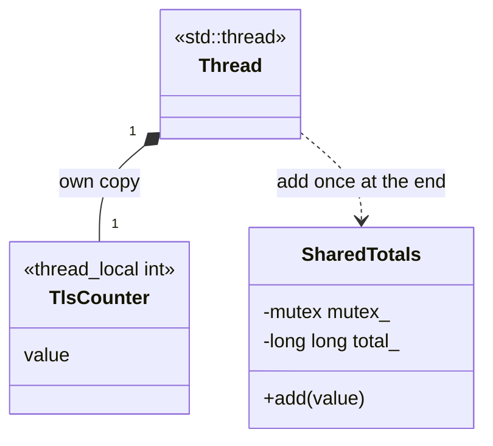
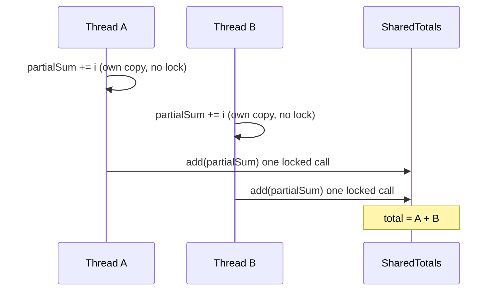

# Thread-Specific Storage

> **Intent:** Give every thread its own copy of a variable, so threads do not need a lock to use it.

## Problem

A global counter or buffer shared by all threads needs synchronization. If each thread can work on its own copy, the contention disappears.

## Roles

| Role | What it is |
|---|---|
| thread_local variable | one separate object per thread, created on first use in that thread |
| Merge step | the per-thread results are combined once at the end |

## Structure



## Sequence



## Examples in `main.cpp`

| # | What | Detail |
|---|---|---|
| 1 | thread_local counter | each thread counts on its own, main stays 0 |
| 2 | Accumulate locally, merge once | 4 threads, 100000 additions each, 1 lock per thread |
| 3 | thread_local vs one atomic | all threads on one variable vs each on its own |

## When to use

- Counters, caches, scratch buffers, random generators, error codes (like `errno`) per thread.

## Pitfalls

- Values are lost when the thread ends: copy them out first.
- Do not hand a pointer to a `thread_local` to another thread.
- In a thread pool the worker lives on, so a `thread_local` is shared by all tasks that run on that worker.

## Related

- `05_Multithreading/03_ThreadAttributes`.

## Build and run

```bash
g++ -std=c++23 -Wall -Wextra -pthread main.cpp -o thread_specific
./thread_specific
```

or with CMake:

```bash
cmake -S . -B build
cmake --build build
./build/thread_specific
```

## Output (GCC 15.2.0)

```text
=== EXAMPLE 1: thread_local COUNTER ===
thread 0 bumped 1 time(s), its counter = 1
thread 1 bumped 2 time(s), its counter = 2
thread 2 bumped 3 time(s), its counter = 3
main thread counter is untouched: 0

=== EXAMPLE 2: ACCUMULATE LOCALLY, MERGE ONCE ===
total = 20000200000 (expected 20000200000)

=== EXAMPLE 3: thread_local vs ATOMIC ===
shared atomic = 4000
per-thread counters = 1000 1000 1000 1000
```

## Tested

- GCC 15.2.0, `-std=c++23 -Wall -Wextra -pthread`: no warnings (also with `-O2`).
- ThreadSanitizer: no reports in 3 runs. AddressSanitizer and UBSan: no reports.
- The output was identical in all runs.
- Not tested with Clang or MSVC.

## Reference

- `thread_local` storage duration (C++11, language keyword).
