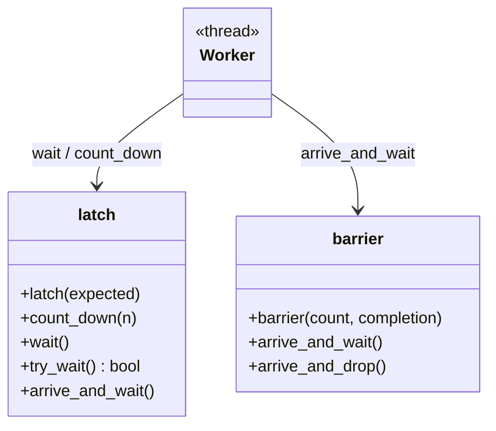
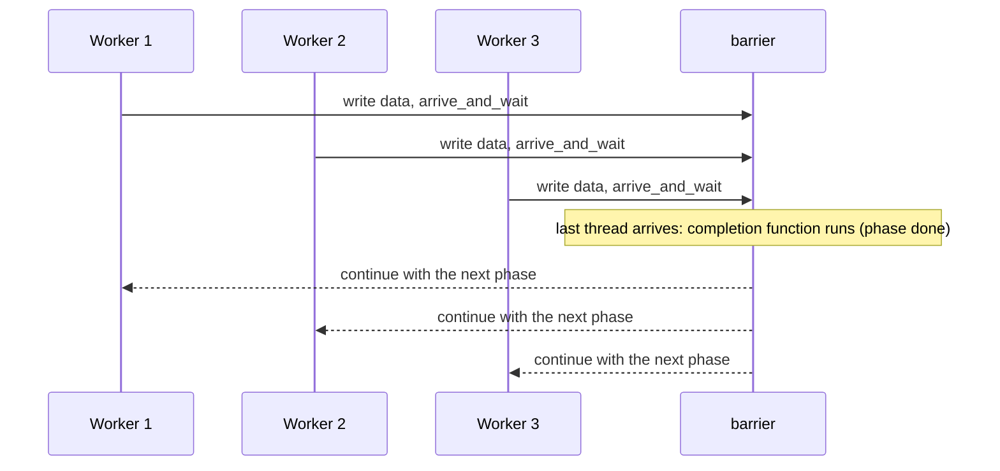

# Barrier and Latch

> **Intent:** Make threads wait for each other. A latch opens once after a number of events. A barrier lets a group of threads meet again and again, phase after phase.

## Problem

Threads must start together, or each phase of a calculation must finish in all threads before the next phase begins.

## Roles

| Role | What it is |
|---|---|
| std::latch | single-use counter: `count_down`, `wait`, `try_wait` |
| std::barrier | reusable meeting point: `arrive_and_wait`, optional completion function |
| Completion function | runs once per phase, in one of the threads, before the group continues |

## Structure



## Sequence



## Examples in `main.cpp`

| # | What | Detail |
|---|---|---|
| 1 | Latch | start gate for 4 workers and a "all done" latch |
| 2 | Barrier | 3 threads, 3 phases, a completion function prints the phase sum |
| 3 | Latch is single-use | `try_wait` before and after, no reset |

## When to use

- Simulation or algorithm steps where each step needs all results of the step before.
- "Start everyone at the same moment" (benchmarks, tests).

## Pitfalls

- A latch cannot be reset. Use a barrier for repeated rendezvous.
- The completion function must be `noexcept`.
- If one thread never arrives, all others wait forever. Use `arrive_and_drop` when a thread leaves early.

## Related

- `05_Multithreading/12_ThreadSynchronization`.

## Build and run

```bash
g++ -std=c++23 -Wall -Wextra -pthread main.cpp -o barrier_latch
./barrier_latch
```

or with CMake:

```bash
cmake -S . -B build
cmake --build build
./build/barrier_latch
```

## Output (GCC 15.2.0)

```text
=== EXAMPLE 1: LATCH ===
sum of results = 100

=== EXAMPLE 2: BARRIER ===
phase 0 complete, sum of all values = 6
phase 1 complete, sum of all values = 12
phase 2 complete, sum of all values = 18

=== EXAMPLE 3: LATCH IS SINGLE-USE ===
try_wait before count_down: false
try_wait after count_down:  true
```

## Tested

- GCC 15.2.0, `-std=c++23 -Wall -Wextra -pthread`: no warnings (also with `-O2`).
- ThreadSanitizer: no reports in 3 runs. AddressSanitizer and UBSan: no reports.
- The output was identical in all runs.
- Not tested with Clang or MSVC.

## Reference

- `<latch>`, `<barrier>`: `std::latch`, `std::barrier` (C++20).
