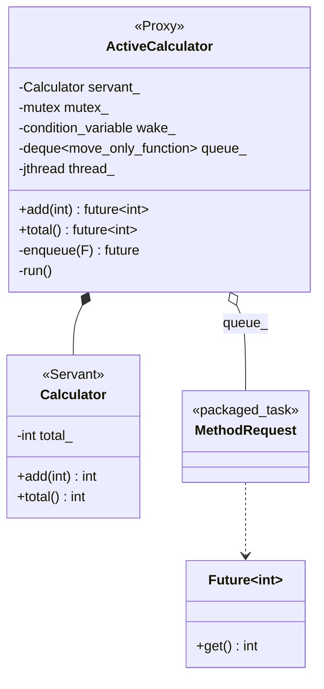
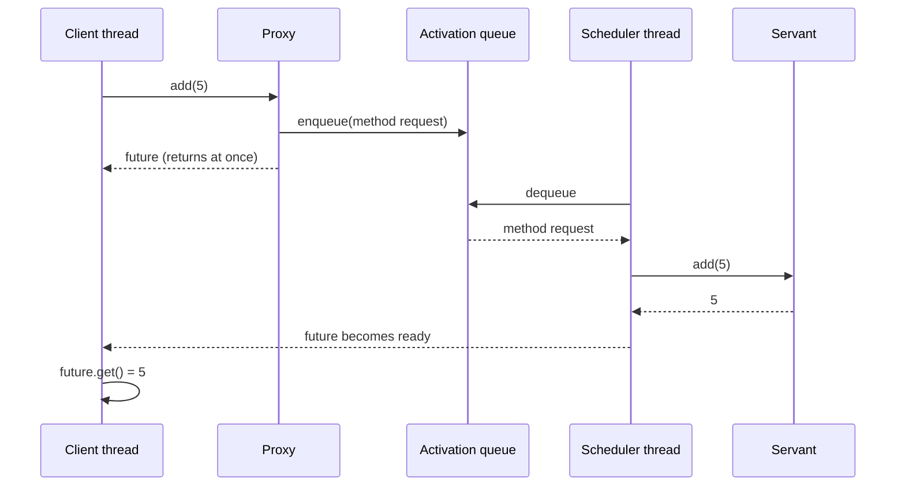

# Active Object

> **Intent:** Give an object its own thread. A call from outside only queues a request and returns a future, and the object works through the requests one after the other.

## Problem

An object used by many threads needs locks around all its data. If only one thread ever touches the data, no locks are needed inside the object.

## Roles

| Role | What it is |
|---|---|
| Proxy | public interface (`add`, `total`): queues a request, returns a `std::future` |
| Method request | a packaged call (`std::packaged_task`) with its arguments |
| Activation queue | FIFO of requests, protected by a mutex |
| Scheduler | the object's own thread: takes requests from the queue and runs them |
| Servant | the real object (`Calculator`), plain and not thread-safe |
| Future | the caller's handle to the result |

## Structure



## Sequence



## Examples in `main.cpp`

| # | What | Detail |
|---|---|---|
| 1 | Calls return a future | `add(5)` returns at once |
| 2 | Many clients, one servant thread | 4 threads x 250 additions, no mutex in `Calculator` |
| 3 | FIFO order | running totals 1, 3, 6, 10, 15 |

## When to use

- One object that must be accessed from many threads but is easier to write single-threaded (a device driver, a logger, a connection).
- Callers should not block while the object is busy.

## Pitfalls

- Calls never run on the caller's thread, so thread-local state is not shared.
- Calling `get()` from inside the servant on its own future would deadlock.
- The queue is the only shared state: keep it small and well tested.

## Related

- `05_Multithreading/17_Worker` (a worker thread with a queue), and `02_ThreadPool` (many workers instead of one).

## Build and run

```bash
g++ -std=c++23 -Wall -Wextra -pthread main.cpp -o active_object
./active_object
```

or with CMake:

```bash
cmake -S . -B build
cmake --build build
./build/active_object
```

## Output (GCC 15.2.0)

```text
=== EXAMPLE 1: CALLS RETURN A FUTURE ===
add(5) returned a future, result = 5
total = 5

=== EXAMPLE 2: MANY CLIENTS ===
total after 4 x 250 additions = 1000

=== EXAMPLE 3: FIFO ORDER ===
running total: 1
running total: 3
running total: 6
running total: 10
running total: 15
```

## Tested

- GCC 15.2.0, `-std=c++23 -Wall -Wextra -pthread`: no warnings (also with `-O2`).
- ThreadSanitizer: no reports in 3 runs. AddressSanitizer and UBSan: no reports.
- The output was identical in all runs.
- Not tested with Clang or MSVC.

## Reference

- `<future>`, `<functional>` (`std::move_only_function`, C++23), `<thread>` (`std::jthread`, C++20).
