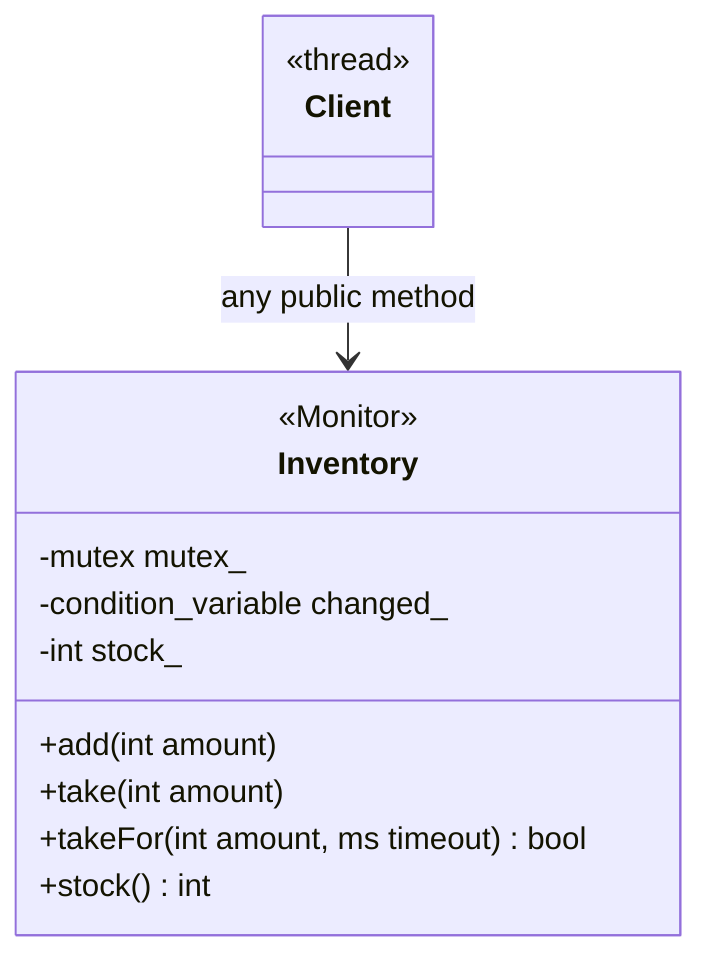
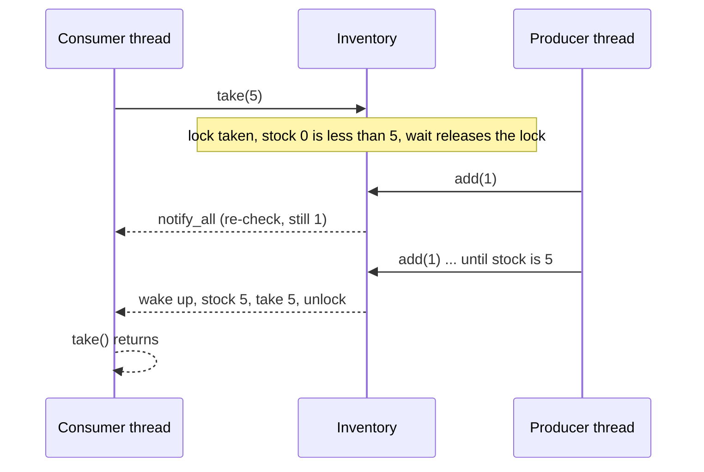

# Monitor Object

> **Intent:** Put the lock inside the object. Every public method takes the same mutex, and a method that has to wait for a condition waits inside the object.

## Problem

If callers have to lock an object from outside, someone will forget. The object should protect itself and manage its own waiting.

## Roles

| Role | What it is |
|---|---|
| Monitor object | the class (`Inventory`) with all state private |
| Monitor lock | one mutex taken by every public method |
| Monitor condition | a condition variable used with the lock to wait for a state |

## Structure



## Sequence



## Examples in `main.cpp`

| # | What | Detail |
|---|---|---|
| 1 | All methods synchronized | 2 threads x 1000 `add` |
| 2 | Blocking inside the monitor | `take(5)` waits for 5 `add(1)` |
| 3 | Timeout | `takeFor` returns false when nothing arrives |

## When to use

- A shared object with a few operations that all need the same lock (queues, counters, resource pools).

## Pitfalls

- A public method must not call another public method of the same monitor (self-deadlock). See the Thread-Safe Interface pattern.
- Do not call unknown code (callbacks) while holding the monitor lock.
- Calls from several threads are serialized. For read-mostly data use a reader-writer lock.

## Related

- `12_ThreadSafeInterface` (how to build the monitor's methods) and `05_Multithreading/07_ConditionVariable`.

## Build and run

```bash
g++ -std=c++23 -Wall -Wextra -pthread main.cpp -o monitor_object
./monitor_object
```

or with CMake:

```bash
cmake -S . -B build
cmake --build build
./build/monitor_object
```

## Output (GCC 15.2.0)

```text
=== EXAMPLE 1: SYNCHRONIZED METHODS ===
stock after 2 x 1000 adds = 2000

=== EXAMPLE 2: take() WAITS FOR STOCK ===
consumer got its 5 units, stock left = 0

=== EXAMPLE 3: TIMEOUT ===
takeFor(3) with empty stock succeeded: false
takeFor(3) after add(3) succeeded:     true
```

## Tested

- GCC 15.2.0, `-std=c++23 -Wall -Wextra -pthread`: no warnings (also with `-O2`).
- ThreadSanitizer: no reports in 3 runs. AddressSanitizer and UBSan: no reports.
- The output was identical in all runs.
- Not tested with Clang or MSVC.

## Reference

- `<mutex>`, `<condition_variable>`, `<chrono>`; C++11.
