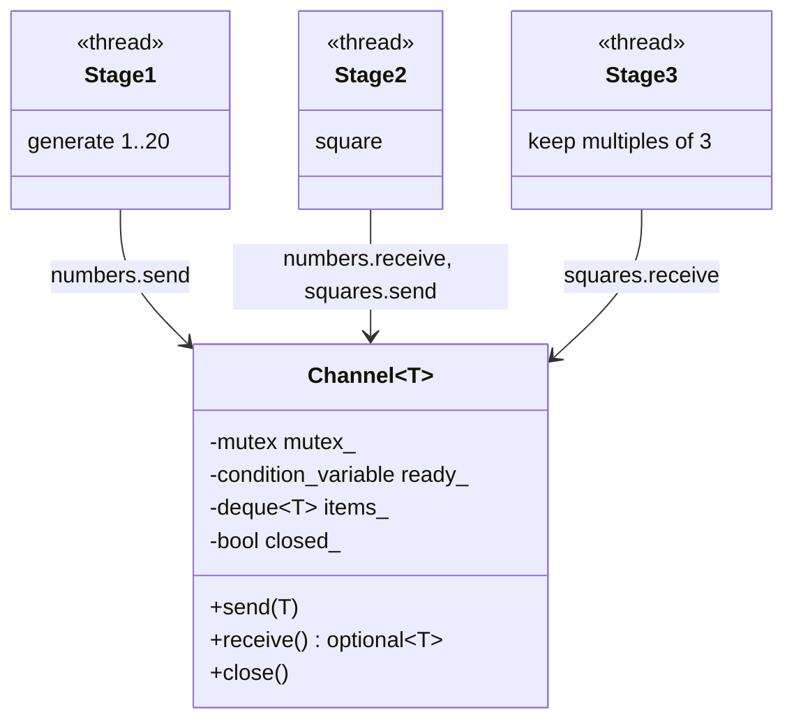
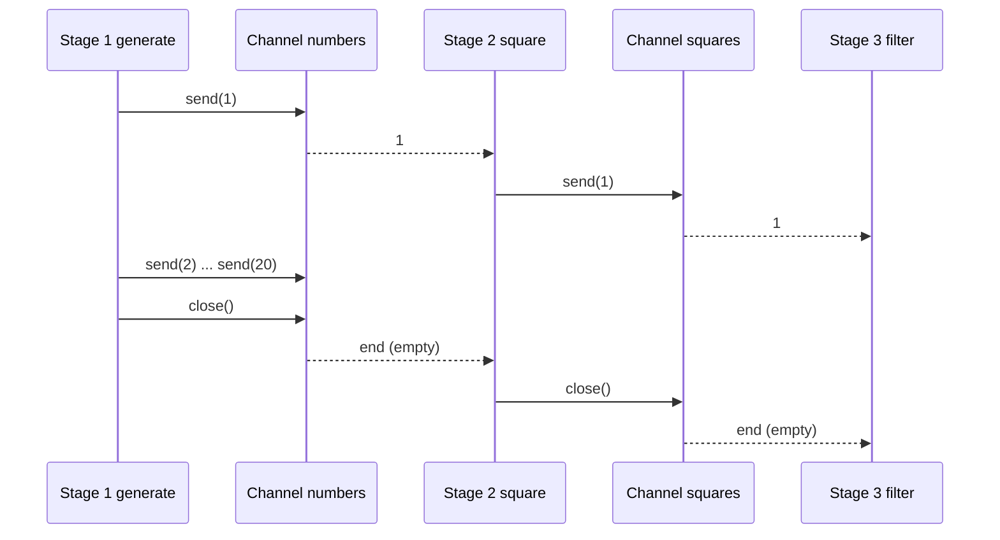

# Pipeline

> **Intent:** Split work into stages. Each stage runs in its own thread and passes its results to the next stage through a queue, like an assembly line.

## Problem

A long processing chain on one thread uses one core. Running the stages at the same time keeps all of them busy and keeps the order of the data.

## Roles

| Role | What it is |
|---|---|
| Stage | a thread that reads from its input channel, processes, and writes to its output channel |
| Channel | thread-safe queue between two stages (`send`, `receive`, `close`) |
| End marker | `close()` on a channel: the next stage finishes and closes its own output |

## Structure



## Sequence



## Examples in `main.cpp`

| # | What | Detail |
|---|---|---|
| 1 | Generate, square, filter | 20 numbers, 6 values kept |
| 2 | Order preserved | one thread per stage keeps the order |
| 3 | Closing an empty pipeline | all stages end without data |

## When to use

- Data flows through several processing steps (decode, transform, encode, write).
- Steps have different speeds and you want them to overlap.

## Pitfalls

- The slowest stage limits the whole pipeline. Bound the channels to avoid a growing queue.
- If you run two threads in one stage, the order is no longer guaranteed.
- Forgetting `close()` leaves the later stages waiting forever.

## Related

- `01_ProducerConsumer` (a pipeline is a chain of producer-consumer pairs).

## Build and run

```bash
g++ -std=c++23 -Wall -Wextra -pthread main.cpp -o pipeline
./pipeline
```

or with CMake:

```bash
cmake -S . -B build
cmake --build build
./build/pipeline
```

## Output (GCC 15.2.0)

```text
=== EXAMPLE 1: GENERATE -> SQUARE -> FILTER ===
kept 6 values
  9
  36
  81
  144
  225
  324

=== EXAMPLE 2: ORDER PRESERVED ===
10 values arrived in the original order: true

=== EXAMPLE 3: CLOSING AN EMPTY PIPELINE ===
processed 0 items, all stages ended
```

## Tested

- GCC 15.2.0, `-std=c++23 -Wall -Wextra -pthread`: no warnings (also with `-O2`).
- ThreadSanitizer: no reports in 3 runs. AddressSanitizer and UBSan: no reports.
- The output was identical in all runs.
- Not tested with Clang or MSVC.

## Reference

- `<thread>` (`std::jthread`), `<mutex>`, `<condition_variable>`, `<optional>`.
