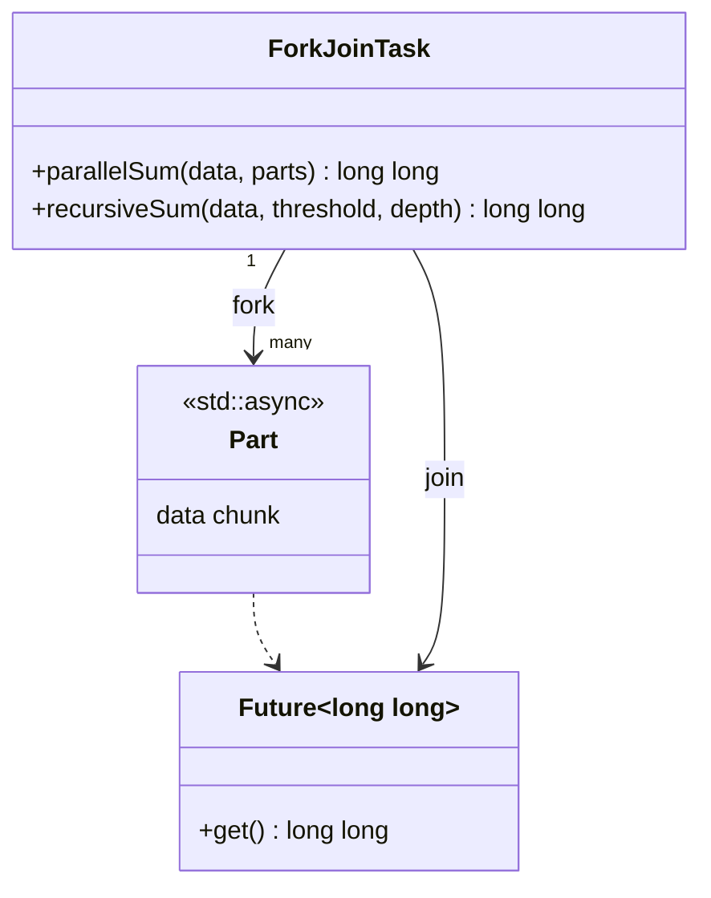
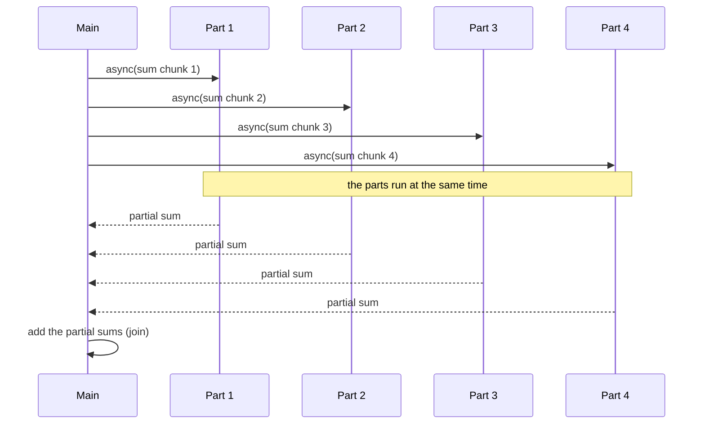

# Fork-Join

> **Intent:** Split a big task into independent parts, run the parts in parallel (fork), wait for all of them and combine the results (join).

## Problem

A calculation over a large data set uses only one core. If the parts do not depend on each other, they can run on all cores.

## Roles

| Role | What it is |
|---|---|
| Fork | start one task per part (`std::async`) |
| Part | an independent piece of the data and its calculation |
| Join | `get()` on every future and combine the results |
| Threshold | below this size a part is computed directly, not split further |

## Structure



## Sequence



## Examples in `main.cpp`

| # | What | Detail |
|---|---|---|
| 1 | One task per chunk | sum of 1..1,000,000 in 4 parts |
| 2 | Recursive fork-join | split in halves down to a threshold and a depth limit |
| 3 | Compare with sequential | sequential, chunked and recursive results are equal |

## When to use

- Large data, CPU-bound work, independent parts (sum, search, image tiles, sorting halves).

## Pitfalls

- Splitting too finely costs more than it saves. Use a threshold.
- The parts must not write to the same data without a lock.
- Unlimited recursion creates too many threads. Limit the depth, or use a thread pool.

## Related

- `02_ThreadPool` (run the parts on a pool), `05_Multithreading/08_Futures`.

## Build and run

```bash
g++ -std=c++23 -Wall -Wextra -pthread main.cpp -o fork_join
./fork_join
```

or with CMake:

```bash
cmake -S . -B build
cmake --build build
./build/fork_join
```

## Output (GCC 15.2.0)

```text
=== EXAMPLE 1: ONE TASK PER CHUNK ===
parallel sum (4 parts) = 500000500000

=== EXAMPLE 2: RECURSIVE FORK-JOIN ===
recursive sum = 500000500000

=== EXAMPLE 3: COMPARE WITH SEQUENTIAL ===
sequential = 7620877153
all three equal: true
```

## Tested

- GCC 15.2.0, `-std=c++23 -Wall -Wextra -pthread`: no warnings (also with `-O2`).
- ThreadSanitizer: no reports in 3 runs. AddressSanitizer and UBSan: no reports.
- The output was identical in all runs.
- Not tested with Clang or MSVC.

## Reference

- `<future>` (`std::async`, C++11), `<span>` (C++20), `<numeric>` (`std::accumulate`).
