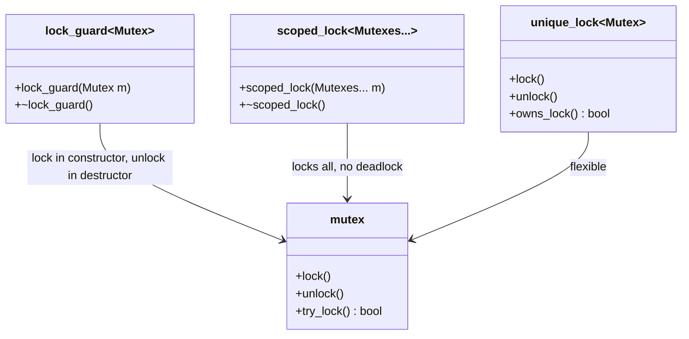
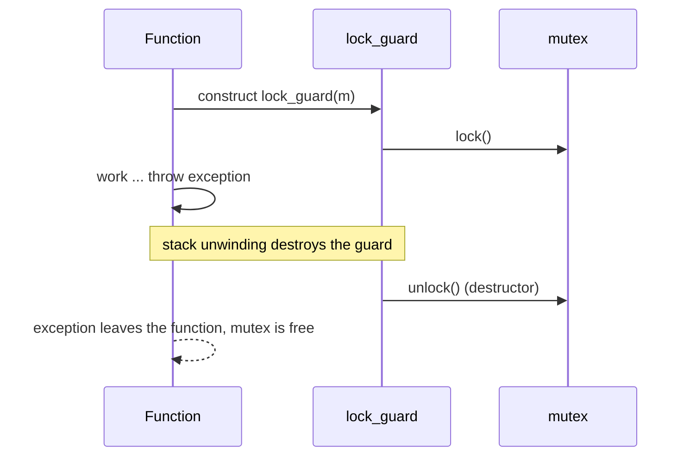

# Scoped Locking

> **Intent:** Tie a lock to a scope with RAII. The lock is taken in a constructor and released in the destructor, on every way out of the scope.

## Problem

With manual `lock()` and `unlock()` a return, a `break` or an exception between the two calls leaves the mutex locked forever.

## Roles

| Role | What it is |
|---|---|
| lock_guard | simple scoped lock for one mutex |
| scoped_lock | scoped lock for one or more mutexes, deadlock-free (C++17) |
| unique_lock | scoped lock that can be released early, moved and used with condition variables |

## Structure



## Sequence



## Examples in `main.cpp`

| # | What | Detail |
|---|---|---|
| 1 | Manual lock leaks | after an exception the mutex is still locked |
| 2 | lock_guard | the mutex is free after the exception |
| 3 | scoped_lock with two mutexes | two threads transfer in opposite directions, no deadlock |

## When to use

- Always. Prefer a scoped lock to manual `lock()` / `unlock()`.

## Pitfalls

- A named variable is needed: `std::lock_guard(m);` creates a temporary that unlocks at once.
- Keep the scope as small as possible. Do not run slow code or callbacks while holding the lock.
- Locking two mutexes one after the other in different orders can deadlock. Use `scoped_lock` for all of them at once.

## Related

- `05_Multithreading/05_Mutex`, `06_DeadLock`, and the RAII examples in `03_MemoryManagement/03_RAII`.

## Build and run

```bash
g++ -std=c++23 -Wall -Wextra -pthread main.cpp -o scoped_locking
./scoped_locking
```

or with CMake:

```bash
cmake -S . -B build
cmake --build build
./build/scoped_locking
```

## Output (GCC 15.2.0)

```text
=== EXAMPLE 1: MANUAL LOCK LEAKS ===
caught: something went wrong
mutex is free after the exception: false

=== EXAMPLE 2: lock_guard RELEASES ALWAYS ===
caught: something went wrong
mutex is free after the exception: true

=== EXAMPLE 3: scoped_lock WITH TWO MUTEXES ===
balances: a = 1000, b = 1000, total = 2000
```

## Tested

- GCC 15.2.0, `-std=c++23 -Wall -Wextra -pthread`: no warnings (also with `-O2`).
- ThreadSanitizer: no reports in 3 runs. AddressSanitizer and UBSan: no reports.
- The output was identical in all runs.
- Not tested with Clang or MSVC.

## Reference

- `<mutex>`: `std::lock_guard` (C++11), `std::unique_lock` (C++11), `std::scoped_lock` (C++17).
