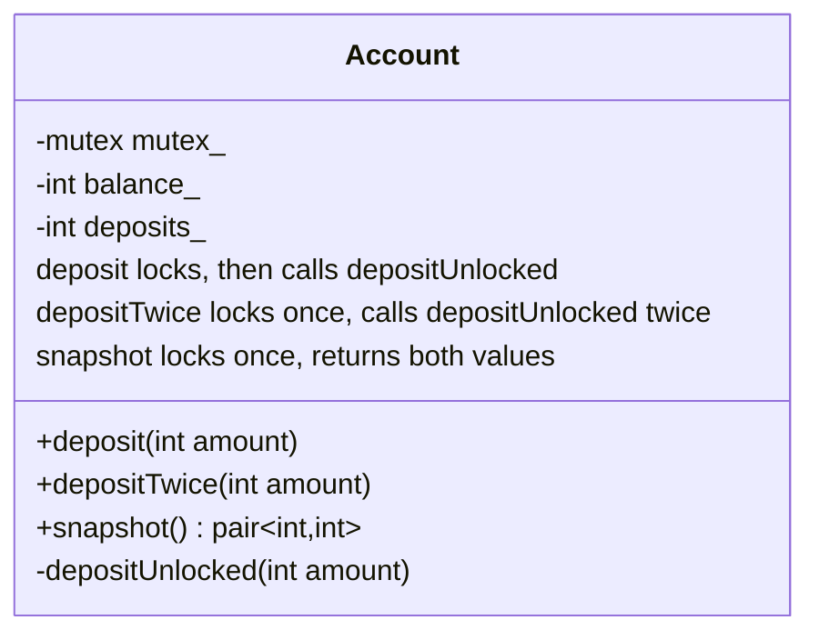
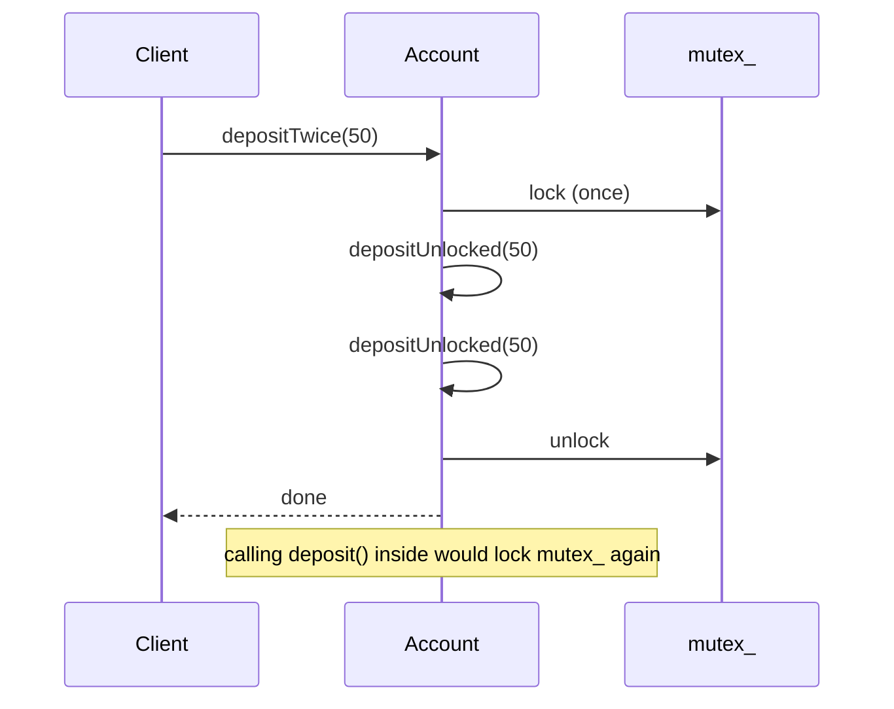

# Thread-Safe Interface

> **Intent:** Public methods lock once and call private methods that assume the lock is already held. This avoids locking the same mutex twice and keeps the locking in one place.

## Problem

When a locked public method calls another public method of the same class, the mutex is locked a second time. With a normal `std::mutex` that is a deadlock or undefined behavior.

## Roles

| Role | What it is |
|---|---|
| Public method | takes the lock, calls the private implementation, releases the lock |
| Private `...Unlocked` method | does the work, never locks |
| snapshot() | one locked region that returns several values that belong together |

## Structure



## Sequence



## Examples in `main.cpp`

| # | What | Detail |
|---|---|---|
| 1 | depositTwice | balance 100, deposits 2 |
| 2 | 4 threads | 8000 and 8000 |
| 3 | Consistent snapshot | balance and deposits always match in a snapshot |

## When to use

- Any class with a mutex where public methods share logic.

## Pitfalls

- Never call a public (locking) method from inside a locked region of the same class.
- Two separate getters (`balance()` and `deposits()`) can show values from different moments. Return both from one locked method.
- `std::recursive_mutex` hides the design problem and is slower. Prefer this pattern.

## Related

- `08_MonitorObject`, `11_ScopedLocking`.

## Build and run

```bash
g++ -std=c++23 -Wall -Wextra -pthread main.cpp -o thread_safe_interface
./thread_safe_interface
```

or with CMake:

```bash
cmake -S . -B build
cmake --build build
./build/thread_safe_interface
```

## Output (GCC 15.2.0)

```text
=== EXAMPLE 1: depositTwice ===
balance = 100, deposits = 2

=== EXAMPLE 2: 4 THREADS ===
balance = 8000 (expected 8000), deposits = 8000 (expected 8000)

=== EXAMPLE 3: CONSISTENT SNAPSHOT ===
balance == deposits in every snapshot: true
```

## Tested

- GCC 15.2.0, `-std=c++23 -Wall -Wextra -pthread`: no warnings (also with `-O2`).
- ThreadSanitizer: no reports in 3 runs. AddressSanitizer and UBSan: no reports.
- The output was identical in all runs.
- Not tested with Clang or MSVC.

## Reference

- `<mutex>`, `<utility>` (`std::pair`); C++17.
