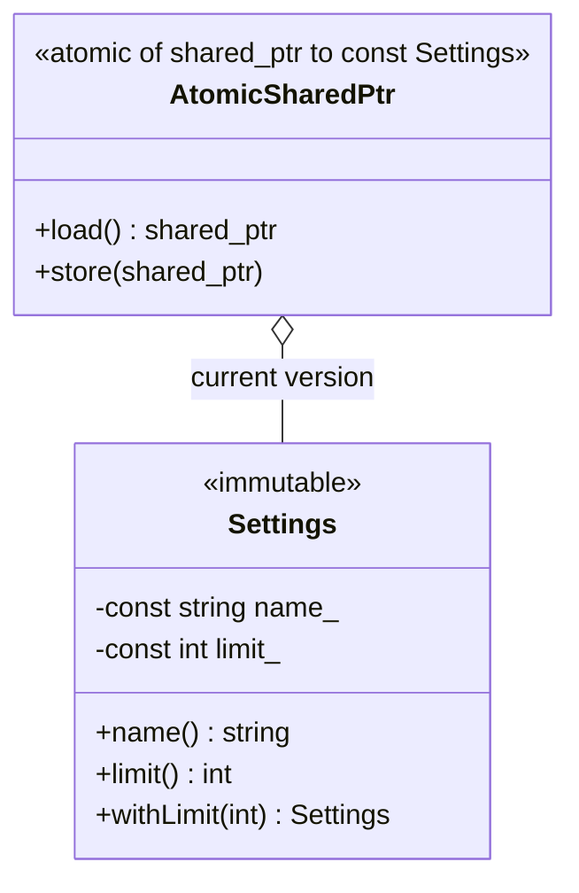
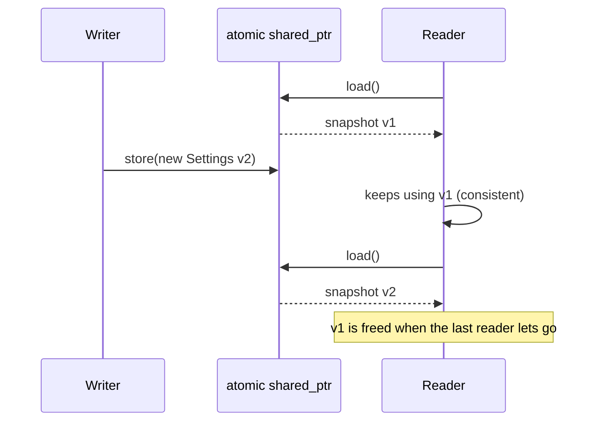

# Immutable Object

> **Intent:** An object that never changes after construction can be shared by any number of threads without a lock. A "change" creates a new object.

## Problem

Locks are needed because data is modified. If data is never modified, the problem does not exist.

## Roles

| Role | What it is |
|---|---|
| Immutable class | only `const` members, no setters (`Settings`) |
| withX() method | returns a modified copy |
| Atomic publication | `std::atomic<std::shared_ptr<const T>>`: readers load a stable snapshot, the writer swaps in a new version |

## Structure



## Sequence



## Examples in `main.cpp`

| # | What | Detail |
|---|---|---|
| 1 | Const members | no way to change an object |
| 2 | A change creates a new object | `withLimit` returns a copy |
| 3 | Atomic publication | 3 readers, 200 versions, every snapshot consistent |

## When to use

- Configuration, lookup tables, messages passed between threads, value types.

## Pitfalls

- Creating a new object for every change costs memory and time. It fits data that changes rarely or is small.
- `const` members make the class non-assignable. That is intended here.
- Only the pointer swap is atomic. Never modify an object after publishing it.

## Related

- `04_ReaderWriterLock` (the lock-based alternative for read-mostly data).

## Build and run

```bash
g++ -std=c++23 -Wall -Wextra -pthread main.cpp -o immutable_object
./immutable_object
```

or with CMake:

```bash
cmake -S . -B build
cmake --build build
./build/immutable_object
```

## Output (GCC 15.2.0)

```text
=== EXAMPLE 1: CONST MEMBERS ===
basic / 10

=== EXAMPLE 2: A CHANGE CREATES A NEW OBJECT ===
original limit = 10
updated  limit = 99

=== EXAMPLE 3: ATOMIC PUBLICATION ===
every snapshot was consistent: true
final version: v200
```

## Tested

- GCC 15.2.0, `-std=c++23 -Wall -Wextra -pthread`: no warnings (also with `-O2`).
- ThreadSanitizer: no reports in 3 runs. AddressSanitizer and UBSan: no reports.
- The output was identical in all runs.
- Not tested with Clang or MSVC.

## Reference

- `<memory>` (`std::shared_ptr`, `std::atomic<std::shared_ptr<T>>` since C++20), `<atomic>`.
