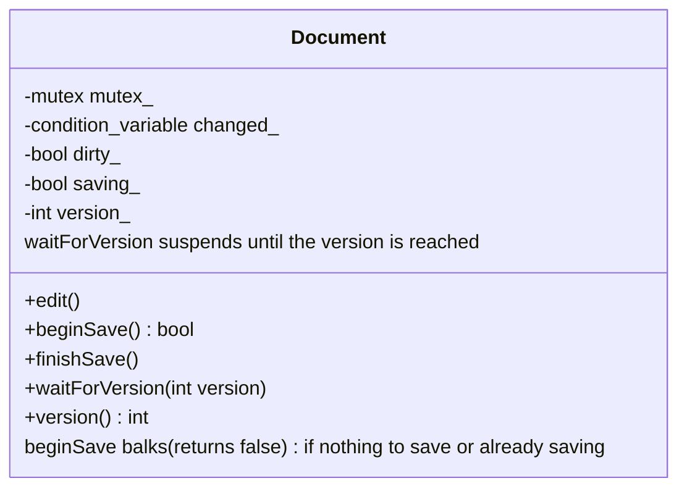
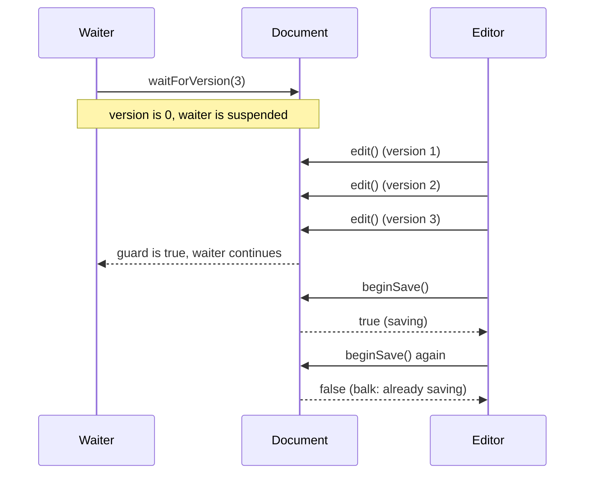

# Guarded Suspension and Balking

> **Intent:** Two answers to "the object is not in the right state for this call". Guarded suspension waits until the state is right. Balking refuses immediately.

## Problem

A call can only make sense in a certain state: wait for data to arrive, or save a document that has not changed. The caller needs a defined behavior.

## Roles

| Role | What it is |
|---|---|
| Guard condition | the state test (`version_ >= version`, `dirty_ && !saving_`) |
| Guarded suspension | wait on a condition variable until the guard is true |
| Balking | test the guard and return `false` at once when it is not true |

## Structure



## Sequence



## Examples in `main.cpp`

| # | What | Detail |
|---|---|---|
| 1 | Nothing to save | `beginSave` returns false until there is an edit |
| 2 | A second save is refused | balking while `saving_` is true |
| 3 | Guarded suspension | a thread waits until version 3 exists |

## When to use

- Guarded suspension: the caller needs the result and can wait.
- Balking: the call is optional or repeatable (autosave, refresh, "already running").

## Pitfalls

- Check the guard with the lock held, in the same critical section that changes the state.
- Balking must be documented: callers must handle the `false` result.
- Waiting without a timeout can block forever. Add `wait_for` if the state may never come.

## Related

- `08_MonitorObject` (same lock-and-condition structure), `05_Multithreading/07_ConditionVariable`.

## Build and run

```bash
g++ -std=c++23 -Wall -Wextra -pthread main.cpp -o guarded_balking
./guarded_balking
```

or with CMake:

```bash
cmake -S . -B build
cmake --build build
./build/guarded_balking
```

## Output (GCC 15.2.0)

```text
=== EXAMPLE 1: NOTHING TO SAVE ===
beginSave on an unchanged document: false
beginSave after an edit:            true
beginSave right after saving:       false

=== EXAMPLE 2: SECOND SAVE IS REFUSED ===
first beginSave:  true
second beginSave: false
after finishSave and a new edit: true

=== EXAMPLE 3: GUARDED SUSPENSION ===
waiter continued with version >= 3: true
```

## Tested

- GCC 15.2.0, `-std=c++23 -Wall -Wextra -pthread`: no warnings (also with `-O2`).
- ThreadSanitizer: no reports in 3 runs. AddressSanitizer and UBSan: no reports.
- The output was identical in all runs.
- Not tested with Clang or MSVC.

## Reference

- `<mutex>`, `<condition_variable>`; C++11.
