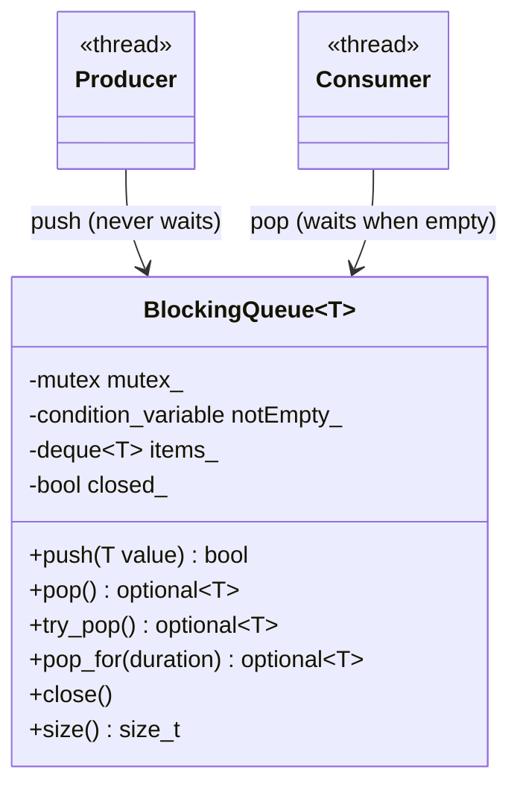
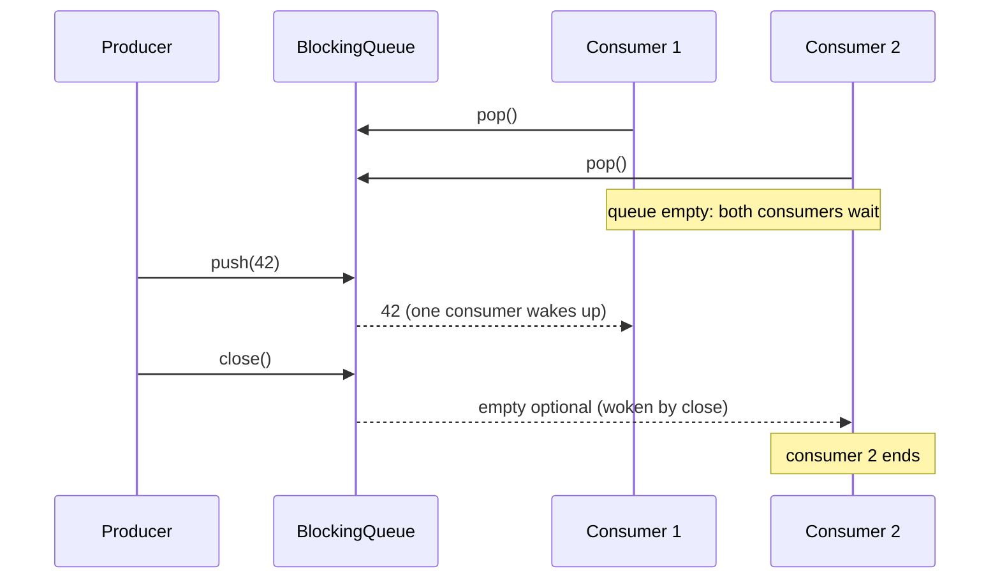

# Blocking Queue (unbounded)

> **Intent:** A thread-safe queue whose `pop()` waits while the queue is empty. This version has no size limit, so `push()` never waits.

## Problem

A consumer must wait for work without spinning, and several threads must be able to use the same queue safely. "Blocking" describes the consumer side: it sleeps until an item arrives or the queue is closed.

## Roles

| Role | What it is |
|---|---|
| push | adds an item at the back, never waits, returns `false` after `close()` |
| pop | waits until an item is available, returns an empty optional when closed and drained |
| try_pop | takes an item if there is one, never waits |
| pop_for | waits at most a given time |
| close | no more pushes; wakes every waiting consumer, remaining items are still delivered |

## Structure



## Sequence



## Examples in `main.cpp`

| # | What | Detail |
|---|---|---|
| 1 | FIFO and try_pop | items come out in push order; `try_pop` on an empty queue returns nothing |
| 2 | pop() waits | a consumer blocks until the producer pushes |
| 3 | pop_for | timeout on an empty queue, then success after a push |
| 4 | close() wakes all | 3 waiting consumers all end |
| 5 | Drain after close | items pushed before `close()` are still delivered, `push` after it fails |
| 6 | No size limit | 100000 items pushed without a consumer |

## When to use

- The producer must never be slowed down (for example it is an event source or a UI thread) and memory is not a concern.
- Hand-over of work between threads where the rate is naturally limited.

## Pitfalls

- Without a limit a fast producer and a slow consumer make the queue grow until memory runs out. Use the bounded version when that can happen.
- Always call `close()` (or send a stop item) so that waiting consumers can end.
- `size()` is only a snapshot: it can change right after it returns.

## Related

- `16_BoundedQueue` (the same queue with a capacity), `01_ProducerConsumer` (uses a bounded queue), `09_Pipeline` (`Channel<T>`, a similar unbounded queue), `DataStructuresCpp/07_Concurrent/02_ThreadSafeQueue` (bounded; there it is called `BlockingQueue`).

## Build and run

```bash
g++ -std=c++23 -Wall -Wextra -pthread main.cpp -o blocking_queue
./blocking_queue
```

or with CMake:

```bash
cmake -S . -B build
cmake --build build
./build/blocking_queue
```

## Output (GCC 15.2.0)

```text
=== EXAMPLE 1: FIFO AND try_pop ===
pop: 1 2 3
try_pop on an empty queue has a value: false

=== EXAMPLE 2: pop() WAITS ===
consumer received 42

=== EXAMPLE 3: pop_for ===
empty queue, 20 ms: has value = false
after push(7): has value = true, value = 7

=== EXAMPLE 4: close() WAKES ALL CONSUMERS ===
consumers that ended: 3

=== EXAMPLE 5: DRAIN AFTER close() ===
push after close succeeded: false
pop: 1 2
pop on a closed, empty queue has a value: false

=== EXAMPLE 6: NO SIZE LIMIT ===
items waiting in the queue: 100000
```

## Tested

- GCC 15.2.0, `-std=c++23 -Wall -Wextra -pthread`: no warnings (also with `-O2`).
- ThreadSanitizer: no reports in 3 runs. AddressSanitizer and UBSan: no reports.
- The output was identical in all runs.
- Not tested with Clang or MSVC.

## Reference

- `<mutex>`, `<condition_variable>`, `<deque>`, `<optional>`, `<chrono>`; C++17 (`std::optional`).
