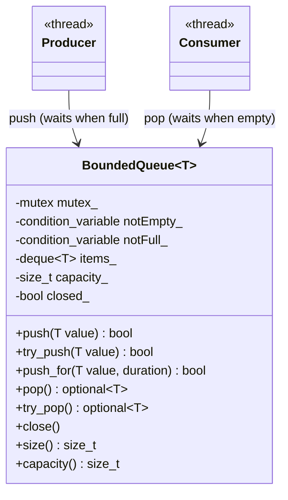
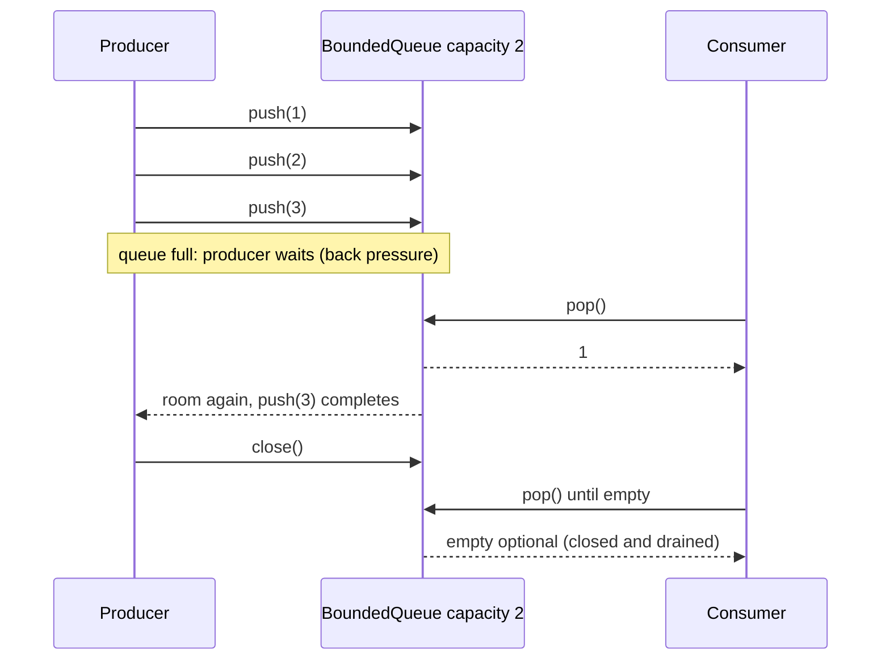

# Bounded Queue

> **Intent:** A blocking queue with a size limit. `push()` waits while the queue is full, and `pop()` waits while it is empty.

## Problem

If a producer is faster than its consumer, an unbounded queue grows without limit. A bounded queue slows the producer down instead (back pressure) and keeps memory use fixed.

## Roles

| Role | What it is |
|---|---|
| push | waits while the queue is full, returns `false` after `close()` |
| try_push | never waits, returns `false` if the queue is full or closed |
| push_for | waits at most a given time for room |
| pop / try_pop / pop_for | the same three variants for the consumer side |
| close | wakes every waiting producer and consumer |

## Structure



## Sequence



## Examples in `main.cpp`

| # | What | Detail |
|---|---|---|
| 1 | try_push / try_pop | capacity 2: the third `try_push` fails |
| 2 | Back pressure | 10 items through a queue of 2, the size never exceeds the capacity |
| 3 | push_for | timeout on a full queue, success after room was made |
| 4 | close() wakes a producer | a stuck producer ends when the queue is closed |

## When to use

- A producer can be faster than its consumer (network input, file reading, event sources).
- Memory use must have an upper limit.

## Pitfalls

- A very small capacity makes the threads wait for each other all the time. A very large one hides a slow consumer.
- If the consumer stops without closing the queue, the producer waits forever. Use `close()` or `push_for`.
- Close the queue only after **all** producers are finished.

## Related

- `15_BlockingQueue` (the same queue without a limit), `01_ProducerConsumer` (a smaller `BoundedQueue` used in the pattern), `DataStructuresCpp/07_Concurrent/02_ThreadSafeQueue` (a bounded queue called `BlockingQueue`).

## Build and run

```bash
g++ -std=c++23 -Wall -Wextra -pthread main.cpp -o bounded_queue
./bounded_queue
```

or with CMake:

```bash
cmake -S . -B build
cmake --build build
./build/bounded_queue
```

## Output (GCC 15.2.0)

```text
=== EXAMPLE 1: try_push / try_pop ===
try_push(1): true
try_push(2): true
try_push(3) on a full queue: false
try_pop: 1 2
try_pop on an empty queue has a value: false

=== EXAMPLE 2: BACK PRESSURE ===
received 10 items, first = 1, last = 10
size never exceeded the capacity: true

=== EXAMPLE 3: push_for ===
push_for on a full queue, 20 ms: false
push_for after making room:     true

=== EXAMPLE 4: close() WAKES A PRODUCER ===
items pushed before the producer got stuck: 3
```

## Tested

- GCC 15.2.0, `-std=c++23 -Wall -Wextra -pthread`: no warnings (also with `-O2`).
- ThreadSanitizer: no reports in 3 runs. AddressSanitizer and UBSan: no reports.
- The output was identical in all runs.
- Not tested with Clang or MSVC.

## Reference

- `<mutex>`, `<condition_variable>`, `<deque>`, `<optional>`, `<chrono>`; C++17 (`std::optional`).
