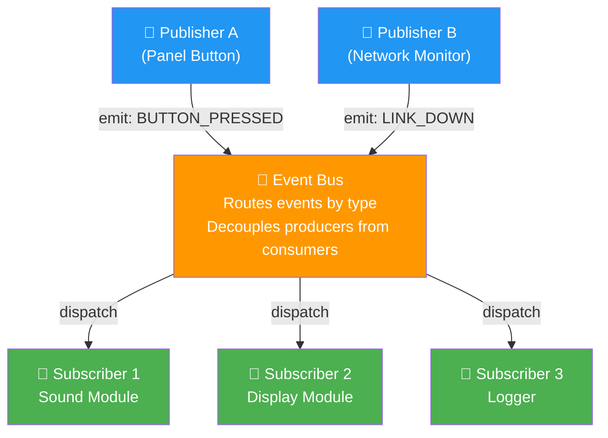
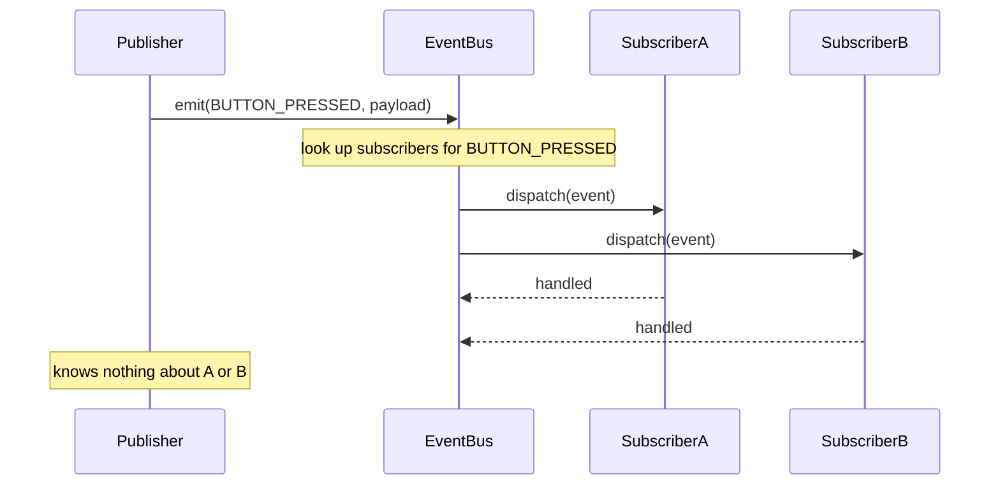
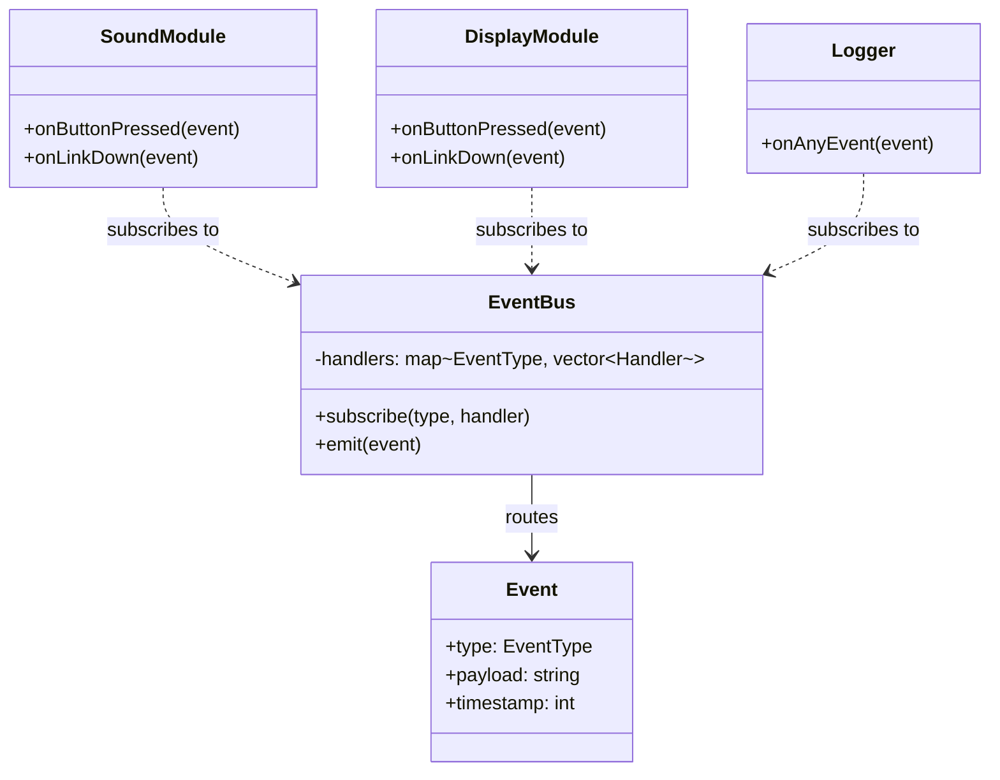
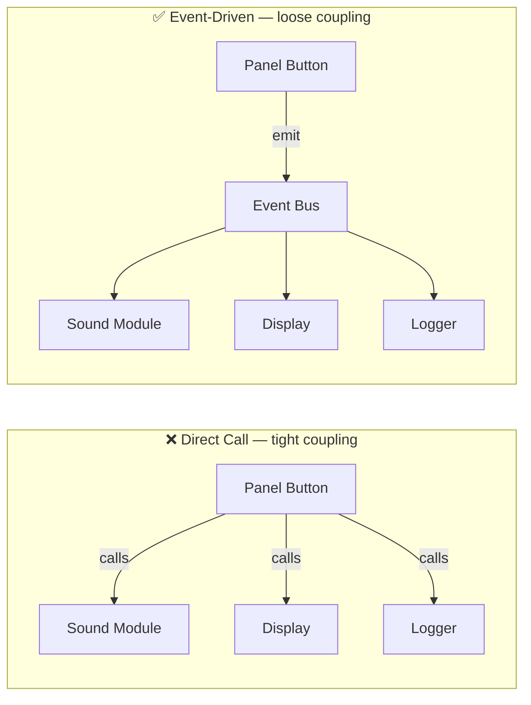

# 03 · Event-Driven Architecture

> Components don't call each other.  
> They emit events. Others listen.  
> The emitter doesn't know who's listening — and doesn't care.

---

## Structure

---

## Event Lifecycle

---

## C++ Class Map

---

## Event-Driven vs Direct Call

---

## When to Use

✅ Device and UI control — button events, message arrivals, link status  
✅ Qt applications — signals/slots are event-driven  
✅ Any system where producers and consumers must be independent  
✅ Adding new subscribers without changing existing code (Open/Closed Principle)  
❌ When you need guaranteed synchronous call order  
❌ When debugging — event chains can be hard to trace

## What was tested

- Compiled with GCC 13.3 (`-std=c++23`) using a stand-in `<print>` header, because `std::println` needs GCC 14 and it was not available here. The source files were compiled directly, not through CMake.
- Run and compared with the original `std::cout` output line by line. Differences: `bool` values print as `true`/`false` instead of `1`/`0`, floating-point numbers print in their shortest exact form instead of 6 significant digits, and values that change on every run (thread ids, timings, random data). I sampled the differing lines; I did not review every one.
- Run once with AddressSanitizer + UndefinedBehaviorSanitizer: no findings.

## Not tested

- The real `<print>` header (GCC 14+, recent Clang or MSVC) and platforms other than Linux x86-64.
