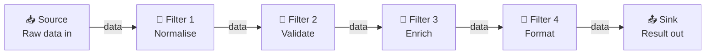
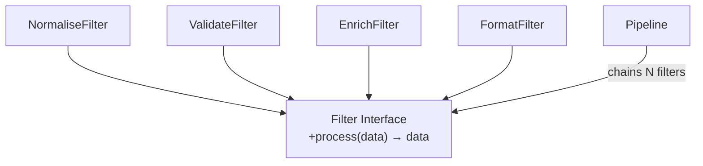
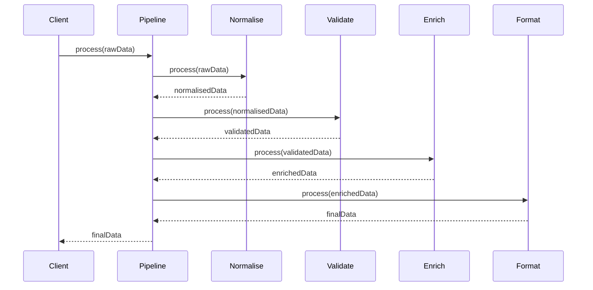

# 05 · Pipe and Filter Architecture

> Data enters one end.  
> Each filter transforms it and passes it on.  
> Filters know nothing about each other.  
> This is how Unix pipes work. This is how FFmpeg works.

---

## Structure

---

## Each Filter Is Independent

---

## Pipeline Composition

---

## Real-World Mappings

| Domain | Source | Filters | Sink |
|---|---|---|---|
| Unix shell | `cat file` | `grep` → `awk` → `sort` | `> output.txt` |
| FFmpeg | video file | decode → scale → encode | output file |
| Compiler | source code | lex → parse → optimise → codegen | binary |
| Audio recording | mic input | resample → encode → compress → write | file |
| This example | raw sensor strings | normalise → validate → enrich → format | report |

---

## When to Use

✅ Data transformation pipelines  
✅ Compilers, media encoders, signal processing  
✅ When you want to add/remove/reorder processing steps easily  
✅ Testable — each filter tested independently  
❌ When steps are tightly coupled and must share complex state  
❌ When the overhead of passing data between stages matters

## What was tested

- Compiled with GCC 13.3 (`-std=c++23`) using a stand-in `<print>` header, because `std::println` needs GCC 14 and it was not available here. The source files were compiled directly, not through CMake.
- Run, and the output is identical to the original `std::cout` version.
- Run once with AddressSanitizer + UndefinedBehaviorSanitizer: no findings.

## Not tested

- The real `<print>` header (GCC 14+, recent Clang or MSVC) and platforms other than Linux x86-64.
