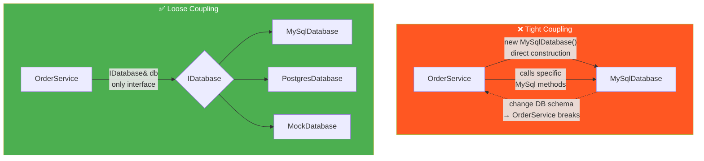
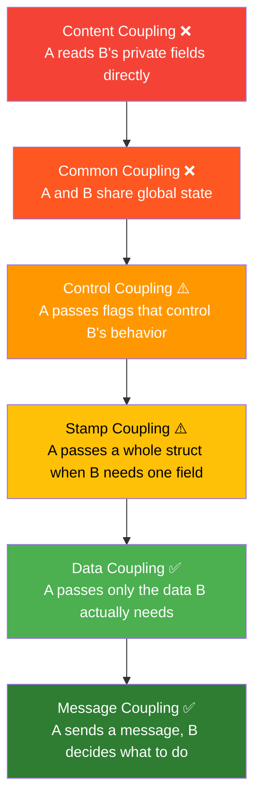
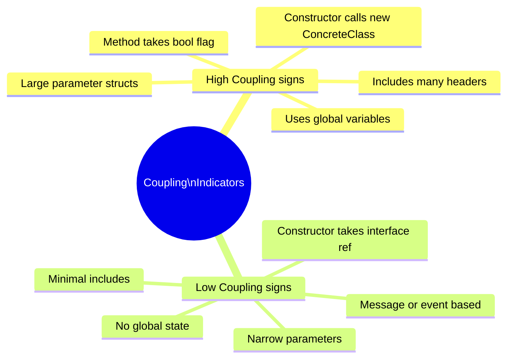
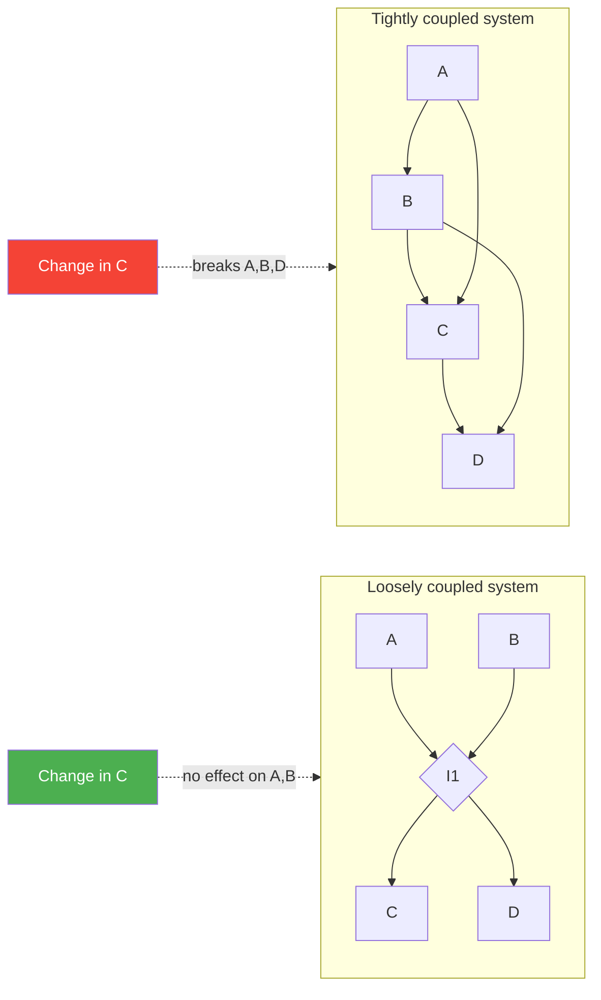

# 02 · Coupling

> Coupling measures how much one component **knows** about another.  
> The more it knows, the more it breaks when the other changes.  
> Low coupling = components that can evolve independently.

---

## Tight vs Loose Coupling

---

## Types of Coupling (worst → best)

---

## Coupling Metrics

---

## The Ripple Effect

---

## When Coupling Is Unavoidable

Some coupling is necessary and healthy:

| Type | Example | Verdict |
|---|---|---|
| Interface coupling | `ILogger& log` | ✅ Good — depend on abstraction |
| Data coupling | Pass `int id` not whole `User` struct | ✅ Good — minimal data |
| Concrete coupling | `std::vector`, `std::string` | ✅ OK — stable standard types |
| Framework coupling | Qt signals/slots | ⚠️ Acceptable — framework is stable |
| Concrete coupling | `MySqlDatabase db` | ❌ Bad — tight to one vendor |

## Notes moved from main.cpp

This text used to be printed by `main()`. It is lecture material, so it lives here and the program only prints the demo output.

### Closing summary

**Key difference:**

TIGHT — OrderService hardcodes MySqlDatabase  
Cannot test without a real DB  
Cannot swap DB without editing OrderService

LOOSE — OrderService knows only IDatabase + ILogger  
Swap MySql→Postgres: zero changes to OrderService  
Unit test with Mock: zero changes to OrderService

All assertions passed.

## What was tested

- Compiled with GCC 13.3 (`-std=c++23`) using a stand-in `<print>` header, because `std::println` needs GCC 14 and it was not available here. The source files were compiled directly, not through CMake.
- Run, and the output matches the original `std::cout` version except that the lecture text moved into *Notes moved from main.cpp* is no longer printed (and the remaining example titles were renumbered where an example was removed).
- Run once with AddressSanitizer + UndefinedBehaviorSanitizer: no findings.

## Not tested

- The real `<print>` header (GCC 14+, recent Clang or MSVC) and platforms other than Linux x86-64.
