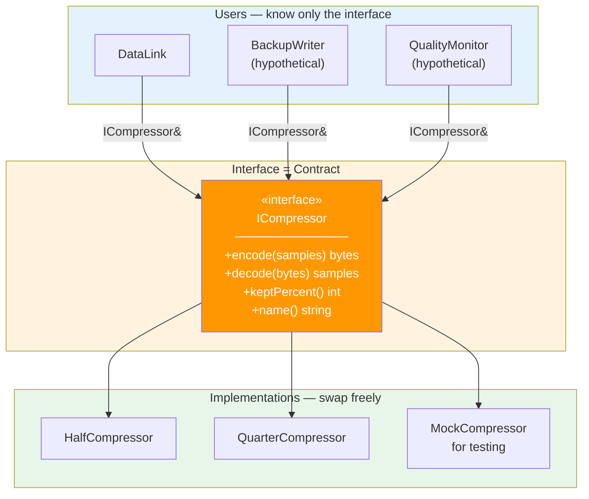
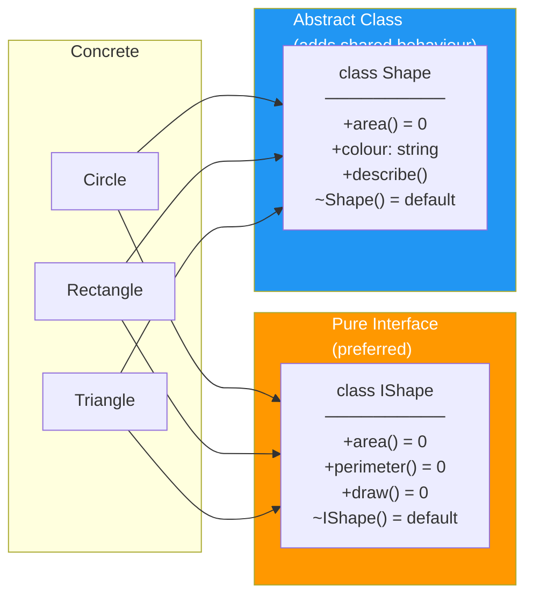
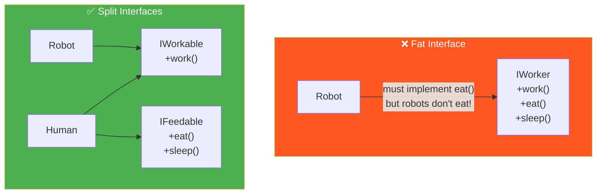

# 03 · Interfaces — Program to Abstractions

> Never depend on a concrete class when you can depend on a contract.  
> An interface defines **what** something does.  
> The implementation defines **how** it does it.  
> Callers only need to know *what*.

---

## Interface as Contract

---

## Interface vs Abstract Class in C++

| | Pure Interface | Abstract Class |
|---|---|---|
| Has data members | ❌ | ✅ |
| Has implemented methods | ❌ | ✅ |
| Multiple inheritance | ✅ safe | ⚠️ diamond risk |
| Use when | Contract only | Shared behaviour + contract |

---

## Interface Segregation (ISP)

Don't force classes to implement methods they don't need:

---

## When to Define an Interface

| Question | If yes → interface |
|---|---|
| Will this be mocked in tests? | ✅ |
| Could implementation swap later? | ✅ |
| Do multiple classes do the same thing differently? | ✅ |
| Is this a stable, well-understood contract? | ✅ |
| Is there only ever one implementation and it never changes? | ❌ skip it |

## What was tested

- Compiled with GCC 13.3 (`-std=c++23`) using a stand-in `<print>` header, because `std::println` needs GCC 14 and it was not available here. The source files were compiled directly, not through CMake.
- Run and compared with the original `std::cout` output line by line. Differences: `bool` values print as `true`/`false` instead of `1`/`0`, floating-point numbers print in their shortest exact form instead of 6 significant digits, and values that change on every run (thread ids, timings, random data). I sampled the differing lines; I did not review every one.
- Run once with AddressSanitizer + UndefinedBehaviorSanitizer: no findings.

## Not tested

- The real `<print>` header (GCC 14+, recent Clang or MSVC) and platforms other than Linux x86-64.
