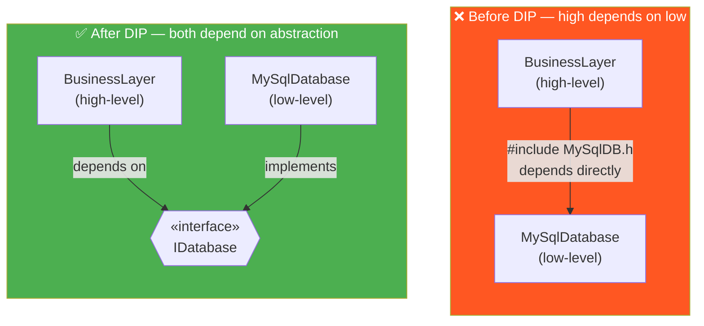
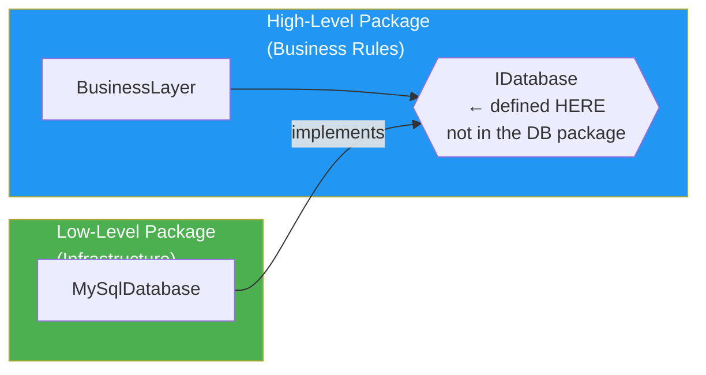
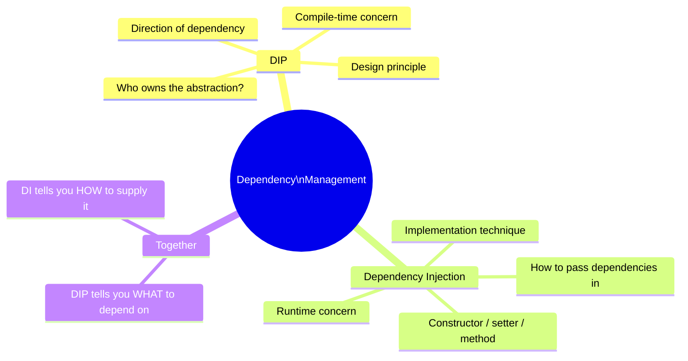
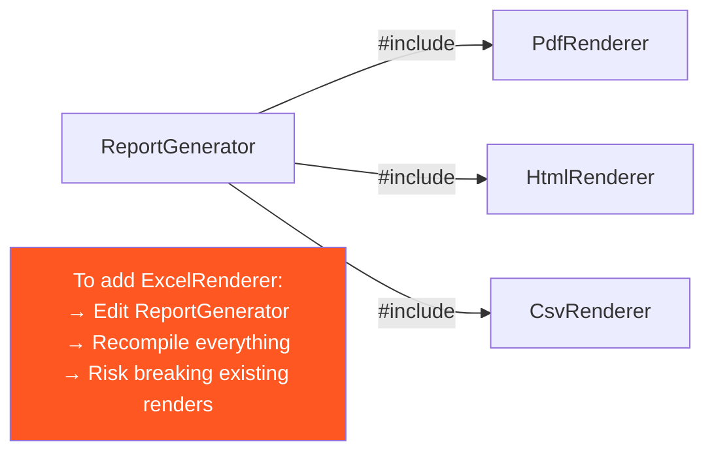
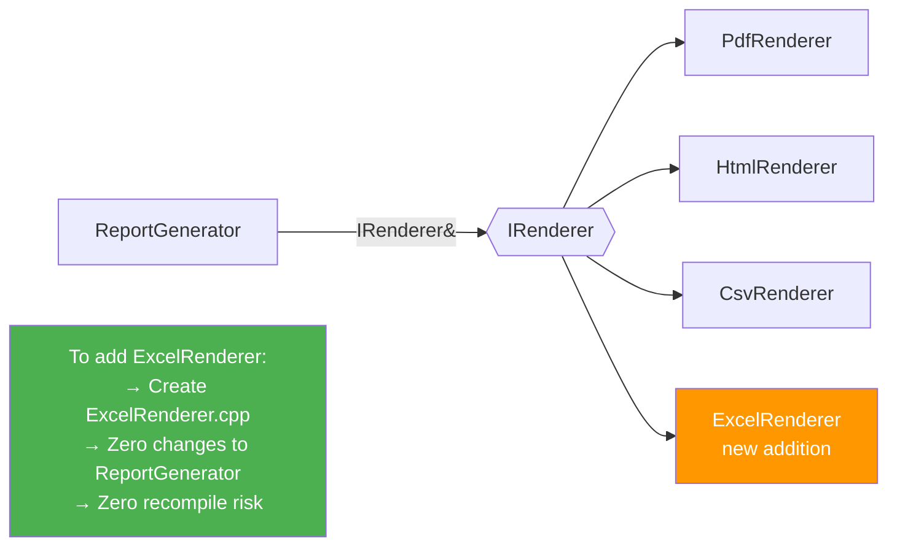

# 04 · Dependency Inversion Principle (DIP)

> **High-level modules should not depend on low-level modules.**  
> Both should depend on abstractions.  
> Abstractions should not depend on details.  
> Details should depend on abstractions.  
> — Robert C. Martin

---

## The Inversion

---

## Who Owns the Interface?

This is the key insight of DIP — the **high-level module owns the interface**.

The arrow of dependency now points **from low-level toward high-level** — it is *inverted* from the naive approach.

---

## DIP vs Dependency Injection

These are related but different:

---

## Without DIP — The Compile-Time Problem

---

## With DIP — The Open/Closed Result

---

## When to Apply DIP

✅ Any boundary between business logic and infrastructure  
✅ Anything that touches I/O: database, network, file system, hardware  
✅ Anything you want to mock in tests  
✅ Anything that might be swapped: cloud provider, compression library, storage backend  
❌ Internal helpers that are stable and never tested in isolation  
❌ Standard library types — `std::vector`, `std::string` are stable enough

## Notes moved from main.cpp

This text used to be printed by `main()`. It is lecture material, so it lives here and the program only prints the demo output.

### Closing summary

**Key difference:**

BEFORE — add CSV → edit ReportGenerator + enum + switch  
AFTER  — add Markdown → new file only, zero edits to generator

All assertions passed.

## What was tested

- Compiled with GCC 13.3 (`-std=c++23`) using a stand-in `<print>` header, because `std::println` needs GCC 14 and it was not available here. The source files were compiled directly, not through CMake.
- Run, and the output matches the original `std::cout` version except that the lecture text moved into *Notes moved from main.cpp* is no longer printed (and the remaining example titles were renumbered where an example was removed).
- Run once with AddressSanitizer + UndefinedBehaviorSanitizer: no findings.

## Not tested

- The real `<print>` header (GCC 14+, recent Clang or MSVC) and platforms other than Linux x86-64.
