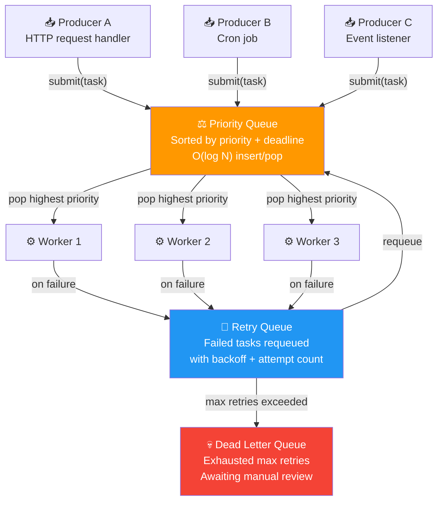
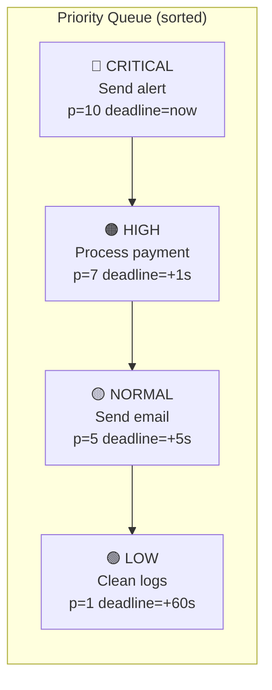
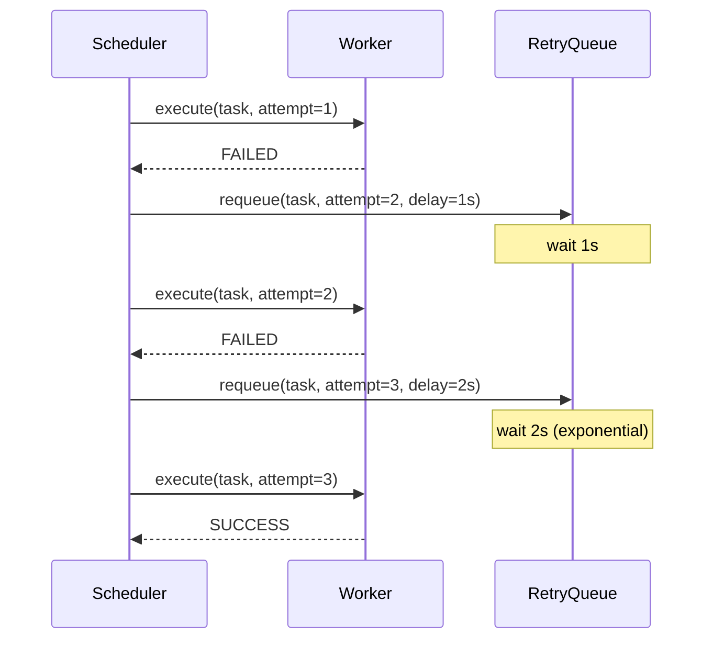
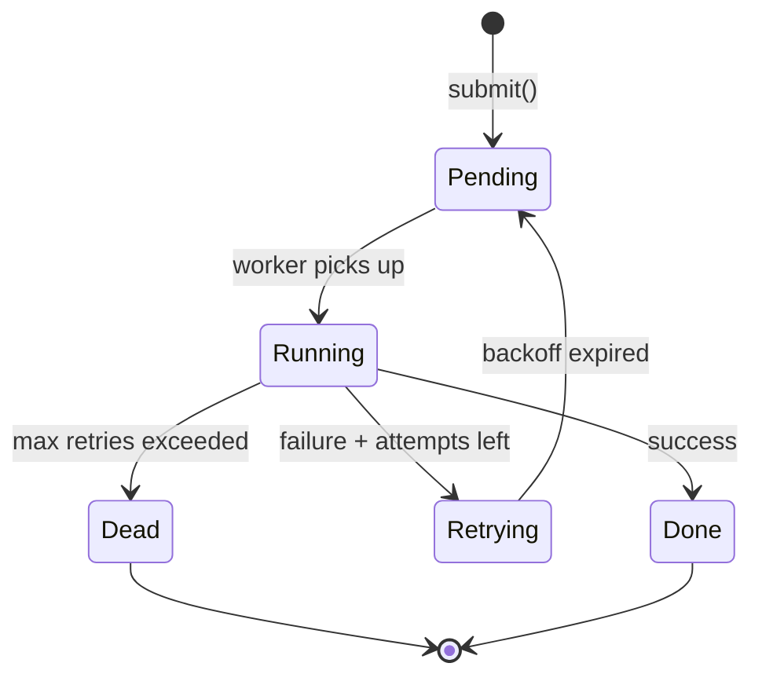

# 02 · Task Scheduler

> A real system always has more work than it can do right now.  
> A task scheduler decides **what runs next**, **when**, and **how many times to retry**.

---

## Architecture

---

## Priority + Deadline Ordering

---

## Retry with Exponential Backoff

---

## Task Lifecycle

---

## When to Use

✅ Background job processing — email, reports, notifications  
✅ Rate-limited external APIs — queue and throttle  
✅ Job queues — order incoming requests by priority  
✅ Any system where tasks arrive faster than they can be processed  
❌ Real-time hard deadlines — use a RTOS scheduler instead  
❌ Simple sequential scripts with no concurrency

## What was tested

- Compiled with GCC 13.3 (`-std=c++23`) using a stand-in `<print>` header, because `std::println` needs GCC 14 and it was not available here. The source files were compiled directly, not through CMake.
- Run and compared with the original `std::cout` output line by line. Differences: `bool` values print as `true`/`false` instead of `1`/`0`, floating-point numbers print in their shortest exact form instead of 6 significant digits, and values that change on every run (thread ids, timings, random data). I sampled the differing lines; I did not review every one.
- Run once with AddressSanitizer + UndefinedBehaviorSanitizer: no findings.

## Not tested

- The real `<print>` header (GCC 14+, recent Clang or MSVC) and platforms other than Linux x86-64.
