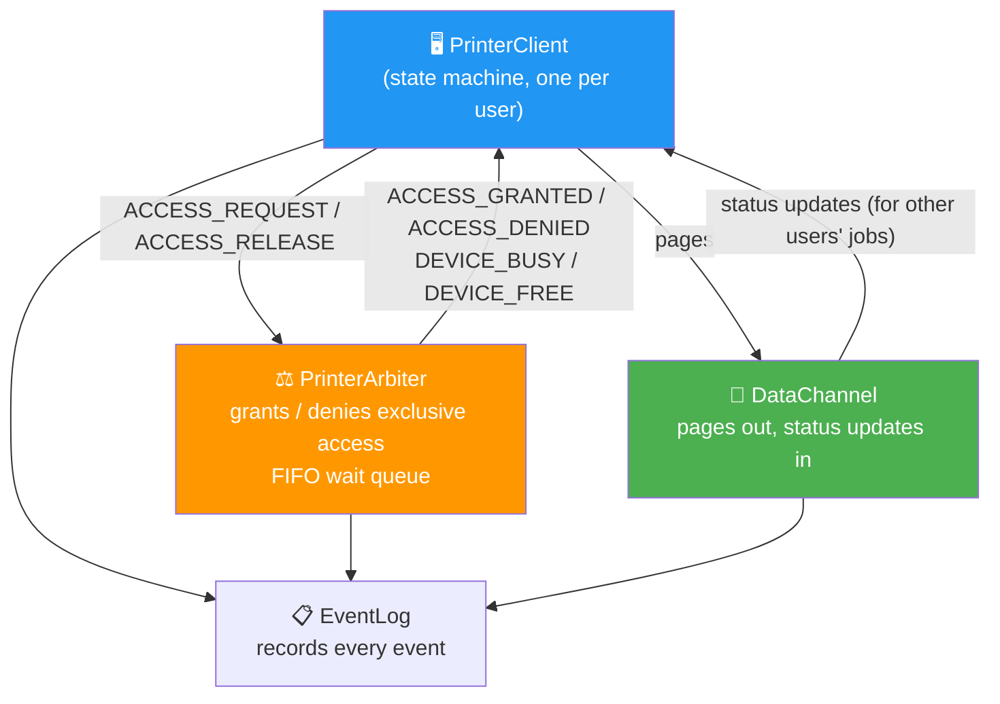
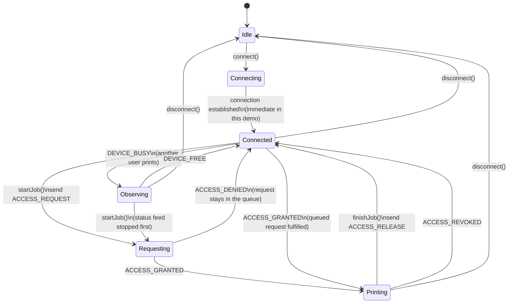
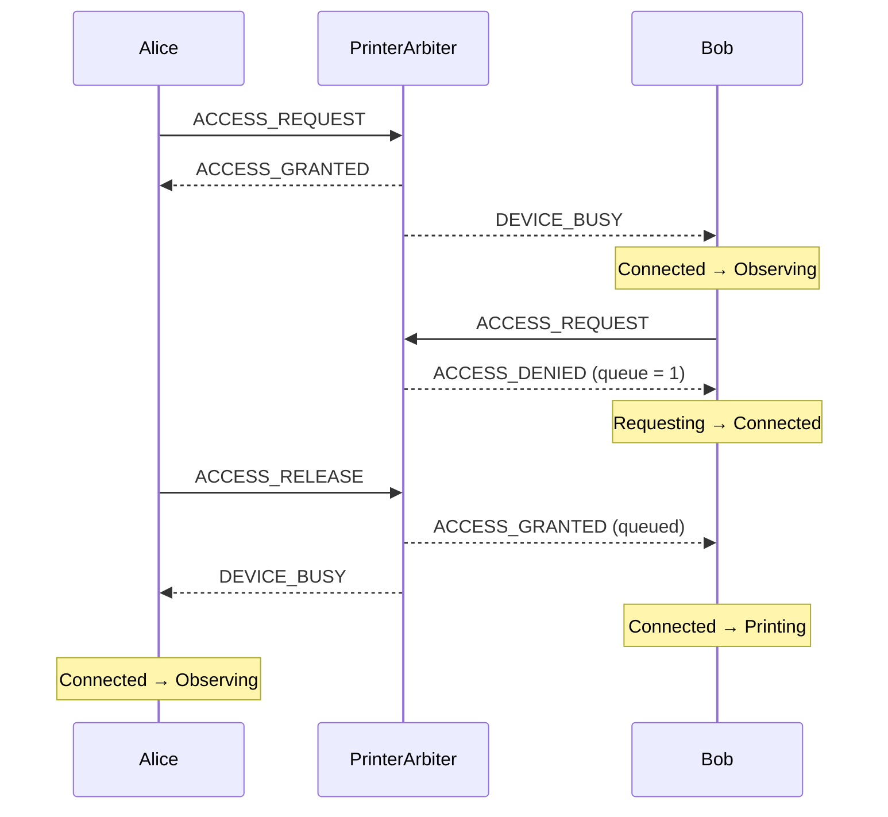

# 03 · Shared Printer Arbiter — State Machine + Exclusive-Access Arbitration

> Several clients share **one** printer. A client may only send pages after the arbiter has granted it exclusive access.
> If the printer is busy, the request goes into a FIFO queue and is granted automatically when the current user finishes.

---

## Components



| Class | Role |
|---|---|
| `PrinterClient` | State machine. User actions: `connect`, `startJob`, `finishJob`, `disconnect`. Reacts to arbiter signals in `onAccessSignal`. |
| `PrinterArbiter` | Holds the current holder and a `std::queue` of waiting users. Notifies the other clients when the printer becomes busy or free. |
| `DataChannel` | Counts pages sent (`pagesSent`) and status updates received (`updatesReceived`). |
| `EventLog` | Collects `{component, event}` entries, prints them, and answers `count("keyword")` for the assertions. |

---

## Client state machine (as implemented)



`ACCESS_REVOKED` is handled by the client, but nothing in the demo sends it, so that transition is never exercised.
There is no time-out or rejection path while connecting: `connect()` completes immediately.

---

## Arbitration with a waiting queue



---

## What `main()` checks

Four scenarios, each verified with `assert`:

1. **Normal job** — Alice requests and gets access, Bob observes, Alice finishes, both are back to `Connected`.
2. **Contention** — Bob asks while Alice prints, is queued, and is granted automatically when Alice finishes.
3. **Disconnect** — both clients return to `Idle`.
4. **Error handling** — `startJob()` in the wrong state throws `std::runtime_error`.

Final counters (asserted): 3 pages sent, 5 status updates received, 6 `ACCESS_REQUEST` entries, 6 `ACCESS_GRANTED` entries. The six requests are four user requests plus two entries logged when the queued request is fulfilled.

---

## Patterns used

| Pattern | Where |
|---|---|
| State Machine | `ClientState` enum + `transition()` |
| Event-Driven | `PrinterArbiter` sends `AccessSignal`s to the clients |
| Layered | Client logic / arbitration / data channel |
| Observer | Clients are registered with the arbiter and notified of busy/free |

---

## Build and run

```bash
g++ -std=c++23 -Wall -Wextra main.cpp -o printer_arbiter
./printer_arbiter
```

Needs a standard library with `<print>` (GCC 14+). The `assert` calls are active unless you compile with `-DNDEBUG`.

## What was tested

Compiled with GCC 13.3 and a small `<print>` stand-in header (GCC 13 has no `<print>`):

- `-Wall -Wextra -Wshadow`: no warnings.
- Runs to exit code 0 with AddressSanitizer + UBSan: no reports. All four scenarios and all assertions pass.
- The state transitions in the diagram above were taken from reading the code and from the logged output (`STATE: A → B` lines); only transitions seen in the output were exercised.

Not tested: GCC 14 / real `<print>`, other platforms, the CMake build.
