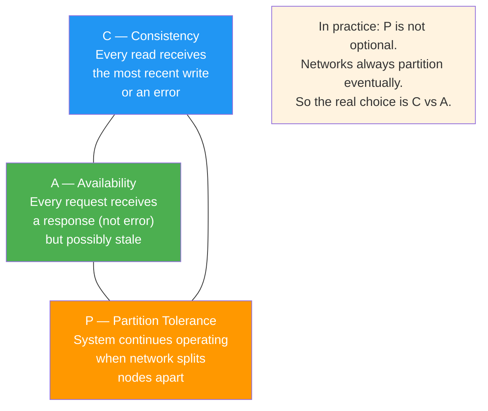
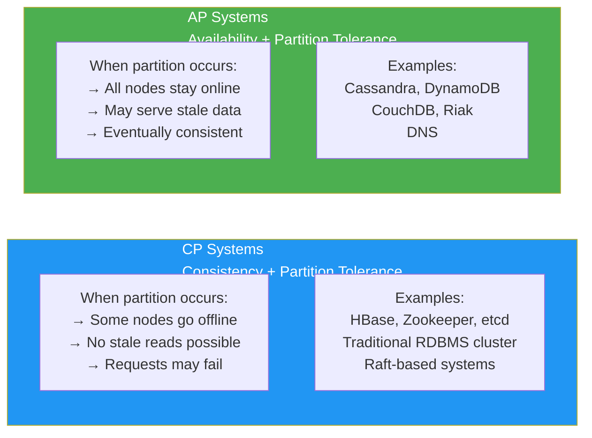
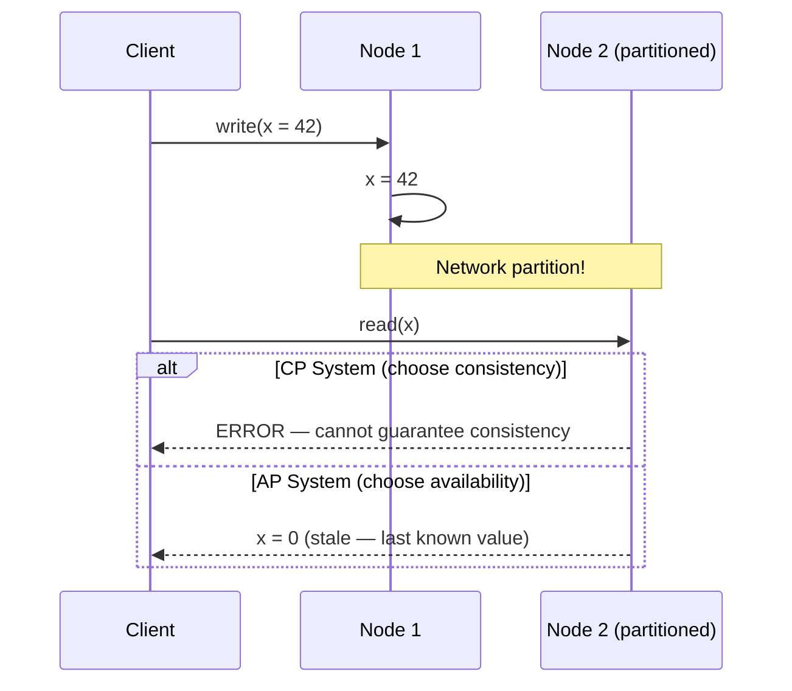
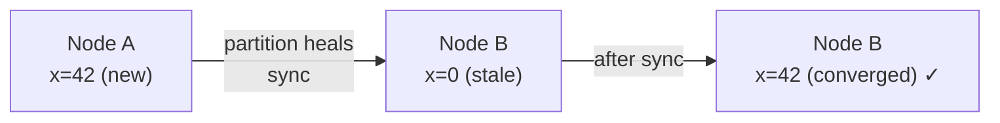

# 03 · CAP Theorem

> In a distributed system you can only **guarantee two** of three properties:  
> **C**onsistency · **A**vailability · **P**artition Tolerance  
> — Eric Brewer, 2000

---

## The Triangle

---

## CP vs AP Systems

---

## What Happens During a Partition

---

## Eventual Consistency

AP systems use eventual consistency — after a partition heals, all nodes converge:

---

## Real-World Choice Guide

| Use case | Choose | Reason |
|---|---|---|
| Bank account balance | CP | Wrong balance = fraud |
| Social media likes count | AP | Approximate is fine |
| Bank transfer ledger | CP | Two conflicting balances = catastrophic |
| Product search results | AP | Slightly stale is fine |
| Distributed lock | CP | Must be exclusive |
| User profile display | AP | Eventually correct is OK |

## Notes moved from main.cpp

This text used to be printed by `main()`. It is lecture material, so it lives here and the program only prints the demo output.

### Closing summary

=== Summary ===  
CP: during partition → replica returned ERROR (no stale reads)  
AP: during partition → node served STALE DATA (always available)  
Both: after heal → data converged (eventual consistency)

All assertions passed.

## What was tested

- Compiled with GCC 13.3 (`-std=c++23`) using a stand-in `<print>` header, because `std::println` needs GCC 14 and it was not available here. The source files were compiled directly, not through CMake.
- Run, and the output matches the original `std::cout` version except that the lecture text moved into *Notes moved from main.cpp* is no longer printed (and the remaining example titles were renumbered where an example was removed).
- Run once with AddressSanitizer + UndefinedBehaviorSanitizer: no findings.

## Not tested

- The real `<print>` header (GCC 14+, recent Clang or MSVC) and platforms other than Linux x86-64.
